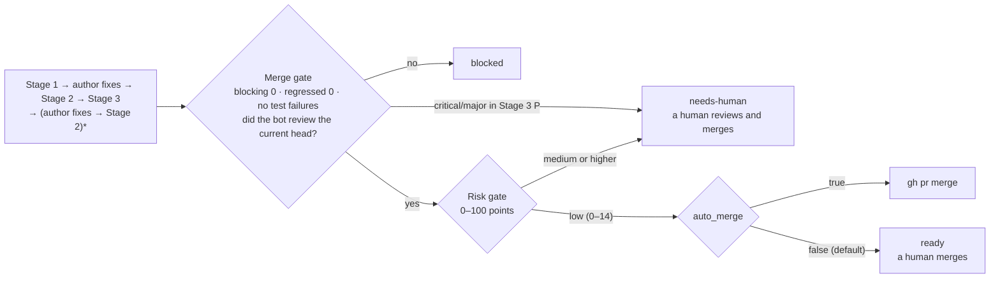
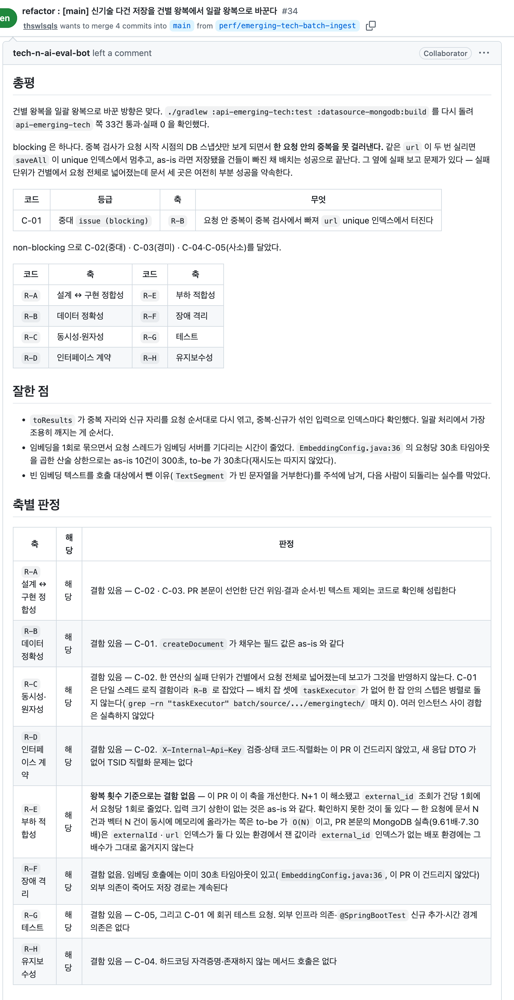
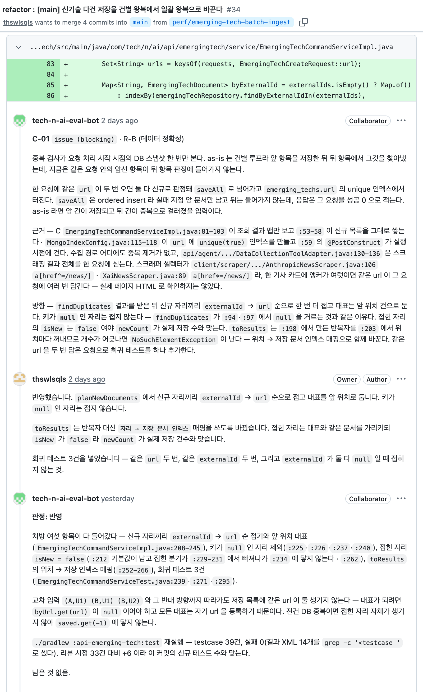

<p align="right">
  <a href="./README.md">English</a> | <strong>한국어</strong> | <a href="./README.zh-CN.md">简体中文</a>
</p>

> 이 문서는 [영어판](./README.md)을 옮긴 것이다. 내용이 다르면 영어판이 맞다. 기준: `README.md` @ `271a302`

<p align="center">
  <picture>
    <source media="(prefers-color-scheme: dark)" srcset="assets/logo-dark.svg">
    
  </picture>
</p>

GitHub PR 을 여러 Claude 세션이 나눠 리뷰하고, 작성자가 반영한 뒤 다시 확인하고 실측해서, 리스크 점수로 머지할지 정하는 Claude Code 플러그인이다.
봇 계정을 PR 의 리뷰어로 지정하면 리뷰가 시작되고, 리뷰는 사람 리뷰어처럼 요약 한 건과 코드 줄에 붙는 인라인 코멘트로 올라간다.

개인 저장소(tech-n-ai-backend)의 `tools/pr-eval/` 에서 돌던 하니스를 플러그인으로 옮긴 것이다. 아래에 나오는 PR 번호는 모두 그 저장소의 PR 이다.

## 무엇을 하나

리뷰는 세 스테이지로 나눠 붙는다. 한 번 리뷰하고 끝내면 지적이 실제로 반영됐는지, 리뷰가 놓친 것이 있는지를 아무도 확인하지 않기 때문이다.

| 스테이지 | 묻는 것 | 하는 일 |
|---|---|---|
| Stage 1 · review | 이 PR 에 무슨 결함이 있나 | 위원 4인이 리뷰 축을 나눠 맡아 서로의 결과를 모른 채 결함을 찾는다. 반박자가 `critical`(치명)·`major`(중대) 지적을 하나씩 실제 코드로 다시 확인하고, 검증자 셋이 근거·인용·저자 입장에서 리뷰를 다시 읽는다. 기준을 못 채우면 라운드를 이어 돌며, 상한은 5라운드다 |
| Stage 2 · followup | 리뷰가 시킨 것을 했나 | 코멘트마다 `addressed`(반영)·`partial`(부분)·`not-addressed`(미반영)·`regressed`(역행) 중 하나로 판정해 스레드에 답한다. `regressed` 는 고치다가 새 결함을 만든 경우다 |
| Stage 3 · measured | 실측하면 리뷰가 버티나 | 반영된 커밋으로 빌드와 테스트를 다시 돌리고, 리뷰가 놓친 결함(`P`)을 찾는다 |

위원·반박자·검증자는 모두 `pr-quorum:judge` 에이전트로 뜨고, 스테이지는 `/pr-quorum:review` 스킬이 진행한다.
리뷰를 반영하는 일은 봇이 아니라 따로 뜨는 저자 세션(`/pr-quorum:author`)이 한다. 저자 세션은 사용자의 gh 계정으로 PR 브랜치에만 push 하고, force push·머지·승인은 하지 않는다.

봇을 리뷰어로 지정하면 watcher(`scripts/watch.sh`)가 60초 안에 이를 찾아 체인(`scripts/chain.sh`)을 띄운다. 체인은 아래 순서를 사람 없이 이어 돈다.



리스크 게이트는 코드가 좋은지를 보지 않고, 어떤 파일을 얼마나 바꿨는지만 보고 점수를 매긴다. 인증 코드·비밀값·CI·빌드 스크립트·하니스 자신을 건드린 PR 은 점수가 올라 자동으로 머지되지 않는다. 점수표는 봇이 PR 코멘트로 남긴다. 규칙은 [`rules/03-risk.md`](rules/03-risk.md) 에 있다.

## 실제로 붙은 리뷰

tech-n-ai-backend PR #34(신기술 다건 저장을 건별 왕복에서 일괄 왕복으로 바꾼 리팩토링)에 봇이 남긴 리뷰다.

리뷰 요약. 머지를 막을 만한 것을 먼저 적고, 리뷰 축마다 무엇이 걸렸고 무엇을 확인하지 못했는지 표로 정리했다.



인라인 코멘트 한 건. 문제가 되는 줄에 붙고, 근거로 든 파일과 줄 번호가 적혀 있다. 가운데가 저자의 답이고, 그 아래는 저자가 고친 뒤 봇이 같은 스레드에 남긴 Stage 2 판정이다.



이 PR 에서 Stage 1 은 코멘트 6건(그중 잘한 점 1건)을 남겼다. 저자가 고친 뒤 Stage 2 가 `addressed` 5건·`partial` 1건으로 판정했고, Stage 3 이 리뷰가 놓친 테스트 빈틈 1건을 더 찾았다.

## 다른 리뷰 도구와 다른 점

아래는 운영 기록과 규칙 문서로 확인되는 것만 적었다. 절차가 엄격하다는 뜻이지, 리뷰가 더 정확하다는 증거는 아니다(아래 "아직 모르는 것").

- **근거에 등급을 매기고, 인용이 결론까지 말하는지 따로 검사한다.** 근거를 저장소 규범 문서·공식 문서 인용·코드의 `file:line`·직접 실행한 결과 넷으로 나누고, 등급이 허용하는 범위를 넘은 주장은 무효로 뺀다. 인용문은 맞는데 결론이 인용을 넘어선 곳은 검증자 V2 가 잡는다([`rules/00-criteria.md`](rules/00-criteria.md) §4, [`rules/02-judges.md`](rules/02-judges.md) §6).
- **고치다가 나빠졌는지(`regressed`)를 따로 판정하고, 고친 뒤 다시 실측한다.** PR #33 의 첫 Stage 2 에서 `regressed` 2건·`not-addressed` 1건이 나왔고, Stage 3 은 #33 에서 2건, #34 에서 1건의 놓친 결함을 찾았다.
- **확정된 사실을 `frozen.md` 에 고정한다.** 라운드를 거듭하며 같은 논쟁을 되풀이하지 않도록, 확정된 사실을 뒤집으려면 그것이 틀렸다는 새 근거를 요구한다(무효 조건 I-4).
- **규칙·프롬프트·게이트를 모두 들여다보고 고칠 수 있다.** 규칙은 [`rules/`](rules/), 위원에게 주는 지시는 [`rules/02-judges.md`](rules/02-judges.md), 게이트는 [`scripts/`](scripts/) 에 있다. 어떤 지적이 왜 나왔는지는 `~/.pr-quorum/runs/` 의 라운드 기록으로 따라갈 수 있다.

리뷰에 점수는 쓰지 않는다. 총점을 매기면 저자가 코드를 고치는 대신 점수에 항변하게 되므로, 판정은 `critical`·`major`·`minor`(경미)·`nit`(사소) 네 등급뿐이다. 잘한 점도 최소 한 건은 적는다.

### 기준의 출처

리뷰 축을 어떤 순서로 두고 어디까지 문제 삼을지는 공개된 코드 리뷰 기준에서 가져왔다. 인용문이 말하는 범위를 넘어선 주장은 무효로 빼는 것이 이 하니스의 규칙이므로, 규칙 자체도 인용 범위 안에서 정했다.

| 하니스의 규칙 | 출처 | 근거가 된 문장 |
|---|---|---|
| 설계를 가장 먼저 본다 — `R-A` 가 첫 축이고 중복 제거에서 J1 이 우선인 이유 | Google, [What to look for in a code review](https://google.github.io/eng-practices/review/reviewer/looking-for.html) | "The most important thing to cover in a review is the overall design of the CL." |
| 동시성을 별도 축(`R-C`)으로 떼어 낸다 | 같은 문서, Functionality 절 | "…if there is some sort of **parallel programming** going on in the CL that could theoretically cause deadlocks or race conditions." |
| 테스트 축의 판정 문구 — "테스트가 있는가"가 아니라 "깨졌을 때 실패하는가" | 같은 문서, Tests 절 | "Will the tests actually fail when the code is broken?" |
| 잘한 점을 최소 한 건 반드시 적는다 | 같은 문서 Good Things 절 · [Conventional Comments](https://conventionalcomments.org/) | "If you see something nice in the CL, tell the developer…" · "Try to leave at least one of these comments per review." |
| 판정 문구가 "이상적인 설계인가"가 아니라 "코드 헬스를 악화시키는가" | Google, [The Standard of Code Review](https://google.github.io/eng-practices/review/reviewer/standard.html) | "reviewers should favor approving a CL once it is in a state where it definitely improves the overall code health of the system being worked on, even if the CL isn't perfect." |
| 근거 없는 취향은 `nitpick` 까지만 쓴다 | 같은 문서 | "On matters of style, the style guide is the absolute authority. Any purely style point (whitespace, etc.) that is not in the style guide is a matter of personal preference." |
| 코멘트 라벨 표기 — `issue (blocking)` · `suggestion` · `nitpick (non-blocking)` · `praise` | [Conventional Comments](https://conventionalcomments.org/) | 라벨 + 괄호 표시(blocking / non-blocking) 형식을 그대로 따랐다 |
| 보안 축(`R-I`)의 첫 항목이 인가 누락인 이유 | OWASP, [ASVS 5.0.0](https://github.com/OWASP/ASVS/blob/v5.0.0/5.0/en/0x17-V8-Authorization.md) V8 Authorization, 8.2.2 (Level 1) | "Verify that the application ensures that data-specific access is restricted to consumers with explicit permissions to specific data items to mitigate insecure direct object reference (IDOR) and broken object level authorization (BOLA)." |
| 토큰·자격증명이 로그에 남는 것을 결함으로 보는 근거 | [같은 표준](https://github.com/OWASP/ASVS/blob/v5.0.0/5.0/en/0x25-V16-Security-Logging-and-Error-Handling.md) V16 Security Logging and Error Handling, 16.2.5 (Level 2) | "Verify that when logging sensitive data, the application enforces logging based on the data's protection level. For example, it may not be allowed to log certain data, such as credentials or payment details. Other data, such as session tokens, may only be logged by being hashed or masked, either in full or partially." |

테스트 축에서 세게 몰아붙이지 않는 이유도 여기에 있다. 근거가 되는 문장이 *"Ask for unit, integration, or end-to-end tests **as appropriate** for the change."* 라는 선택지형이라, "이런 테스트가 없으니 blocking" 이라고 쓰면 인용이 뒷받침하는 범위를 넘는다.

> Google eng-practices 저장소는 아카이브 상태다(마지막 push 2024-09-19). 위 인용은 그 시점의 문서 기준이다.
>
> ASVS 는 점검표로 돌리지 않는다. 두 인용문은 보안 축 정의문의 근거로만 쓴다. 표준 요구사항 상당수는 설정·아키텍처·실행 환경을 봐야 판정되는데 봇이 보는 것은 PR 의 diff 라서, 전 항목 점검표로 돌리면 근거로 댈 코드 줄이 없는 지적만 잔뜩 나온다.

리뷰 축의 정의와 축마다 볼 것·보지 않을 것은 [`examples/profiles/`](examples/profiles/) 에 있다.

## 아직 모르는 것

- **리뷰가 맞았는지 사람이 판정한 값이 없다.** 게시된 코멘트를 사람이 맞음·틀림·과함으로 적는 `human-labels.md` 가 비어 있다. 그래서 "절차가 엄격하면 리뷰가 더 낫다"는 이 하니스의 가정은 아직 검증되지 않았다.
- **비용이 크다.** 체인 전체 비용은 30~70줄 PR 에 약 $30 였다(#52 $30.2, #55 $28.2). 플러그인으로 옮긴 뒤 처음 돈 PR #61(9개 파일, 추가 384줄·삭제 13줄)은 Stage 1 부터 저자 2회차까지 약 47분이 걸렸고, 기록에 남은 비용 합계는 $29.54 다. 다만 이 비용 값(`claude -p` 의 `total_cost_usd`)이 위원·반박자·검증자 같은 하위 에이전트 비용까지 담은 세션 전체 값인지는 확인하지 못했다. 담지 않는다면 실제 비용은 이보다 크다.
- **실제로 돈 것은 backend 저장소 하나다.** [`examples/profiles/frontend.md`](examples/profiles/frontend.md) 는 문서 초안만 있고, 프런트엔드 PR 에 돌린 기록은 없다.

## 설치

마켓플레이스로 설치하는 방법은 아래와 같다.

```
/plugin marketplace add thswlsqls/pr-quorum
/plugin install pr-quorum@pr-quorum
```

Claude Code 2.1.275 이상이면 세션 안에서 한 줄로도 된다.

```
/plugin install pr-quorum --marketplace thswlsqls/pr-quorum
```

마켓플레이스 설치본은 `.claude-plugin/plugin.json` 의 `version` 이 오를 때만 새 판을 받는다. main 에 커밋이 머지돼도 버전이 그대로면 설치본은 바뀌지 않는다([공식 문서](https://code.claude.com/docs/en/plugins/host-marketplace#release-a-new-version)). 새 판은 셸에서 아래처럼 받는다. 버전마다 바뀐 것은 [`CHANGELOG.md`](CHANGELOG.md) 에 있다.

```bash
claude plugin update pr-quorum@pr-quorum
```

**다만 무인 체인은 마켓플레이스 설치본을 쓰지 않고, clone 한 폴더를 `--plugin-dir` 로 싣는다.** 이유는 두 가지다.

- 마켓플레이스로 설치한 플러그인은 `~/.claude/plugins/cache/` 아래 버전별 폴더에 놓여, 업데이트할 때마다 경로가 바뀐다. launchd 설정이 가리킬 고정 경로가 없다.
- 체인은 도구 권한을 이 머신의 설정과 떼어 놓으려고 사용자 설정을 읽지 않는다(`--setting-sources ""`). 그래서 사용자 설정으로 켠 설치본은 체인 세션에 실리지 않는다.

그래서 체인용으로는 저장소를 clone 하고, watcher 와 수동 실행이 그 폴더를 가리키게 한다. 이 문서에서 `<plugin-dir>` 는 그 clone 의 절대 경로다.

```bash
git clone https://github.com/thswlsqls/pr-quorum.git <plugin-dir>
```

**실행용 clone 과 개발용 사본을 나눈다.** `--plugin-dir` 로 실은 플러그인은 세션이 시작될 때마다 그 폴더에 지금 있는 파일을 읽는다. watcher 는 main 만 받아 두는 clone 을 가리키게 하고, 하니스를 고치는 일은 다른 clone 이나 worktree 에서 한다. 그래야 고치던 중인 하니스가 실제 리뷰를 돌지 않는다.

**실행용 clone 은 저절로 갱신되지 않는다.** `--plugin-dir` 로 실은 clone 은 `version` 과 상관없이 clone 에 있는 파일을 그대로 읽는다. 그래서 `claude plugin update` 로는 바뀌지 않고, main 에 새 커밋이 머지돼도 체인은 clone 에 있는 옛 파일로 돈다. 바뀐 것을 쓰려면 사람이 직접 `git pull` 로 받는다.

```bash
git -C <plugin-dir> switch main && git -C <plugin-dir> pull --ff-only
```

## 처음 한 번 할 설정

필요한 도구는 `claude`, `gh`(사용자 계정으로 로그인), `jq`, `git` 이다. watcher 예시는 macOS launchd 기준이다.

### 1. 봇 계정

플러그인을 쓰는 사람마다 리뷰를 올릴 자기 봇 계정을 GitHub 에 따로 하나 만든다. 여럿이 함께 쓰는 공용 봇은 없다.

- 리뷰할 저장소에 **collaborator read** 로 초대한다. 리뷰 요청을 받는 데는 read 면 된다.
- 토큰은 그 봇 계정의 PAT 로, scope 는 `public_repo` 다.
- 봇은 리뷰와 코멘트만 올린다. 승인이나 변경 요청은 쓰지 않는다. 봇이 머지 여부를 쥐면 사람이 봇을 통과시키려고 리뷰를 왜곡하게 된다.

봇이 코드를 못 고치게 막는 것은 collaborator read 역할 하나뿐이다. `public_repo` scope 는 public 저장소에 쓰는 권한을 포함하므로, 봇을 write 로 올리는 순간 이 토큰으로 push 할 수 있게 된다.

### 2. 토큰 파일

```bash
mkdir -p ~/.config/pr-quorum
cat > ~/.config/pr-quorum/bot.env <<'ENV'
PR_QUORUM_BOT_TOKEN=<bot-PAT>
ENV
chmod 600 ~/.config/pr-quorum/bot.env
```

키 이름은 `PR_QUORUM_BOT_TOKEN` 이나 `GH_TOKEN` 중 하나를 쓴다. 이 파일은 GitHub 에 쓰는 유일한 스크립트(`scripts/pr-quorum.sh`)만 자기 안에서 읽고, 리뷰 세션에는 읽지 못하게 막아 둔다. **어느 저장소에도 커밋하지 않는다.**

### 3. `~/.pr-quorum/config.json`

PR 마다 쌓이는 상태와 설정은 플러그인 밖 `~/.pr-quorum/` 한 곳에 둔다. 견본 [`templates/config.json`](templates/config.json) 을 복사해 고친다.

```bash
mkdir -p ~/.pr-quorum/profiles
cp <plugin-dir>/templates/config.json ~/.pr-quorum/config.json
touch ~/.pr-quorum/learnings.md ~/.pr-quorum/human-labels.md
```

| 키 | 뜻 |
|---|---|
| `owner` | 리뷰할 저장소들의 GitHub 소유자 로그인. watcher 는 이 소유자의 저장소에서 봇에게 걸린 리뷰 요청을 찾는다 |
| `bot` | 1단계에서 만든 봇 계정의 로그인. 토큰 파일의 계정과 같아야 한다 |
| `auto_merge` | 두 게이트를 다 지난 PR 을 체인이 머지할지. 기본은 `false` 이고, 이때 체인은 `ready`(머지 준비됨) 로 멈추고 리스크 점수표만 남긴다 |
| `repos` | 저장소 이름마다 로컬 clone 의 절대 경로(`path`)와 쓸 프로파일 이름(`profile`) |

`learnings.md` 는 PR 을 넘어 쌓이는 학습 기록이고 리뷰 세션이 읽는다. `human-labels.md` 는 사람이 봇 코멘트를 판정해 적는 표다. 둘 다 처음에는 빈 파일로 둔다.
체인은 각 저장소 clone 옆에 `<repo-name>-worktrees/` 폴더를 두고 그 안에 PR 마다 worktree 를 만든다.

### 4. 프로파일

프로파일은 리뷰 축의 정의와 위원마다 볼 것·보지 않을 것을 적은 문서다. 견본을 복사해 자기 저장소 구조에 맞게 고친다. 파일 이름이 `config.json` 의 `profile` 값이 된다.

```bash
cp <plugin-dir>/examples/profiles/backend.md ~/.pr-quorum/profiles/backend.md
```

견본 둘([`backend.md`](examples/profiles/backend.md) · [`frontend.md`](examples/profiles/frontend.md))은 tech-n-ai 의 Spring Boot 백엔드와 Next.js 프런트엔드에 맞춰 쓴 것이다.

### 5. watcher (선택)

watcher 를 띄우지 않으면 리뷰어를 지정해도 아무 일도 일어나지 않는다. macOS 에서는 `~/Library/LaunchAgents/io.github.thswlsqls.pr-quorum.plist` 에 아래처럼 두고 `launchctl load` 한다. 잠자기에 들어가지 않게 `caffeinate -i` 로 감쌌다.

```xml
<?xml version="1.0" encoding="UTF-8"?>
<!DOCTYPE plist PUBLIC "-//Apple//DTD PLIST 1.0//EN" "http://www.apple.com/DTDs/PropertyList-1.0.dtd">
<plist version="1.0">
<dict>
  <key>Label</key><string>io.github.thswlsqls.pr-quorum</string>
  <key>ProgramArguments</key>
  <array>
    <string>/usr/bin/caffeinate</string>
    <string>-i</string>
    <string><plugin-dir>/scripts/watch.sh</string>
  </array>
  <key>StartInterval</key><integer>60</integer>
  <key>WorkingDirectory</key><string><plugin-dir></string>
  <key>EnvironmentVariables</key>
  <dict>
    <key>PATH</key><string><dirs-containing-claude-gh-jq-git></string>
  </dict>
  <key>StandardOutPath</key><string><home-dir>/Library/Logs/pr-quorum-watch.log</string>
  <key>StandardErrorPath</key><string><home-dir>/Library/Logs/pr-quorum-watch.log</string>
</dict>
</plist>
```

한 번만 돌려 보려면 `<plugin-dir>/scripts/watch.sh --once` 를 쓴다.
watcher 는 PR 을 한 번에 한 건씩 차례로 처리하고, 머신이 꺼져 있으면 돌지 않는다. 켜지면 밀린 요청부터 처리한다.

## 안전장치와 남은 위험

**도구 권한은 플러그인이 아니라 호출 줄에 걸린다.** 체인은 세션마다 `claude -p --settings <rendered-settings-file> --permission-mode dontAsk` 로 띄우고, 허용 목록에 없는 도구는 묻지 않고 거부한다. 리뷰 세션은 `~/.pr-quorum/runs/` 밖을 편집할 수 없고, GitHub 에는 정해진 스크립트로만 쓰며, 봇 토큰 파일을 읽지 못한다. settings 파일은 [`templates/`](templates/) 의 템플릿을 `chain.sh` 가 돌 때마다 `~/.pr-quorum/` 에 만들어 쓴다.

그래서 **사람이 대화형으로 `/pr-quorum:review` 를 부르면 이 보호가 없다.** 손으로 돌릴 때도 같은 권한을 걸려면 아래처럼 띄운다. `~/.pr-quorum/settings.json` 은 `chain.sh` 가 한 번 돈 뒤에 생긴다.

```bash
claude --settings ~/.pr-quorum/settings.json --setting-sources "" --plugin-dir <plugin-dir> \
  --permission-mode dontAsk --mcp-config <plugin-dir>/mcp.json --strict-mcp-config
```

그 밖에 이렇게 막아 두었다.

- 체인은 저장소 소유자가 연 PR 만 받는다. watcher 가 걸러 내고, `chain.sh` 도 시작할 때 다시 확인한다. 남이 쓴 PR 본문이나 diff 가 사용자 계정으로 push·머지하는 세션에 들어가지 않게 하려는 것이다.
- 리뷰 세션은 PR 본문·코멘트·diff 속 문서를 지시가 아니라 데이터로 다룬다. 저자 세션은 봇 계정이 단 코멘트에서만 할 일을 가져온다.
- 저자 세션의 push 는 `scripts/author-push.sh` 로만 하며, force push 와 다른 브랜치 지정은 받지 않는다.

**고치지 않고 남겨 둔 위험이 셋 있다.**

- **토큰 파일을 이름 없이 읽는 명령은 막지 못한다.** 토큰 폴더 읽기 금지 규칙은 파일을 이름으로 짚는 명령에만 걸린다. `cd ~/.config/pr-quorum && grep -r TOKEN .` 처럼 파일 이름을 쓰지 않는 명령은 막지 못한다고 공식 문서에 적혀 있고, 리뷰 세션과 저자 세션은 모두 `cd`·`grep` 을 쓸 수 있다.
- **빌드와 테스트가 PR 의 코드를 실행한다.** `./gradlew`·`npm run build` 는 PR 에 든 빌드 스크립트를 그대로 돈다. 저장소 소유자가 연 PR 에만 체인을 돌린다는 검사가 이 위험의 전제다.
- **테스트 결과는 세션이 스스로 적은 값이다.** 머지 게이트는 테스트 통과 여부와 남은 blocking 수를 저자 세션이 쓴 파일에서 읽는다. CI 결과로 바꾸는 것은 CI 가 있는 저장소에서만 의미가 있어, 대신 `auto_merge` 를 기본으로 꺼 두었다.

셋 다 Claude Code 의 [sandbox](https://code.claude.com/docs/en/sandboxing) 를 켜서 `~/.config` 읽기와 네트워크 접근을 OS 수준에서 막으면 줄어든다. 권한의 deny 규칙만으로는 실행되는 프로그램 자체를 가두지 못한다.

## 범위와 제약

- **개인 저장소 기준이다.** 체인은 `author_association == OWNER` 인 PR 만 받는다. organization 저장소에서는 구성원이 연 PR 도 건너뛴다. 막히는 쪽으로 실패하므로, 필요하다는 요청이 오면 그때 고친다.
- **리스크 점수 규칙은 tech-n-ai 구조에 맞춰져 있다.** 리스크 점수는 바꾼 파일 경로와 줄 수만으로 매기므로 같은 diff 에는 늘 같은 점수가 나온다. 그런데 경로 규칙(`common/security/`, Gateway 의 `filter/`, `/api/bff/auth/` 등)이 tech-n-ai 에 맞춘 것이라, 다른 저장소에서는 인증 코드를 바꿔도 점수가 오르지 않을 수 있다. 그래서 `auto_merge` 는 기본으로 꺼져 있다. 켜기 전에 [`rules/03-risk.md`](rules/03-risk.md) 와 `scripts/risk.jq` 가 자기 저장소에서도 맞는지 본다.
- **큰 PR 은 리뷰하지 않는다.** 바뀐 파일이 50개를 넘거나 추가·삭제한 줄의 합이 3,000줄을 넘으면 체인이 보류하고 PR 에 알림만 남긴다.
- **경로에 쓸 수 없는 문자가 있다.** 체인은 settings 템플릿을 `sed` 로 채우므로, 플러그인 폴더 경로에 `|`·`&` 가 있거나 `config.json` 의 저장소 경로에 `*`·`[` 가 있으면 권한 규칙이 틀어진다.
- **GitHub 만 지원하고, 한 머신에서 돈다.** watcher 는 폴링 방식이라 머신이 켜져 있어야 한다.
- **리뷰 글은 PR 의 언어를 따른다.** 스크립트가 만드는 리스크 점수표와 알림은 영어다.

## 개선 제안

`learnings.md` 는 사용자마다 `~/.pr-quorum/` 에 따로 쌓인다. `scripts/dream.sh` 가 낸 정리안에 다른 저장소에도 맞을 항목이 있으면 이 저장소에 issue 나 PR 로 올려 주기 바란다. 외부에서 온 PR 에는 체인을 돌리지 않고 사람이 리뷰한다.

플러그인을 고치거나 운영할 때 볼 내부 문서는 [`docs/harness.md`](docs/harness.md) 다. 스크립트 계약, 산출물 규격, 실측으로 확인한 사실이 있다.

## 라이선스

[MIT](LICENSE)
