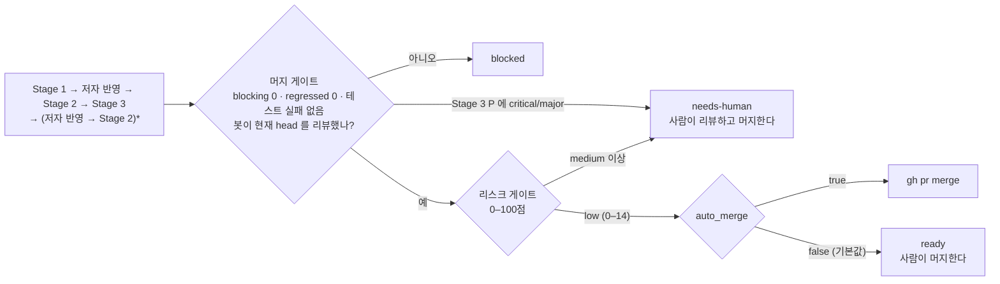
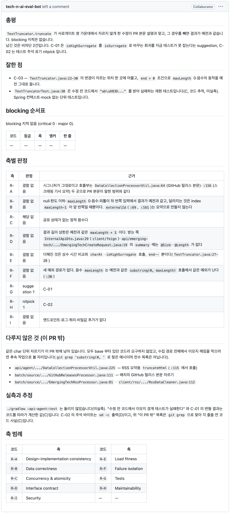
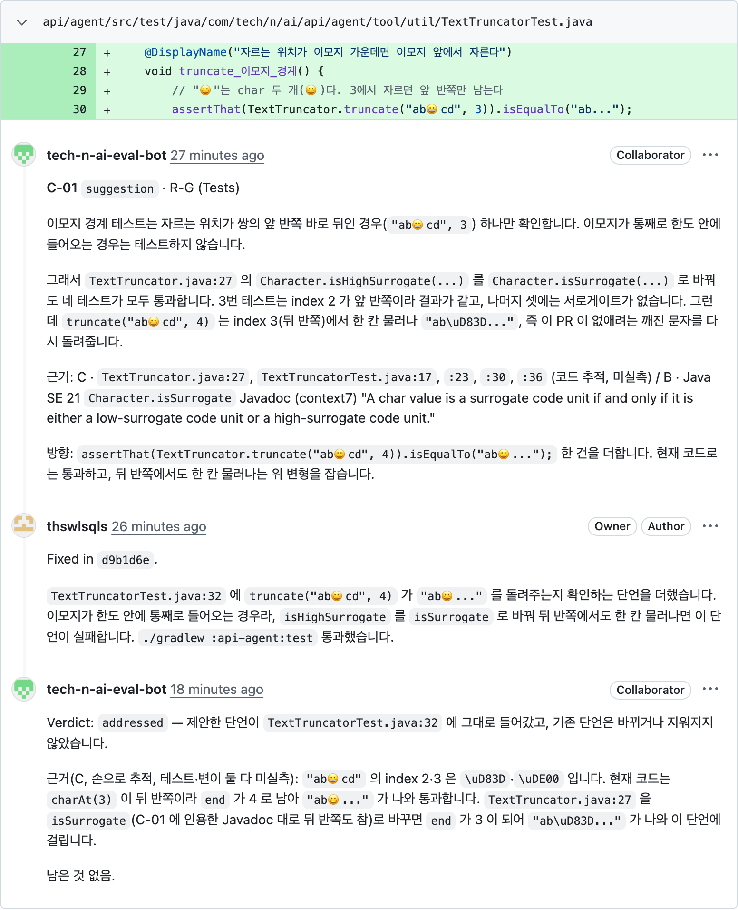

<p align="right">
  <a href="./README.md">English</a> | <strong>한국어</strong> | <a href="./README.zh-CN.md">简体中文</a>
</p>

> 이 문서는 [영어판](./README.md)을 옮긴 것이다. 내용이 다르면 영어판이 맞다. 기준: `README.md` @ `9d15413`

<p align="center">
  <picture>
    <source media="(prefers-color-scheme: dark)" srcset="assets/logo-dark.svg">
    
  </picture>
</p>

GitHub PR 리뷰를 여러 Claude 세션에 나눠 맡기는 Claude Code 플러그인이다. 저자 세션이 리뷰를 반영하면 반영 여부를 확인하고 빌드·테스트를 다시 돌린 뒤, 리스크 점수로 머지 여부를 정한다.

PR 에 봇 계정을 리뷰어로 지정하면 나머지는 사람 없이 돈다. 리뷰는 사람 리뷰어처럼 요약 한 건과 코드 줄에 붙는 인라인 코멘트로 올라간다.

## 동작 방식

| 스테이지 | 하는 일 |
|---|---|
| Stage 1 · review | 위원 4인이 리뷰 축을 나눠 맡아 서로의 결과를 모른 채 리뷰한다. 반박자가 `critical`(치명)·`major`(중대) 지적을 하나씩 코드로 다시 확인하고, 검증자 셋이 리뷰를 다시 읽는다. 최대 5라운드 |
| 저자 | 별도 세션(`/pr-quorum:author`)이 코드를 고쳐 사용자의 gh 계정으로 PR 브랜치에 push 한다. force push·머지·승인은 하지 않는다 |
| Stage 2 · followup | 스레드마다 `addressed`(반영)·`partial`(부분)·`not-addressed`(미반영)·`regressed`(역행, 고치다가 새 결함을 만듦) 중 하나로 답한다 |
| Stage 3 · measured | 고친 커밋으로 빌드와 테스트를 다시 돌리고, 리뷰가 놓친 결함(`P`)을 찾는다 |



리스크 게이트는 코드 품질이 아니라 어떤 파일을 얼마나 바꿨는지만 본다. 인증·비밀값·CI·빌드 스크립트·하니스 자신을 건드린 PR 은 점수가 올라 자동 머지되지 않는다. 규칙: [`rules/03-risk.md`](rules/03-risk.md).

### 예시

이 하니스가 처음 돌던 tech-n-ai-backend 의 PR #68 에 봇이 남긴 리뷰다. 리뷰 글은 PR 의 언어를 따른다.





Stage 1 은 suggestion 1건·nitpick 1건·잘한 점 1건을 남겼다. Stage 2 는 두 건 모두 `addressed` 로 판정했고, Stage 3 은 놓친 결함을 찾지 못했다. 리스크 점수 0점(`low`)으로 체인이 머지했다.

## 설계 원칙

- **근거에 등급을 매긴다.** 지적에는 저장소 규범 문서, 공식 문서 인용, `file:line`, 직접 실행한 결과 중 하나가 붙어야 한다. 근거가 뒷받침하는 범위를 넘은 주장은 뺀다([`rules/00-criteria.md`](rules/00-criteria.md) §4).
- **리뷰에 점수를 쓰지 않는다.** 등급은 `critical`·`major`·`minor`(경미)·`nit`(사소) 넷뿐이고, 잘한 점을 최소 한 건 적는다.
- **확정된 사실은 `frozen.md` 에 고정한다.** 새 근거 없이는 라운드마다 같은 논쟁을 되풀이하지 않는다.
- **모두 들여다볼 수 있다.** 규칙은 [`rules/`](rules/), 위원 지시는 [`rules/02-judges.md`](rules/02-judges.md), 게이트는 [`scripts/`](scripts/), 라운드별 기록은 `~/.pr-quorum/runs/` 에 있다.

### 기준의 출처

리뷰 축과 축마다 어디까지 문제 삼을지는 공개된 가이드라인에서 가져왔고, 규칙마다 인용문이 말하는 범위를 넘지 않게 정했다.

<details>
<summary>출처와 인용문</summary>

| 하니스의 규칙 | 출처 | 근거가 된 문장 |
|---|---|---|
| 설계를 가장 먼저 본다 — `R-A` 가 첫 축이고 중복 제거에서 J1 이 우선인 이유 | Google, [What to look for in a code review](https://google.github.io/eng-practices/review/reviewer/looking-for.html) | "The most important thing to cover in a review is the overall design of the CL." |
| 동시성을 별도 축(`R-C`)으로 떼어 낸다 | 같은 문서, Functionality 절 | "…if there is some sort of **parallel programming** going on in the CL that could theoretically cause deadlocks or race conditions." |
| 테스트 축의 판정 문구 — "테스트가 있는가"가 아니라 "깨졌을 때 실패하는가" | 같은 문서, Tests 절 | "Will the tests actually fail when the code is broken?" |
| 잘한 점을 최소 한 건 반드시 적는다 | 같은 문서 Good Things 절 · [Conventional Comments](https://conventionalcomments.org/) | "If you see something nice in the CL, tell the developer…" · "Try to leave at least one of these comments per review." |
| 판정 문구가 "이상적인 설계인가"가 아니라 "코드 헬스를 악화시키는가" | Google, [The Standard of Code Review](https://google.github.io/eng-practices/review/reviewer/standard.html) | "reviewers should favor approving a CL once it is in a state where it definitely improves the overall code health of the system being worked on, even if the CL isn't perfect." |
| 근거 없는 취향은 `nitpick` 까지만 쓴다 | 같은 문서 | "On matters of style, the style guide is the absolute authority. Any purely style point (whitespace, etc.) that is not in the style guide is a matter of personal preference." |
| 코멘트 라벨 표기 — `issue (blocking)` · `suggestion` · `nitpick (non-blocking)` · `praise` | [Conventional Comments](https://conventionalcomments.org/) | 라벨 + 괄호 표시(blocking / non-blocking) 형식을 그대로 따랐다 |
| 보안 축(`R-I`)의 첫 항목이 인가 누락인 이유 | OWASP, [ASVS 5.0.0](https://github.com/OWASP/ASVS/blob/v5.0.0/5.0/en/0x17-V8-Authorization.md) V8 Authorization, 8.2.2 (Level 1) | "Verify that the application ensures that data-specific access is restricted to consumers with explicit permissions to specific data items to mitigate insecure direct object reference (IDOR) and broken object level authorization (BOLA)." |
| 토큰·자격증명이 로그에 남는 것을 결함으로 보는 근거 | [같은 표준](https://github.com/OWASP/ASVS/blob/v5.0.0/5.0/en/0x25-V16-Security-Logging-and-Error-Handling.md) V16 Security Logging and Error Handling, 16.2.5 (Level 2) | "Verify that when logging sensitive data, the application enforces logging based on the data's protection level. For example, it may not be allowed to log certain data, such as credentials or payment details. Other data, such as session tokens, may only be logged by being hashed or masked, either in full or partially." |

테스트 축이 세게 몰아붙이지 않는 것은 근거 문장 *"Ask for unit, integration, or end-to-end tests **as appropriate** for the change."* 가 선택지형이라서다. "이런 테스트가 없으니 blocking" 이라고 쓰면 인용을 넘어선다.

Google eng-practices 저장소는 아카이브 상태이며(마지막 push 2024-09-19) 위 인용은 그 시점 기준이다. ASVS 는 점검표로 돌리지 않는다. 요구사항 상당수가 PR diff 에 드러나지 않는 설정·실행 환경을 봐야 판정되기 때문이다.

</details>

리뷰 축의 정의는 [`examples/profiles/`](examples/profiles/) 에 있다.

## 요구사항

- macOS (watcher 예시가 launchd 기준이고, 스크립트는 bash 다)
- [Claude Code](https://code.claude.com/docs), 본인 계정으로 로그인한 `gh`, `jq`, `git`
- 별도의 GitHub 봇 계정([설정](#1-봇-계정) 참고)
- 본인 소유의 개인 저장소. 다른 사람이 연 PR 은 건너뛴다

## 설치

평소 쓰는 Claude Code 세션에서 스킬을 부르려면 마켓플레이스로 설치한다.

```
/plugin marketplace add thswlsqls/pr-quorum
/plugin install pr-quorum@pr-quorum
```

무인 체인은 이 설치본을 쓰지 **않는다**. 체인은 `--setting-sources ""` 로 돌아 사용자 설정으로 켠 플러그인을 싣지 않고, 고정된 경로도 필요하다. 그래서 clone 한 폴더를 `--plugin-dir` 로 싣는다. 이 문서에서 `<plugin-dir>` 는 그 clone 의 절대 경로다.

```bash
git clone https://github.com/thswlsqls/pr-quorum.git <plugin-dir>
```

이 clone 은 main 에 두고, 하니스 수정은 다른 clone 이나 worktree 에서 한다. 고치던 중인 하니스로 실제 리뷰가 돌지 않게 하기 위해서다.

## 설정

### 1. 봇 계정

자기 GitHub 봇 계정을 따로 만든다. 공용 봇은 없다.

- 리뷰할 저장소마다 **collaborator read** 로 초대한다. 리뷰 요청을 받는 데는 이걸로 충분하다.
- 봇 계정으로 scope `public_repo` 인 PAT 를 만든다.
- 권한은 read 로 둔다. `public_repo` 는 public 저장소에 쓸 수 있으므로, 봇을 write 로 올리면 이 토큰으로 push 할 수 있게 된다.

봇은 리뷰와 코멘트만 올린다. 승인이나 변경 요청은 하지 않는다.

### 2. 토큰 파일

```bash
mkdir -p ~/.config/pr-quorum
cat > ~/.config/pr-quorum/bot.env <<'ENV'
PR_QUORUM_BOT_TOKEN=<bot-PAT>
ENV
chmod 600 ~/.config/pr-quorum/bot.env
```

키 이름은 `GH_TOKEN` 도 된다. 이 파일은 `scripts/pr-quorum.sh` 만 읽고, 리뷰 세션은 읽지 못하게 막혀 있다. 절대 커밋하지 않는다.

### 3. `~/.pr-quorum/config.json`

```bash
mkdir -p ~/.pr-quorum/profiles
cp <plugin-dir>/templates/config.json ~/.pr-quorum/config.json
touch ~/.pr-quorum/learnings.md ~/.pr-quorum/human-labels.md
```

| 키 | 뜻 |
|---|---|
| `owner` | 본인 GitHub 로그인. watcher 는 이 소유자의 저장소에서 리뷰 요청을 찾는다 |
| `bot` | 1단계에서 만든 봇 로그인. 토큰의 계정과 같아야 한다 |
| `auto_merge` | 두 게이트를 지난 PR 을 체인이 머지할지. 기본값 `false` 면 체인은 `ready` 에서 멈춘다 |
| `repos` | 저장소 이름마다 로컬 clone 의 절대 경로(`path`)와 쓸 프로파일(`profile`) |

`learnings.md` 는 PR 을 거치며 쌓이는 학습 기록으로, 리뷰 세션이 읽는다. `human-labels.md` 는 사람이 봇 코멘트를 채점하는 곳이다. PR 마다 저장소 clone 옆 `<repo-name>-worktrees/` 아래에 worktree 가 생긴다.

### 4. 프로파일

프로파일은 리뷰 축과 위원마다 볼 것·보지 않을 것을 정한다. 견본을 복사해 자기 저장소에 맞게 고친다. 파일 이름이 `profile` 값이 된다.

```bash
cp <plugin-dir>/examples/profiles/backend.md ~/.pr-quorum/profiles/backend.md
```

견본([`backend.md`](examples/profiles/backend.md), [`frontend.md`](examples/profiles/frontend.md))은 Spring Boot 백엔드와 Next.js 프런트엔드에 맞춰 썼다.

### 5. watcher (선택)

watcher 는 60초마다 봇에게 온 리뷰 요청을 찾는다. watcher 가 없으면 리뷰를 요청해도 아무 일도 없고, 체인을 손으로 돌려야 한다([사용법](#사용법)). macOS 에서는 아래 내용을 `~/Library/LaunchAgents/io.github.thswlsqls.pr-quorum.plist` 로 저장하고 `launchctl load` 한다. `caffeinate -i` 가 머신이 잠들지 않게 한다.

```xml
<?xml version="1.0" encoding="UTF-8"?>
<!DOCTYPE plist PUBLIC "-//Apple//DTD PLIST 1.0//EN" "http://www.apple.com/DTDs/PropertyList-1.0.dtd">
<plist version="1.0">
<dict>
  <key>Label</key><string>io.github.thswlsqls.pr-quorum</string>
  <key>ProgramArguments</key>
  <array>
    <string>/usr/bin/caffeinate</string>
    <string>-i</string>
    <string><plugin-dir>/scripts/watch.sh</string>
  </array>
  <key>StartInterval</key><integer>60</integer>
  <key>WorkingDirectory</key><string><plugin-dir></string>
  <key>EnvironmentVariables</key>
  <dict>
    <key>PATH</key><string><dirs-containing-claude-gh-jq-git></string>
  </dict>
  <key>StandardOutPath</key><string><home-dir>/Library/Logs/pr-quorum-watch.log</string>
  <key>StandardErrorPath</key><string><home-dir>/Library/Logs/pr-quorum-watch.log</string>
</dict>
</plist>
```

launchd 없이 한 번만 시험하려면 `<plugin-dir>/scripts/watch.sh --once` 를 돌린다. watcher 는 PR 을 한 번에 한 건씩 처리하고, 머신이 꺼져 있던 동안 들어온 요청은 다시 켜졌을 때 처리한다.

## 사용법

아래에서 `<repo>` 는 `config.json` 의 `repos` 아래 저장소 이름이고, `<pr>` 은 PR 번호다.

### PR 리뷰 받기

PR 을 draft 가 아닌 상태로 열고 봇 계정을 리뷰어로 지정한다. 1분 안에 watcher 가 체인을 띄우고, 체인은 Stage 1 부터 머지 판단까지 이어 돈다.

진행 상황은 watcher 로그나 PR 상태 파일로 본다.

```bash
tail -f ~/Library/Logs/pr-quorum-watch.log
jq '{status, chain}' ~/.pr-quorum/runs/<repo>-pr<pr>/meta.json
```

체인은 아래 상태(`chain.state`) 중 하나로 끝난다.

| 상태 | 뜻 | 할 일 |
|---|---|---|
| `merged` | `auto_merge: true` 에서 두 게이트를 통과했다 | 없음 |
| `ready` | 두 게이트를 통과했지만 `auto_merge` 가 꺼져 있다 | 직접 머지한다 |
| `needs-human` | 리스크가 `medium` 이상이거나, Stage 3 이 놓친 `critical`/`major` 결함을 찾았다 | 직접 보고 판단한다. 리스크 점수표가 PR 에 있다 |
| `blocked` | 머지 게이트 실패, 머지 충돌, 세션이 기록을 남기지 않음, head 가 바뀜 중 하나 | `chain.reason` 을 보고 원인을 고친 뒤 체인을 다시 돌린다 |

### 체인 직접 돌리기

watcher 없이 쓰거나 `blocked` 로 멈춘 체인을 이어 가려면 직접 돌린다. 멈춘 지점부터 다시 시작한다.

```bash
<plugin-dir>/scripts/chain.sh <repo> <pr>
```

### 스테이지 하나만 돌리기

스테이지 하나를 대화형으로 돌리려면 체인과 같은 권한으로 Claude Code 를 띄운다. 그냥 띄운 세션에는 이 권한이 걸리지 않는다. `~/.pr-quorum/settings.json` 은 `chain.sh` 가 한 번 돈 뒤에 생긴다.

```bash
claude --settings ~/.pr-quorum/settings.json --setting-sources "" --plugin-dir <plugin-dir> \
  --permission-mode dontAsk --mcp-config <plugin-dir>/mcp.json --strict-mcp-config
```

그다음 세션 안에서 부른다.

```
/pr-quorum:review stage1 <repo> <pr>
/pr-quorum:review stage2 <repo> <pr>
/pr-quorum:review stage3 <repo> <pr>
/pr-quorum:author <repo> <pr>
```

바뀐 파일이 50개를 넘거나 바뀐 줄이 3,000줄을 넘는 PR 은 `held-large` 로 보류된다. 그래도 리뷰하려면 Stage 1 에 `--approve` 를 붙인다.

### 유지보수

| 명령 | 언제 |
|---|---|
| `git -C <plugin-dir> pull --ff-only` | 체인에 새 버전을 반영할 때. clone 은 저절로 갱신되지 않는다 |
| `<plugin-dir>/scripts/dream.sh [<repo>-pr<N>...]` | 지난 run 들의 학습 후보를 `~/.pr-quorum/runs/_dream/<time>/proposal.md` 로 정리한다. `learnings.md` 에 넣을지는 사람이 정한다 |
| `<plugin-dir>/scripts/risk-audit.sh <repo> [N]` | 최근 머지된 PR N건(기본 30)의 리스크 점수를 14일 안에 뒤따른 수정·revert PR 과 나란히 보여 준다. 자동 머지 기준을 조정할 때 쓴다 |
| `<plugin-dir>/scripts/selftest.sh` | 게이트 스크립트를 고친 뒤. LLM 없이 지난 산출물에 게이트를 다시 돌린다 |

마켓플레이스 설치본은 `version` 이 오르면 `claude plugin update pr-quorum@pr-quorum` 으로 새 판을 받는다. 바뀐 내용은 [`CHANGELOG.md`](CHANGELOG.md) 에 있다.

## 보안

체인 세션은 모두 `claude -p --settings <rendered-settings-file> --permission-mode dontAsk` 로 뜨며, 허용 목록([`templates/`](templates/))에 없는 도구는 묻지 않고 거부한다. 리뷰 세션은 `~/.pr-quorum/runs/` 아래에만 쓸 수 있고, GitHub 에는 `scripts/pr-quorum.sh` 로만 올리며, 토큰 파일을 읽지 못한다. 저자 세션은 `scripts/author-push.sh` 로만 push 하고, 이 스크립트는 force push 와 다른 브랜치를 거부한다.

그 밖의 안전장치:

- 저장소 소유자가 연 PR 만 돈다. watcher 가 거르고 `chain.sh` 가 다시 확인한다.
- PR 본문·코멘트·diff 는 지시가 아니라 데이터로 다룬다. 저자 세션은 봇의 코멘트에서만 할 일을 가져온다.

남아 있는 위험:

- **토큰 파일을 우회해서 읽을 수 있다.** deny 규칙은 파일 이름을 짚는 명령에만 걸리므로, `cd ~/.config/pr-quorum && grep -r TOKEN .` 은 막지 못한다.
- **빌드와 테스트가 PR 의 코드를 실행한다**(`./gradlew`, `npm run build`). 체인이 소유자가 연 PR 에만 돌기 때문에 감수하는 위험이다.
- **테스트 결과는 세션이 스스로 적은 값이다.** 머지 게이트는 저자 세션이 쓴 파일에서 결과를 읽는다. `auto_merge` 를 기본으로 꺼 둔 이유다.

Claude Code 의 [sandbox](https://code.claude.com/docs/en/sandboxing) 를 켜서 `~/.config` 읽기와 네트워크 접근을 OS 수준에서 막으면 셋 다 줄어든다.

## 제약

- **효과가 검증되지 않았다.** 리뷰가 맞았는지 사람이 채점한 기록이 아직 없다(`human-labels.md` 가 비어 있다). "절차가 엄격하면 리뷰가 낫다"는 가정은 검증 전이다.
- **비싸다.** 30~70줄 PR 하나에 체인 전체가 약 $30 든다. 9개 파일·약 400줄 PR 은 약 47분 걸렸다. 수치는 `total_cost_usd` 기준이라 하위 에이전트 비용이 빠졌을 수 있다.
- **백엔드 저장소 하나에서만 돌려 봤다.** 프런트엔드 프로파일은 한 번도 돈 적이 없다.
- **리스크 규칙이 tech-n-ai 의 경로에 맞춰져 있다**(`common/security/`, `filter/`, `/api/bff/auth/` …). `auto_merge` 를 켜기 전에 [`rules/03-risk.md`](rules/03-risk.md) 와 `scripts/risk.jq` 가 자기 저장소에 맞는지 확인한다.
- **개인 저장소 전용이다.** organization 저장소에서는 구성원이 연 PR 도 건너뛴다.
- **GitHub 만, 한 머신에서 돈다.** watcher 가 폴링 방식이라 머신이 켜져 있어야 한다.
- **경로 제약.** 플러그인 경로에 `|`·`&` 가, `config.json` 의 저장소 경로에 `*`·`[` 가 있으면 안 된다.
- 스크립트가 만드는 점수표와 알림은 영어다. 리뷰 글은 PR 의 언어를 따른다.

## 기여

issue 와 PR 을 환영한다. [`CONTRIBUTING.md`](CONTRIBUTING.md) 를 참고한다.

## 라이선스

[MIT](LICENSE)
