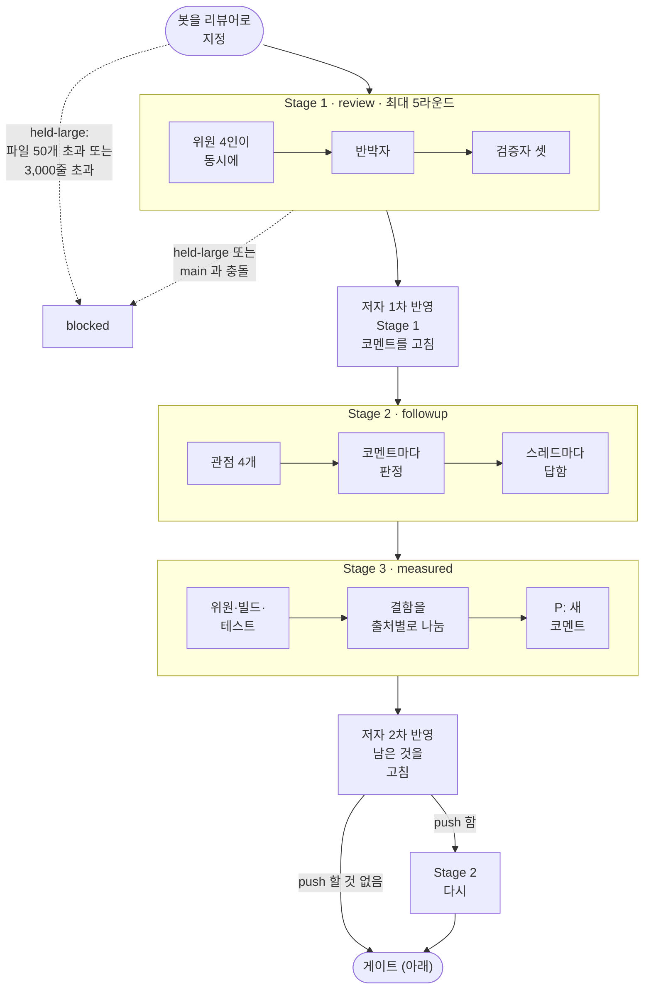
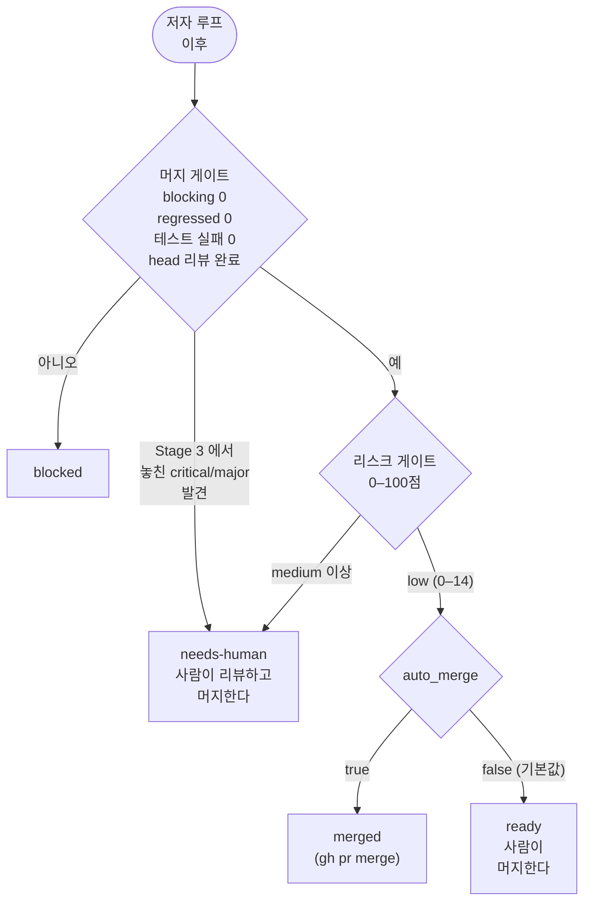
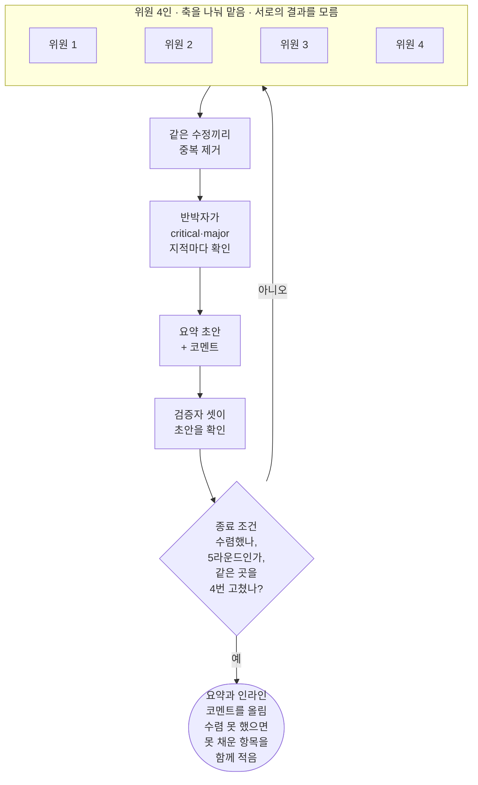
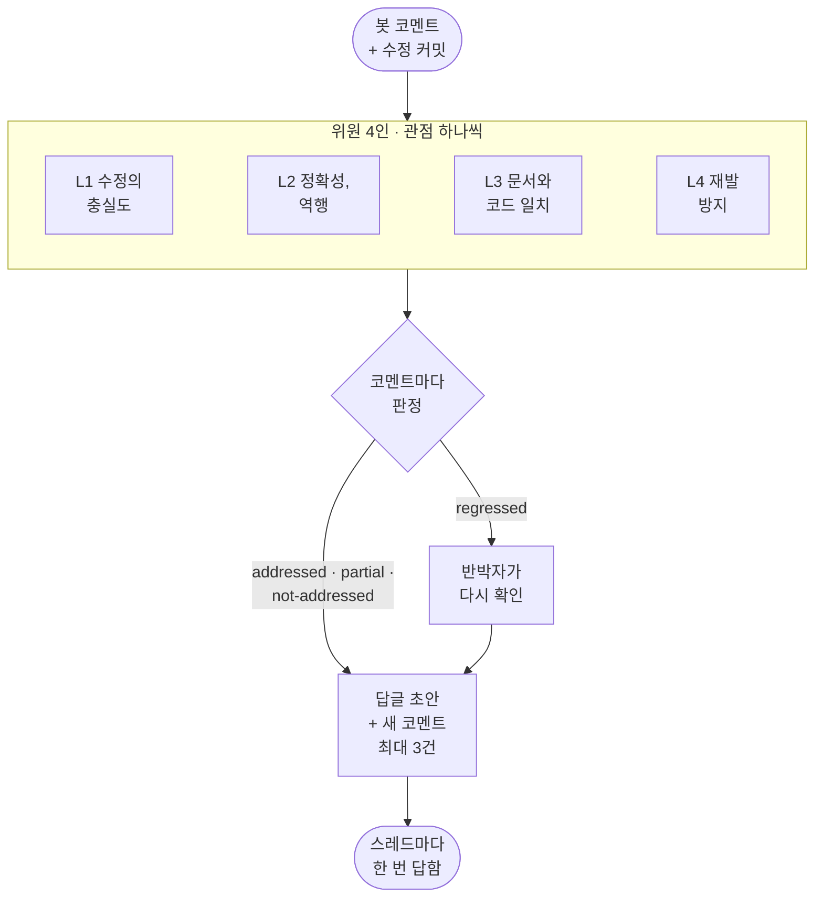
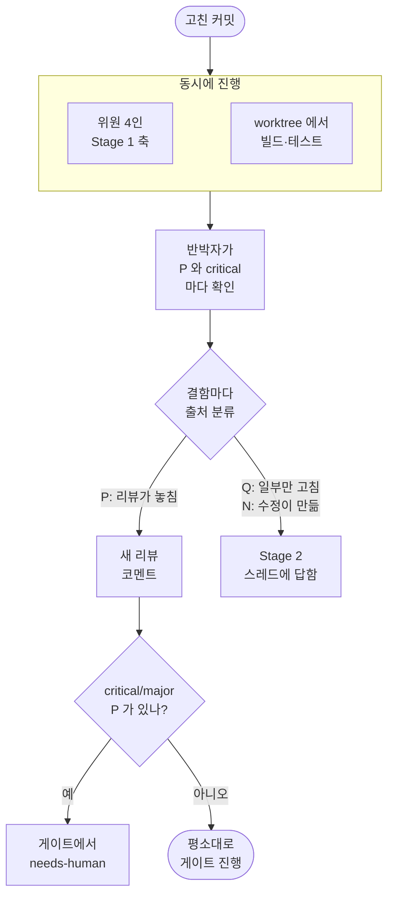
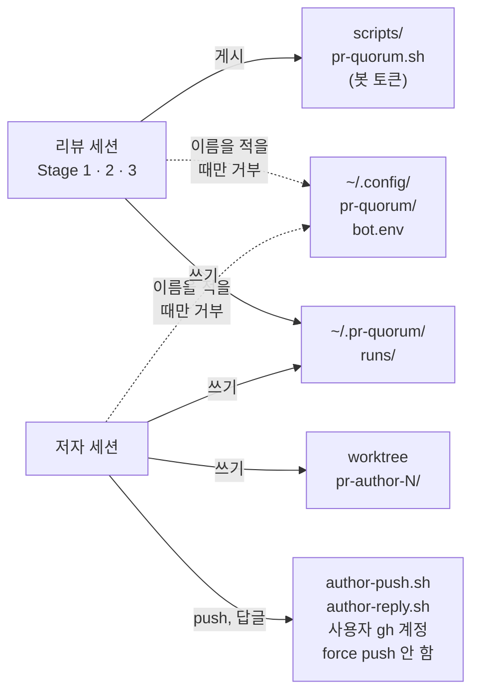

<p align="right">
  <a href="./README.md">English</a> | <strong>한국어</strong> | <a href="./README.zh-CN.md">简体中文</a>
</p>

> 이 문서는 [영어판](./README.md)을 옮긴 것이다. 내용이 다르면 영어판이 맞다. 기준: `README.md` @ `e582453`

<p align="center">
  <picture>
    <source media="(prefers-color-scheme: dark)" srcset="assets/logo-dark.svg">
    
  </picture>
</p>

GitHub PR 리뷰를 여러 Claude 세션에 나눠 맡기는 Claude Code 플러그인이다. 저자 세션이 리뷰를 반영하면 반영 여부를 확인하고 빌드·테스트를 다시 돌린 뒤, 리스크 점수로 머지 여부를 정한다.

PR 에 봇 계정을 리뷰어로 지정하면 나머지는 사람 없이 돈다. 리뷰는 사람 리뷰어처럼 요약 한 건과 코드 줄에 붙는 인라인 코멘트로 올라간다.

## 동작 방식

| 스테이지 | 하는 일 |
|---|---|
| Stage 1 · review | 위원 4인이 리뷰 축을 나눠 맡아 서로의 결과를 모른 채 리뷰한다. 반박자가 `critical`(치명)·`major`(중대) 지적을 하나씩 코드로 다시 확인하고, 검증자 셋이 리뷰를 다시 읽는다. 최대 5라운드 |
| 저자 | 별도 세션(`/pr-quorum:author`)이 코드를 고쳐 사용자의 gh 계정으로 PR 브랜치에 push 한다. force push·머지·승인은 하지 않는다 |
| Stage 2 · followup | 스레드마다 `addressed`(반영)·`partial`(부분)·`not-addressed`(미반영)·`regressed`(역행, 고치다가 새 결함을 만듦) 중 하나로 답한다 |
| Stage 3 · measured | 고친 커밋으로 빌드와 테스트를 다시 돌리고, 리뷰가 놓친 결함(`P`)을 찾는다 |



스테이지마다 자세한 흐름은 아래 접힌 절에 그려 두었다.



리스크 게이트는 코드 품질이 아니라 어떤 파일을 얼마나 바꿨는지만 본다. 인증·비밀값·CI·빌드 스크립트·하니스 자신을 건드린 PR 은 점수가 올라 자동 머지되지 않는다. 규칙: [`rules/03-risk.md`](rules/03-risk.md).

<details>
<summary>Stage 1 한 라운드 안에서 (위원 → 반박자 → 검증자)</summary>



수렴: [`rules/01-stages.md`](rules/01-stages.md) §4 의 종료 조건.

</details>

<details>
<summary>Stage 2 안에서 (코멘트마다 판정 하나)</summary>



`regressed` 판정이 하나라도 남으면 머지 게이트가 막힌다. 관점: [`rules/01-stages.md`](rules/01-stages.md) §2-1.

</details>

<details>
<summary>Stage 3 안에서 (측정한 뒤 결함을 출처별로 나눔)</summary>



측정할 수 없는 것은 `not measured` 로 적는다. 출처 분류: [`rules/01-stages.md`](rules/01-stages.md) §2-2.

</details>

### 예시

실제 PR 에 봇이 남긴 리뷰다. 리뷰 글은 PR 의 언어를 따른다.


Stage 1 은 suggestion 1건·nitpick 1건·잘한 점 1건을 남겼다. Stage 2 는 두 건 모두 `addressed` 로 판정했고, Stage 3 은 놓친 결함을 찾지 못했다. 리스크 점수 0점(`low`)으로 체인이 머지했다.

## 설계 원칙

- **근거에 등급을 매긴다.** 지적에는 저장소 규범 문서, 공식 문서 인용, `file:line`, 직접 실행한 결과 중 하나가 붙어야 한다. 근거가 뒷받침하는 범위를 넘은 주장은 뺀다([`rules/00-criteria.md`](rules/00-criteria.md) §4).
- **리뷰에 점수를 쓰지 않는다.** 등급은 `critical`·`major`·`minor`(경미)·`nit`(사소) 넷뿐이고, 잘한 점을 최소 한 건 적는다.
- **확정된 사실은 `frozen.md` 에 고정한다.** 새 근거 없이는 라운드마다 같은 논쟁을 되풀이하지 않는다.
- **모두 들여다볼 수 있다.** 규칙은 [`rules/`](rules/), 위원 지시는 [`rules/02-judges.md`](rules/02-judges.md), 게이트는 [`scripts/`](scripts/), 라운드별 기록은 `~/.pr-quorum/runs/` 에 있다.

### 기준의 출처

리뷰 축과 축마다 어디까지 문제 삼을지는 공개된 가이드라인에서 가져왔고, 규칙마다 인용문이 말하는 범위를 넘지 않게 정했다.

<details>
<summary>출처와 인용문</summary>

| 하니스의 규칙 | 출처 | 근거가 된 문장 |
|---|---|---|
| 설계를 가장 먼저 본다 — `R-A` 가 첫 축이고 중복 제거에서 J1 이 우선인 이유 | Google, [What to look for in a code review](https://google.github.io/eng-practices/review/reviewer/looking-for.html) | "The most important thing to cover in a review is the overall design of the CL." |
| 동시성을 별도 축(`R-C`)으로 떼어 낸다 | 같은 문서, Functionality 절 | "…if there is some sort of **parallel programming** going on in the CL that could theoretically cause deadlocks or race conditions." |
| 테스트 축의 판정 문구 — "테스트가 있는가"가 아니라 "깨졌을 때 실패하는가" | 같은 문서, Tests 절 | "Will the tests actually fail when the code is broken?" |
| 잘한 점을 최소 한 건 반드시 적는다 | 같은 문서 Good Things 절 · [Conventional Comments](https://conventionalcomments.org/) | "If you see something nice in the CL, tell the developer…" · "Try to leave at least one of these comments per review." |
| 판정 문구가 "이상적인 설계인가"가 아니라 "코드 헬스를 악화시키는가" | Google, [The Standard of Code Review](https://google.github.io/eng-practices/review/reviewer/standard.html) | "reviewers should favor approving a CL once it is in a state where it definitely improves the overall code health of the system being worked on, even if the CL isn't perfect." |
| 근거 없는 취향은 `nitpick` 까지만 쓴다 | 같은 문서 | "On matters of style, the style guide is the absolute authority. Any purely style point (whitespace, etc.) that is not in the style guide is a matter of personal preference." |
| 코멘트 라벨 표기 — `issue (blocking)` · `suggestion` · `nitpick (non-blocking)` · `praise` | [Conventional Comments](https://conventionalcomments.org/) | 라벨 + 괄호 표시(blocking / non-blocking) 형식을 그대로 따랐다 |
| 보안 축(`R-I`)의 첫 항목이 인가 누락인 이유 | OWASP, [ASVS 5.0.0](https://github.com/OWASP/ASVS/blob/v5.0.0/5.0/en/0x17-V8-Authorization.md) V8 Authorization, 8.2.2 (Level 1) | "Verify that the application ensures that data-specific access is restricted to consumers with explicit permissions to specific data items to mitigate insecure direct object reference (IDOR) and broken object level authorization (BOLA)." |
| 토큰·자격증명이 로그에 남는 것을 결함으로 보는 근거 | [같은 표준](https://github.com/OWASP/ASVS/blob/v5.0.0/5.0/en/0x25-V16-Security-Logging-and-Error-Handling.md) V16 Security Logging and Error Handling, 16.2.5 (Level 2) | "Verify that when logging sensitive data, the application enforces logging based on the data's protection level. For example, it may not be allowed to log certain data, such as credentials or payment details. Other data, such as session tokens, may only be logged by being hashed or masked, either in full or partially." |

테스트 축이 세게 몰아붙이지 않는 것은 근거 문장 *"Ask for unit, integration, or end-to-end tests **as appropriate** for the change."* 가 선택지형이라서다. "이런 테스트가 없으니 blocking" 이라고 쓰면 인용을 넘어선다.

Google eng-practices 저장소는 아카이브 상태이며(마지막 push 2024-09-19) 위 인용은 그 시점 기준이다. ASVS 는 점검표로 돌리지 않는다. 요구사항 상당수가 PR diff 에 드러나지 않는 설정·실행 환경을 봐야 판정되기 때문이다.

</details>

리뷰 축의 정의는 [`examples/profiles/`](examples/profiles/) 에 있다.

## 요구사항

- macOS, 또는 Linux(Windows 의 WSL2 포함). 스크립트는 bash 이고 macOS 전용 명령을 쓰지 않는다. macOS 에 묶인 것은 launchd watcher 예시뿐이다. Windows 네이티브(PowerShell, cmd)는 지원하지 않는다
- [Claude Code](https://code.claude.com/docs), 본인 계정으로 로그인한 `gh`, `jq`, `git`
- 별도의 GitHub 봇 계정([설정](#1-봇-계정) 참고)
- github.com 의 저장소. GitHub Enterprise Server 와 ghe.com 은 지원하지 않는다
- 기본으로는 저장소 소유자가 연 PR 만 돌고 나머지는 건너뛴다. 팀원의 PR 도 돌리려면 `trust.authors` 나 `trust.associations` 에 넣고, 조직 저장소는 `repos.<name>.owner` 를 지정한다([설정 §3](#3-pr-quorumconfigjson)). 신뢰한 저자의 PR 본문과 diff 는 본인 gh 계정으로 push·머지하는 세션에 그대로 들어가므로, 그렇게 해도 되는 사람만 신뢰한다

## 설치

평소 쓰는 Claude Code 세션에서 스킬을 부르려면 마켓플레이스로 설치한다.

```
/plugin marketplace add thswlsqls/pr-quorum
/plugin install pr-quorum@pr-quorum
```

무인 체인은 이 설치본을 쓰지 **않는다**. 체인은 `--setting-sources ""` 로 돌아 사용자 설정으로 켠 플러그인을 싣지 않고, 고정된 경로도 필요하다. 그래서 clone 한 폴더를 `--plugin-dir` 로 싣는다. 이 문서에서 `<plugin-dir>` 는 그 clone 의 절대 경로다.

```bash
git clone https://github.com/thswlsqls/pr-quorum.git <plugin-dir>
```

이 clone 은 main 에 두고, 하니스 수정은 다른 clone 이나 worktree 에서 한다. 고치던 중인 하니스로 실제 리뷰가 돌지 않게 하기 위해서다.

## 설정

pr-quorum 이 파일을 두는 곳:

```text
~/.config/pr-quorum/bot.env          봇 PAT (chmod 600)
~/.pr-quorum/
├── config.json                      owner · bot · auto_merge · repos
├── profiles/<profile>.md            저장소별 리뷰 축
├── learnings.md                     리뷰 세션이 읽는 학습 기록
├── human-labels.md                  사람이 봇 코멘트를 채점한 기록
├── settings.json                    리뷰 세션 권한 (chain.sh 가 렌더링)
├── author-settings.json             저자 세션 권한 (chain.sh 가 렌더링)
└── runs/<repo>-pr<N>/               PR 별 상태와 로그
<parent of repo clone>/<repo>-worktrees/
├── pr-author-<N>/                   저자의 worktree
└── pr-quorum-<N>-<sha7>/            측정한 커밋마다 하나씩 생기는 Stage 3 worktree
```

### 1. 봇 계정

자기 GitHub 봇 계정을 따로 만든다. 공용 봇은 없다.

- 리뷰할 저장소마다 **collaborator read** 로 초대하고, 봇으로 로그인해 초대를 수락한다. 리뷰 요청을 받는 데는 이걸로 충분하다.
- 봇 계정으로 PAT 를 만든다. public 저장소는 scope `public_repo` 인 classic 토큰이면 된다. 봇이 collaborator 로 들어간 private 저장소는 scope `repo` 를 쓴다. 외부 collaborator 는 classic 토큰만 쓸 수 있다.
- 권한은 read 로 둔다. 두 scope 모두 봇이 write 권한을 가진 저장소에 쓸 수 있으므로, 봇을 write 로 올리면 이 토큰으로 push 할 수 있게 된다.

봇은 리뷰와 코멘트만 올린다. 승인이나 변경 요청은 하지 않는다.

### 2. 토큰 파일

```bash
mkdir -p ~/.config/pr-quorum
cat > ~/.config/pr-quorum/bot.env <<'ENV'
PR_QUORUM_BOT_TOKEN=<bot-PAT>
ENV
chmod 600 ~/.config/pr-quorum/bot.env
```

키 이름은 `GH_TOKEN` 도 된다. 이 파일은 `scripts/pr-quorum.sh` 만 읽고, 리뷰 세션은 읽지 못하게 막혀 있다. 절대 커밋하지 않는다.

### 3. `~/.pr-quorum/config.json`

```bash
mkdir -p ~/.pr-quorum/profiles
cp <plugin-dir>/templates/config.json ~/.pr-quorum/config.json
touch ~/.pr-quorum/learnings.md ~/.pr-quorum/human-labels.md
```

| 키 | 뜻 |
|---|---|
| `owner` | 본인 GitHub 로그인. `repos` 중 소유자를 따로 지정하지 않은 저장소의 소유자다. watcher 는 소유자마다 그 저장소들에서 리뷰 요청을 찾는다 |
| `bot` | 1단계에서 만든 봇 로그인. 토큰의 계정과 같아야 한다 |
| `auto_merge` | 두 게이트를 지난 PR 을 체인이 머지할지. 기본값 `false` 면 체인은 `ready` 에서 멈춘다 |
| `trust` | 누구의 PR 이 체인을 돌리는지. `authors`(로그인 목록) 또는 `associations`(GitHub `author_association` 값). 없으면 `associations` 는 `["OWNER"]`. GitHub 가 쓰지 않는 값이 있으면 watcher 와 체인이 exit 2 로 멈추고, `OWNER`, `MEMBER`, `COLLABORATOR` 밖의 값은 경고를 남긴다. 조직이라면 로그인 목록이 낫다. `MEMBER` 는 조직 전원이다 |
| `repos` | 저장소 이름마다 로컬 clone 의 절대 경로(`path`)와 쓸 프로파일(`profile`) |
| `repos.<name>.owner` | 그 저장소의 GitHub 소유자(사용자 또는 조직). 없으면 최상위 `owner` |
| `repos.<name>.commands` | 세션이 PR worktree 에서 돌리는 `build`, `test`, `lint` 명령. 명령 안의 `<target>` 은 실행마다 채워진다. 없으면 Gradle worktree 에서는 `./gradlew [<target>:]build` 와 `test`, 그 밖에는 `npm run build`, `npm run lint`, 테스트로 `npx --no -- tsc --noEmit` 을 돌린다. 명령이 없는 종류는 `not measured` 로 기록된다 |
| `limits` | 단계(`stage1`, `stage2`, `stage3`, `author`)마다 `budget_usd` 와 `timeout_min`(실제 경과 시간). `stage1.max_rounds` 는 Stage 1 라운드 상한(없으면 5). 키가 없으면 상한도 없다. 상한에 걸려 끊긴 세션은 재시도하지 않고 체인은 `blocked` 로 멈춘다 |
| `models` | `session` 은 체인 세션마다 쓸 모델, `subagent` 는 위원 등 서브에이전트의 모델. `null` 이거나 없으면 Claude Code 기본값 |

모든 키와 예시 값은 [`templates/config.json`](templates/config.json) 에 있다. 0.3.0 에서 추가된 키는 선택이고, 없으면 체인은 전과 같이 동작한다. 템플릿에는 예시 `limits`(Stage 1 은 3 라운드)가 들어 있으니, 그 상한을 쓰지 않으려면 키를 지운다.

`learnings.md` 는 PR 을 거치며 쌓이는 학습 기록으로, 리뷰 세션이 읽는다. `human-labels.md` 는 사람이 봇 코멘트를 채점하는 곳이다. PR 마다 저장소 clone 옆 `<repo-name>-worktrees/` 아래에 worktree 가 생긴다.

### 4. 프로파일

프로파일은 리뷰 축과 위원마다 볼 것·보지 않을 것을 정한다. 견본을 복사해 자기 저장소에 맞게 고친다. 파일 이름이 `profile` 값이 된다.

```bash
cp <plugin-dir>/examples/profiles/backend.md ~/.pr-quorum/profiles/backend.md
```

견본([`backend.md`](examples/profiles/backend.md), [`frontend.md`](examples/profiles/frontend.md))은 Spring Boot 백엔드와 Next.js 프런트엔드에 맞춰 썼다.

그다음 `<plugin-dir>/scripts/doctor.sh` 로 설정을 점검한다. 명령, `config.json`, 저장소마다 경로와 프로파일, gh 로그인, 토큰 파일의 권한과 계정, 봇 초대 수락 여부를 한 줄씩 출력하고, `FAIL` 이 하나라도 있으면 exit 2 로 끝난다. 읽기만 하고 아무것도 올리지 않는다.

### 5. watcher (선택)

watcher 는 60초마다 봇에게 온 리뷰 요청을 찾는다. watcher 가 없으면 리뷰를 요청해도 아무 일도 없고, 체인을 손으로 돌려야 한다([사용법](#사용법)). macOS 에서는 아래 내용을 `~/Library/LaunchAgents/io.github.thswlsqls.pr-quorum.plist` 로 저장하고 `launchctl load` 한다. `caffeinate -i` 가 머신이 잠들지 않게 한다.

```xml
<?xml version="1.0" encoding="UTF-8"?>
<!DOCTYPE plist PUBLIC "-//Apple//DTD PLIST 1.0//EN" "http://www.apple.com/DTDs/PropertyList-1.0.dtd">
<plist version="1.0">
<dict>
  <key>Label</key><string>io.github.thswlsqls.pr-quorum</string>
  <key>ProgramArguments</key>
  <array>
    <string>/usr/bin/caffeinate</string>
    <string>-i</string>
    <string><plugin-dir>/scripts/watch.sh</string>
  </array>
  <key>StartInterval</key><integer>60</integer>
  <key>WorkingDirectory</key><string><plugin-dir></string>
  <key>EnvironmentVariables</key>
  <dict>
    <key>PATH</key><string><dirs-containing-claude-gh-jq-git></string>
  </dict>
  <key>StandardOutPath</key><string><home-dir>/Library/Logs/pr-quorum-watch.log</string>
  <key>StandardErrorPath</key><string><home-dir>/Library/Logs/pr-quorum-watch.log</string>
</dict>
</plist>
```

launchd 없이 한 번만 시험하려면 `<plugin-dir>/scripts/watch.sh --once` 를 실행한다. watcher 는 PR 을 한 건씩 처리하고, 머신이 꺼져 있던 동안 들어온 요청은 다시 켜지면 처리한다.

Linux(클라우드 VM, Windows 의 WSL2)에서는 cron 이나 systemd timer 로 `watch.sh` 를 1분마다 실행한다. macOS 전용인 `caffeinate` 는 뺀다.

- **로그인**: 브라우저가 없는 머신에서 `gh` 는 화면에 뜨는 device code 나 `gh auth login --with-token` 으로, Claude Code 는 `claude` 를 한 번 실행해 로그인한다. Claude Code 는 로그인 정보를 `~/.claude/.credentials.json` 에 저장하므로 cron 과 systemd 작업도 이를 그대로 쓴다.
- **cron**: launchd 와 달리 cron 은 체인이 도는 중에도 watcher 를 또 띄우므로 `flock -n` 으로 감싼다. 감싸지 않으면 같은 PR 에 체인이 하나 더 붙어, 한 번만 시도한 PR 이 `held-failed` 로 멈출 수 있다. cron 은 `$HOME` 같은 변수를 펼치지 않으니 `PATH` 는 경로를 모두 풀어 적는다.

  ```
  # crontab -e
  PATH=<dirs-containing-claude-gh-jq-git>:/usr/bin:/bin
  * * * * * cd <plugin-dir> && flock -n <home-dir>/.pr-quorum/watch.lock scripts/watch.sh >> <home-dir>/.pr-quorum/watch.log 2>&1
  ```

- **systemd**: `OnBootSec=1min` 과 `OnUnitActiveSec=1min` 을 함께 둔 timer 로 `Type=oneshot` 서비스를 띄운다. `OnUnitActiveSec=` 만 두면 timer 가 한 번도 동작하지 않는다. timer 는 서비스가 도는 동안 다시 띄우지 않으니 `flock` 은 필요 없다. `PATH` 는 서비스의 `Environment=` 로 지정하고, 사용자 timer 라면 로그아웃한 뒤에도 돌도록 `loginctl enable-linger` 를 실행한다.
- **WSL2**: `/etc/wsl.conf` 의 `[boot]` 아래 `systemd=true` 를 두고 `wsl --shutdown` 을 실행한다. WSL 은 15초 동안 유휴 상태인 distro 를 내리고, Windows 에 로그인할 때 distro 를 띄우지도 않는다. 그러니 `%UserProfile%\.wslconfig` 의 `[general]` 아래 `instanceIdleTimeout=-1` 을 두고, 작업 스케줄러로 로그온 때 `wsl.exe -d <distro>` 를 실행한다. Windows 도 절전에 들어가지 않게 한다.

## 사용법

아래에서 `<repo>` 는 `config.json` 의 `repos` 아래 저장소 이름이고, `<pr>` 은 PR 번호다.

### PR 리뷰 받기

PR 을 draft 가 아닌 상태로 열고 봇 계정을 리뷰어로 지정한다. 1분 안에 watcher 가 체인을 띄우고, 체인은 Stage 1 부터 머지 판단까지 이어 돈다.

진행 상황은 watcher 로그나 PR 상태 파일로 본다.

```bash
tail -f ~/Library/Logs/pr-quorum-watch.log
jq '{status, chain}' ~/.pr-quorum/runs/<repo>-pr<pr>/meta.json
```

체인은 아래 상태(`chain.state`) 중 하나로 끝난다.

| 상태 | 뜻 | 할 일 |
|---|---|---|
| `merged` | `auto_merge: true` 에서 두 게이트를 통과했다 | 없음 |
| `ready` | 두 게이트를 통과했지만 `auto_merge` 가 꺼져 있다 | 직접 머지한다 |
| `needs-human` | 리스크가 `medium` 이상이거나, Stage 3 이 놓친 `critical`/`major` 결함을 찾았다 | 직접 보고 판단한다. 리스크 점수표가 PR 에 있다 |
| `blocked` | 머지 게이트 실패, 머지 충돌, 세션이 기록을 남기지 않음, 세션이 `limits` 의 예산·시간 상한에 걸림, head 가 바뀜 중 하나 | `chain.reason` 을 보고 원인을 고친 뒤 체인을 다시 돌린다. 봇도 그 이유와 재개 명령을 PR 에 코멘트로 한 번 남긴다 |

### 체인 직접 돌리기

watcher 없이 쓰거나 `blocked` 로 멈춘 체인을 이어 가려면 직접 돌린다. 멈춘 지점부터 다시 시작한다.

```bash
<plugin-dir>/scripts/chain.sh <repo> <pr>
```

### 스테이지 하나만 돌리기

스테이지 하나를 대화형으로 돌리려면 체인과 같은 권한으로 Claude Code 를 띄운다. 그냥 띄운 세션에는 이 권한이 걸리지 않는다. `~/.pr-quorum/settings.json` 은 `chain.sh` 가 한 번 돈 뒤에 생긴다.

```bash
claude --settings ~/.pr-quorum/settings.json --setting-sources "" --plugin-dir <plugin-dir> \
  --permission-mode dontAsk --mcp-config <plugin-dir>/mcp.json --strict-mcp-config
```

그다음 세션 안에서 부른다.

```
/pr-quorum:review stage1 <repo> <pr>
/pr-quorum:review stage2 <repo> <pr>
/pr-quorum:review stage3 <repo> <pr>
/pr-quorum:author <repo> <pr>
```

바뀐 파일이 50개를 넘거나 바뀐 줄이 3,000줄을 넘는 PR 은 `held-large` 로 보류된다. 그래도 리뷰하려면 Stage 1 에 `--approve` 를 붙인다.

### 유지보수

| 명령 | 언제 |
|---|---|
| `git -C <plugin-dir> pull --ff-only` | 체인에 새 버전을 반영할 때. clone 은 저절로 갱신되지 않는다 |
| `<plugin-dir>/scripts/dream.sh [<repo>-pr<N>...]` | 지난 run 들의 학습 후보를 `~/.pr-quorum/runs/_dream/<time>/proposal.md` 로 정리한다. `learnings.md` 에 넣을지는 사람이 정한다 |
| `<plugin-dir>/scripts/risk-audit.sh <repo> [N]` | 최근 머지된 PR N건(기본 30)의 리스크 점수를 14일 안에 뒤따른 수정·revert PR 과 나란히 보여 준다. 자동 머지 기준을 조정할 때 쓴다 |
| `<plugin-dir>/scripts/selftest.sh` | 게이트 스크립트를 고친 뒤. LLM 없이 지난 산출물에 게이트를 다시 돌린다 |
| `<plugin-dir>/scripts/doctor.sh` | 설정 직후나 `config.json` 을 고친 뒤, 또는 watcher 가 요청을 집지 않을 때. 읽기만 하며 `FAIL` 이 있으면 exit 2 |

마켓플레이스 설치본은 `version` 이 오르면 `claude plugin update pr-quorum@pr-quorum` 으로 새 판을 받는다. 바뀐 내용은 [`CHANGELOG.md`](CHANGELOG.md) 에 있다.

## 문제 해결

| 증상 | 원인 | 할 일 |
|---|---|---|
| watcher 로그: `error — search failed (<owner>): …` | 봇 토큰으로 한 검색이 실패했다. 토큰 만료·폐기, rate limit, 네트워크 중 하나다. watcher 는 이를 요청 없음으로 읽지 않고 exit 2 로 끝난다 | `doctor.sh` 를 돌린다. `bot.env` 의 토큰을 바꾸거나 rate limit 이 풀리기를 기다린다 |
| watcher 로그: `warning — search for <owner> hit --limit 100` | 한 소유자 아래 봇에게 열린 리뷰 요청이 100건을 넘었다 | 100건 넘는 요청은 놓칠 수 있다. 오래된 PR 에서 봇을 리뷰어에서 뺀다 |
| `doctor.sh` 가 `FAIL — …` 을 출력 | 전제 조건이 빠졌다. 줄마다 고칠 곳이 나온다 | 고친 뒤 `doctor — all checks passed` 가 나올 때까지 `doctor.sh` 를 다시 돌린다 |
| `budget cap $… reached` 나 `wall-clock cap of … min reached` 로 `blocked` | 세션이 `limits.<step>.budget_usd` 나 `timeout_min` 에 걸렸다. 재시도하지 않는다 | 상한을 올리고 `chain.sh <repo> <pr>` 를 다시 돌린다. 멈춘 세션이 남긴 Stage 1 lock 은 그 프로세스가 사라지거나 3시간이 지나면 풀린다. 바로 풀려면 `<plugin-dir>/scripts/pr-quorum.sh unlock <repo> <pr>` |
| Stage 3 이 빌드나 테스트를 `not measured` 로 보고 | 그 종류의 명령이 없다. `repos.<name>.commands` 에 빠져 있거나, `commands` 가 없고 worktree 에 `gradlew` 도 `package.json` 도 없다(Gradle 은 기본 lint 가 없다) | `repos.<name>.commands.build`, `test`, `lint` 를 지정한다 |
| watcher 로그: `skip <repo>#<pr> — author is not trusted (<login>, <association>)`, 또는 `chain.sh` 가 같은 이유로 exit 3 | PR 저자가 `trust.authors` 에도 `trust.associations` 에도 없다 | 그 사람을 신뢰한다면 로그인을 `trust.authors` 에 넣는다 |
| 스크립트가 `GH_HOST=… — pr-quorum supports only github.com` 으로 exit 2 | `GH_HOST` 가 github.com 이 아닌 호스트로 잡혀 있다 | watcher 와 체인이 도는 환경에서 `GH_HOST` 를 지운다 |

## 보안

체인 세션은 모두 `claude -p --settings <rendered-settings-file> --permission-mode dontAsk` 로 뜨며, 허용 목록([`templates/`](templates/))에 없는 도구는 묻지 않고 거부한다. 리뷰 세션은 `~/.pr-quorum/runs/` 아래에만 쓸 수 있고, GitHub 에는 `scripts/pr-quorum.sh` 로만 올리며, 토큰 파일을 읽지 못한다. 저자 세션은 `scripts/author-push.sh` 로만 push 하고, 이 스크립트는 force push 와 다른 브랜치를 거부한다.



그림에 없는 것: 토큰 파일 거부 규칙은 파일 이름을 적은 명령만 막는다. Stage 3 은 자기 worktree 에서 PR 을 빌드하고 테스트한다. 머지 게이트는 저자 세션이 스스로 보고한 결과(테스트, 남은 blocker)를 그대로 믿는다.

그 밖의 안전장치:

- 신뢰한 저자의 PR 만 돈다. 기본은 저장소 소유자이고, `trust.authors` 나 `trust.associations` 에 든 사람이 더해진다. 신뢰는 `config.json` 과 GitHub API 에서만 정해진다. watcher 가 PR 을 거르고 `chain.sh` 가 다시 확인한다. 신뢰한 저자의 PR 텍스트는 본인 계정으로 push·머지하는 세션에 들어가므로, 신뢰 목록이 곧 경계다.
- 세션은 빌드 도구를 직접 부르지 못한다. 빌드와 테스트는 `pr-quorum.sh build`(리뷰: PR 이 고정한 SHA 의 깨끗한 worktree)와 `pr-quorum.sh author-build`(저자의 worktree)로만 돌고, 이 둘은 `repos.<name>.commands` 의 명령이나 Gradle/npm 기본 명령을 실행한다.
- 모든 게시와 push 는 먼저 토큰 검사를 거친다. `pr-quorum.sh`, `author-reply.sh`, `author-push.sh` 는 GitHub 토큰 패턴이나 봇·`GH_TOKEN`·`GITHUB_TOKEN`·본인 gh 토큰 값이 든 본문이나 커밋을 거부한다. `author-push.sh` 는 최종 diff 만이 아니라 push 할 커밋을 하나하나 검사한다.
- 세션은 머지 게이트가 읽는 `meta.json` 을 고치지 못한다. Stage 2·Stage 3 기록은 `pr-quorum.sh` 서브커맨드로 쓴다.
- PR 본문·코멘트·diff 는 지시가 아니라 데이터로 다룬다. 저자 세션은 봇의 코멘트에서만 할 일을 가져온다.

## 기여

issue 와 PR 을 환영한다. [`CONTRIBUTING.md`](CONTRIBUTING.md) 를 참고한다.

## 라이선스

[MIT](LICENSE)
