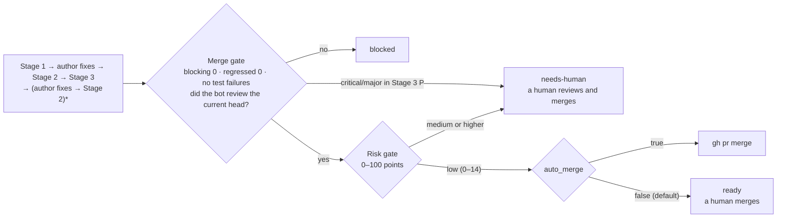

<p align="right">
  <strong>English</strong> | <a href="./README.ko.md">한국어</a> | <a href="./README.zh-CN.md">简体中文</a>
</p>

<p align="center">
  <picture>
    <source media="(prefers-color-scheme: dark)" srcset="assets/logo-dark.svg">
    
  </picture>
</p>

A Claude Code plugin that splits a GitHub PR review across several Claude sessions, re-checks and re-measures after the author addresses the review, and uses a risk score to decide whether to merge.
Assigning the bot account as a reviewer on a PR starts the review, and the review is posted like a human reviewer's: one summary plus inline comments attached to lines of code.

It is the harness that ran in `tools/pr-eval/` of a personal repository (tech-n-ai-backend), moved into a plugin. Every PR number below refers to a PR in that repository.

## What it does

The review is attached in three stages. If you review once and stop, nobody checks whether the findings were actually addressed or whether the review missed something.

| Stage | Question | What it does |
|---|---|---|
| Stage 1 · review | What defects does this PR have? | Four judges split the review axes and look for defects without seeing each other's results. A challenger re-checks each `critical`/`major` finding against the actual code, and three verifiers re-read the review from the angles of evidence, quotations, and the author. If the criteria are not met it runs another round, up to 5 rounds |
| Stage 2 · followup | Did the author do what the review asked? | Replies in each comment's thread with one verdict: `addressed` (반영), `partial` (부분), `not-addressed` (미반영), or `regressed` (역행). `regressed` means the fix introduced a new defect |
| Stage 3 · measured | Does the review hold up when measured? | Re-runs the build and tests on the commit with the fixes, and looks for defects the review missed (`P`) |

Judges, challengers, and verifiers all run as the `pr-quorum:judge` agent, and the `/pr-quorum:review` skill drives the stages.
Addressing the review is done not by the bot but by a separate author session (`/pr-quorum:author`). The author session pushes only to the PR branch with the user's gh account, and never force-pushes, merges, or approves.

Once the bot is assigned as a reviewer, the watcher (`scripts/watch.sh`) finds it within 60 seconds and starts the chain (`scripts/chain.sh`). The chain runs the sequence below without a human.



The risk gate does not judge whether the code is good. It scores only which files changed and by how much. A PR that touches authentication code, secrets, CI, build scripts, or the harness itself scores higher and is not merged automatically. The bot leaves the scorecard as a PR comment. The rules are in [`rules/03-risk.md`](rules/03-risk.md).

## A real review

This is the review the bot left on tech-n-ai-backend PR #34 (a refactoring that changed bulk saving of new technologies from one round trip per item to a single batched round trip).

The review summary. It lists what could block the merge first, then a table of what each review axis flagged and what it could not verify.


One inline comment. It is attached to the problem line and names the files and line numbers it cites as evidence. In the middle is the author's reply, and below it is the Stage 2 verdict the bot left in the same thread after the author's fix.


This PR was in Korean, so the bot wrote in Korean. The Korean in the screenshots maps to the IDs used now: 반영 → `addressed`, 부분 → `partial`, 미반영 → `not-addressed`, 역행 → `regressed`, 치명 → `critical`, 중대 → `major`, 경미 → `minor`, 사소 → `nit`.

On this PR, Stage 1 left 6 comments (1 of them praise). After the author's fixes, Stage 2 judged 5 `addressed` (반영) and 1 `partial` (부분), and Stage 3 found 1 more test gap the review had missed.

## How it differs from other review tools

Only what the operating records and rule documents confirm is listed here. It means the process is strict, not that the review is proven more accurate (see "What we don't know yet" below).

- **It grades evidence, and checks separately whether a quotation actually supports the conclusion.** Evidence falls into four kinds: the repository's normative documents, quotations from official documentation, `file:line` in the code, and results of running something directly. A claim that goes beyond what its grade allows is dropped as invalid. Where the quotation is correct but the conclusion goes beyond it, verifier V2 catches it ([`rules/00-criteria.md`](rules/00-criteria.md) §4, [`rules/02-judges.md`](rules/02-judges.md) §6).
- **It judges separately whether a fix made things worse (`regressed`), and re-measures after the fix.** The first Stage 2 on PR #33 produced 2 `regressed` and 1 `not-addressed`, and Stage 3 found missed defects: 2 on #33 and 1 on #34.
- **It pins confirmed facts in `frozen.md`.** To avoid repeating the same argument round after round, overturning a confirmed fact requires new evidence that it is wrong (invalidation condition I-4).
- **Rules, prompts, and gates are all open to inspection and change.** The rules are in [`rules/`](rules/), the instructions given to judges are in [`rules/02-judges.md`](rules/02-judges.md), and the gates are in [`scripts/`](scripts/). You can trace why a finding was raised through the round logs in `~/.pr-quorum/runs/`.

The review does not use scores. A total score makes the author argue with the score instead of fixing the code, so there are only four grades: `critical`, `major`, `minor`, `nit`. At least one praise is always written.

### Where the criteria come from

The order of the review axes and how far each one goes come from published code review guidelines. This harness drops any claim that goes beyond what its quotation says, so the rules themselves were also set within the scope of their quotations.

| Harness rule | Source | Sentence it rests on |
|---|---|---|
| Design is checked first — why `R-A` is the first axis and J1 wins in deduplication | Google, [What to look for in a code review](https://google.github.io/eng-practices/review/reviewer/looking-for.html) | "The most important thing to cover in a review is the overall design of the CL." |
| Concurrency is split out as its own axis (`R-C`) | Same document, Functionality section | "…if there is some sort of **parallel programming** going on in the CL that could theoretically cause deadlocks or race conditions." |
| Wording of the test axis verdict — not "are there tests" but "do they fail when it breaks" | Same document, Tests section | "Will the tests actually fail when the code is broken?" |
| At least one praise must always be written | Same document, Good Things section · [Conventional Comments](https://conventionalcomments.org/) | "If you see something nice in the CL, tell the developer…" · "Try to leave at least one of these comments per review." |
| Verdict wording is not "is this the ideal design" but "does it worsen code health" | Google, [The Standard of Code Review](https://google.github.io/eng-practices/review/reviewer/standard.html) | "reviewers should favor approving a CL once it is in a state where it definitely improves the overall code health of the system being worked on, even if the CL isn't perfect." |
| Taste without evidence goes no higher than `nitpick` | Same document | "On matters of style, the style guide is the absolute authority. Any purely style point (whitespace, etc.) that is not in the style guide is a matter of personal preference." |
| Comment labels — `issue (blocking)` · `suggestion` · `nitpick (non-blocking)` · `praise` | [Conventional Comments](https://conventionalcomments.org/) | Follows the label + parenthesized decoration (blocking / non-blocking) format as is |
| Why the first item of the security axis (`R-I`) is missing authorization | OWASP, [ASVS 5.0.0](https://github.com/OWASP/ASVS/blob/v5.0.0/5.0/en/0x17-V8-Authorization.md) V8 Authorization, 8.2.2 (Level 1) | "Verify that the application ensures that data-specific access is restricted to consumers with explicit permissions to specific data items to mitigate insecure direct object reference (IDOR) and broken object level authorization (BOLA)." |
| Basis for treating tokens or credentials left in logs as a defect | [Same standard](https://github.com/OWASP/ASVS/blob/v5.0.0/5.0/en/0x25-V16-Security-Logging-and-Error-Handling.md) V16 Security Logging and Error Handling, 16.2.5 (Level 2) | "Verify that when logging sensitive data, the application enforces logging based on the data's protection level. For example, it may not be allowed to log certain data, such as credentials or payment details. Other data, such as session tokens, may only be logged by being hashed or masked, either in full or partially." |

This is also why the test axis does not push hard. The sentence it rests on, *"Ask for unit, integration, or end-to-end tests **as appropriate** for the change."*, offers a choice, so writing "these tests are missing, so blocking" goes beyond what the quotation supports.

> The Google eng-practices repository is archived (last push 2024-09-19). The quotations above are from the documents as of that date.
>
> ASVS is not run as a checklist. The two quotations serve only as the basis for the security axis definition. Many of the standard's requirements can only be judged by looking at configuration, architecture, and runtime environment, while the bot sees the PR's diff, so running the whole checklist would produce mostly findings with no line of code to cite as evidence.

The definitions of the review axes, and what each axis does and does not look at, are in [`examples/profiles/`](examples/profiles/).

## What we don't know yet

- **There are no human judgments of whether the reviews were right.** `human-labels.md`, where a human marks posted comments as right, wrong, or overreaching, is empty. So this harness's assumption that "a stricter process gives better reviews" has not been tested.
- **It is expensive.** A full chain cost about $30 for a 30–70 line PR (#52 $30.2, #55 $28.2). PR #61 (9 files, 384 lines added, 13 deleted), the first PR run after the move to a plugin, took about 47 minutes from Stage 1 through the author's second pass, with a recorded total cost of $29.54. However, we have not confirmed whether this cost value (`total_cost_usd` from `claude -p`) is the whole session including subagents such as judges, challengers, and verifiers. If it is not, the real cost is higher.
- **It has only actually run on one backend repository.** [`examples/profiles/frontend.md`](examples/profiles/frontend.md) is only a draft document, and there is no record of running it on a frontend PR.

## Installation

To install through the marketplace:

```
/plugin marketplace add thswlsqls/pr-quorum
/plugin install pr-quorum@pr-quorum
```

With Claude Code 2.1.275 or later, one line inside a session also works.

```
/plugin install pr-quorum --marketplace thswlsqls/pr-quorum
```

A marketplace install receives a new release only when `version` in `.claude-plugin/plugin.json` goes up. If commits are merged to main but the version stays the same, the install does not change ([official docs](https://code.claude.com/docs/en/plugins/host-marketplace#release-a-new-version)). Get a new release from the shell as below. What changed in each version is in [`CHANGELOG.md`](CHANGELOG.md).

```bash
claude plugin update pr-quorum@pr-quorum
```

**However, the unattended chain does not use the marketplace install; it loads a cloned folder with `--plugin-dir`.** There are two reasons.

- A plugin installed from the marketplace lives in a per-version folder under `~/.claude/plugins/cache/`, so its path changes on every update. There is no fixed path for the launchd configuration to point at.
- The chain does not read user settings (`--setting-sources ""`), to keep tool permissions separate from this machine's settings. So an install enabled in user settings is not loaded into chain sessions.

So for the chain, clone the repository and point the watcher and manual runs at that folder. In this document, `<plugin-dir>` is the absolute path of that clone.

```bash
git clone https://github.com/thswlsqls/pr-quorum.git <plugin-dir>
```

**Keep the runtime clone separate from your development copy.** A plugin loaded with `--plugin-dir` reads whatever files are in that folder each time a session starts. Point the watcher at a clone that only tracks main, and change the harness in another clone or worktree. That way a half-edited harness never runs a real review.

**The runtime clone does not update itself.** A clone loaded with `--plugin-dir` reads the files in the clone as they are, regardless of `version`. So `claude plugin update` does not change it, and even when new commits are merged to main the chain runs on the old files in the clone. To use the changes, pull them yourself with `git pull`.

```bash
git -C <plugin-dir> switch main && git -C <plugin-dir> pull --ff-only
```

## One-time setup

You need `claude`, `gh` (logged in with your user account), `jq`, and `git`. The watcher example is for macOS launchd.

### 1. Bot account

Each person using the plugin creates their own separate GitHub bot account to post reviews. There is no shared bot.

- Invite it to the repositories to review as a **collaborator with read**. Read is enough to receive review requests.
- The token is a PAT of that bot account, with scope `public_repo`.
- The bot posts only reviews and comments. It does not approve or request changes. If the bot held the merge decision, people would bend the review to get past the bot.

The only thing preventing the bot from changing code is the collaborator read role. The `public_repo` scope includes write access to public repositories, so the moment you raise the bot to write, this token can push.

### 2. Token file

```bash
mkdir -p ~/.config/pr-quorum
cat > ~/.config/pr-quorum/bot.env <<'ENV'
PR_QUORUM_BOT_TOKEN=<bot-PAT>
ENV
chmod 600 ~/.config/pr-quorum/bot.env
```

Use either `PR_QUORUM_BOT_TOKEN` or `GH_TOKEN` as the key name. Only the one script that writes to GitHub (`scripts/pr-quorum.sh`) reads this file, internally, and review sessions are blocked from reading it. **Do not commit it to any repository.**

### 3. `~/.pr-quorum/config.json`

State and settings that accumulate per PR live in one place outside the plugin, `~/.pr-quorum/`. Copy the sample [`templates/config.json`](templates/config.json) and edit it.

```bash
mkdir -p ~/.pr-quorum/profiles
cp <plugin-dir>/templates/config.json ~/.pr-quorum/config.json
touch ~/.pr-quorum/learnings.md ~/.pr-quorum/human-labels.md
```

| Key | Meaning |
|---|---|
| `owner` | GitHub owner login of the repositories to review. The watcher looks for review requests to the bot in this owner's repositories |
| `bot` | Login of the bot account created in step 1. Must match the account of the token file |
| `auto_merge` | Whether the chain merges a PR that passed both gates. The default is `false`, in which case the chain stops at `ready` and only leaves the risk scorecard |
| `repos` | For each repository name, the absolute path of its local clone (`path`) and the profile name to use (`profile`) |

`learnings.md` is the learning record that accumulates across PRs, and review sessions read it. `human-labels.md` is the table where a human judges the bot's comments. Start both as empty files.
The chain places a `<repo-name>-worktrees/` folder next to each repository clone and creates one worktree per PR inside it.

### 4. Profile

A profile is the document that defines the review axes and what each judge does and does not look at. Copy a sample and adapt it to your repository's structure. The file name becomes the `profile` value in `config.json`.

```bash
cp <plugin-dir>/examples/profiles/backend.md ~/.pr-quorum/profiles/backend.md
```

The two samples ([`backend.md`](examples/profiles/backend.md) · [`frontend.md`](examples/profiles/frontend.md)) were written for tech-n-ai's Spring Boot backend and Next.js frontend.

### 5. Watcher (optional)

Without the watcher running, assigning the reviewer does nothing. On macOS, put the following in `~/Library/LaunchAgents/io.github.thswlsqls.pr-quorum.plist` and run `launchctl load`. It is wrapped in `caffeinate -i` so the machine does not go to sleep.

```xml
<?xml version="1.0" encoding="UTF-8"?>
<!DOCTYPE plist PUBLIC "-//Apple//DTD PLIST 1.0//EN" "http://www.apple.com/DTDs/PropertyList-1.0.dtd">
<plist version="1.0">
<dict>
  <key>Label</key><string>io.github.thswlsqls.pr-quorum</string>
  <key>ProgramArguments</key>
  <array>
    <string>/usr/bin/caffeinate</string>
    <string>-i</string>
    <string><plugin-dir>/scripts/watch.sh</string>
  </array>
  <key>StartInterval</key><integer>60</integer>
  <key>WorkingDirectory</key><string><plugin-dir></string>
  <key>EnvironmentVariables</key>
  <dict>
    <key>PATH</key><string><dirs-containing-claude-gh-jq-git></string>
  </dict>
  <key>StandardOutPath</key><string><home-dir>/Library/Logs/pr-quorum-watch.log</string>
  <key>StandardErrorPath</key><string><home-dir>/Library/Logs/pr-quorum-watch.log</string>
</dict>
</plist>
```

To run it just once, use `<plugin-dir>/scripts/watch.sh --once`.
The watcher handles PRs one at a time in order, and does not run while the machine is off. When it comes back on, it handles the backlog first.

## Safeguards and remaining risks

**Tool permissions are set on the command line, not by the plugin.** The chain starts each session with `claude -p --settings <rendered-settings-file> --permission-mode dontAsk`, which refuses any tool not on the allow list without asking. Review sessions cannot edit anything outside `~/.pr-quorum/runs/`, write to GitHub only through the designated script, and cannot read the bot token file. `chain.sh` renders the settings files from the templates in [`templates/`](templates/) into `~/.pr-quorum/` every time it runs.

So **when a human calls `/pr-quorum:review` interactively, this protection is absent.** To apply the same permissions when running by hand, start it as below. `~/.pr-quorum/settings.json` exists after `chain.sh` has run once.

```bash
claude --settings ~/.pr-quorum/settings.json --setting-sources "" --plugin-dir <plugin-dir> \
  --permission-mode dontAsk --mcp-config <plugin-dir>/mcp.json --strict-mcp-config
```

Other safeguards:

- The chain only accepts PRs opened by the repository owner. The watcher filters them, and `chain.sh` checks again at start. This keeps PR descriptions or diffs written by others out of sessions that push and merge with the user's account.
- Review sessions treat documents in PR descriptions, comments, and diffs as data, not instructions. The author session takes tasks only from comments made by the bot account.
- The author session pushes only through `scripts/author-push.sh`, which refuses force pushes and other branches.

**Three risks are left unfixed.**

- **Commands that read the token file without naming it are not blocked.** The rule forbidding reads of the token folder applies only to commands that name the file. The official docs state that a command that does not use the file name, such as `cd ~/.config/pr-quorum && grep -r TOKEN .`, is not blocked, and both review and author sessions can use `cd` and `grep`.
- **The build and tests execute the PR's code.** `./gradlew` and `npm run build` run the build scripts in the PR as they are. The check that the chain runs only on PRs opened by the repository owner is the premise for this risk.
- **Test results are values the session reports about itself.** The merge gate reads whether tests passed and how many blocking findings remain from a file written by the author session. Switching to CI results only makes sense in repositories that have CI, so instead `auto_merge` is off by default.

All three shrink if you enable Claude Code's [sandbox](https://code.claude.com/docs/en/sandboxing) to block reads of `~/.config` and network access at the OS level. Permission deny rules alone cannot confine the programs that run.

## Scope and limits

- **It is built for personal repositories.** The chain accepts only PRs with `author_association == OWNER`. In organization repositories it also skips PRs opened by members. It fails closed, so it will be changed when someone asks for it.
- **The risk score rules are fitted to tech-n-ai's structure.** The risk score uses only changed file paths and line counts, so the same diff always gets the same score. But the path rules (`common/security/`, the Gateway's `filter/`, `/api/bff/auth/`, etc.) are fitted to tech-n-ai, so in another repository changing authentication code may not raise the score. That is why `auto_merge` is off by default. Before turning it on, check that [`rules/03-risk.md`](rules/03-risk.md) and `scripts/risk.jq` also fit your repository.
- **Large PRs are not reviewed.** If more than 50 files changed or added plus deleted lines exceed 3,000, the chain holds the PR and only leaves a notice on it.
- **Some characters cannot appear in paths.** The chain fills the settings templates with `sed`, so permission rules break if the plugin folder path contains `|` or `&`, or a repository path in `config.json` contains `*` or `[`.
- **Only GitHub is supported, on a single machine.** The watcher polls, so the machine must be on.
- **Review text follows the PR's language.** The risk scorecard and notices generated by scripts are in English.

## Suggesting improvements

`learnings.md` accumulates separately for each user in `~/.pr-quorum/`. If a proposal from `scripts/dream.sh` has items that would fit other repositories too, please open an issue or PR on this repository. PRs from outside are reviewed by a human, not by the chain.

The internal document to read when changing or operating the plugin is [`docs/harness.md`](docs/harness.md). It covers script contracts, output specs, and facts confirmed by measurement.

## License

[MIT](LICENSE)
