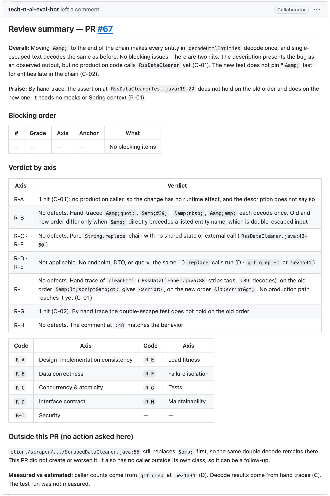
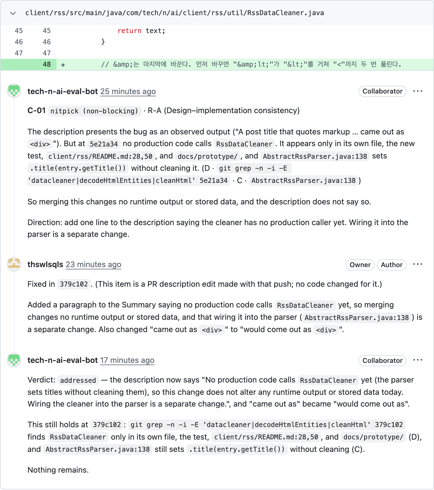
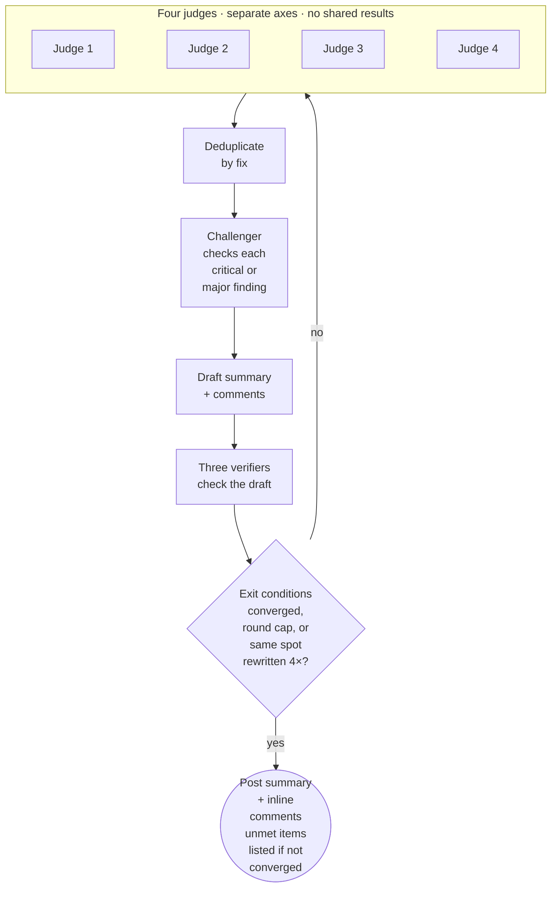
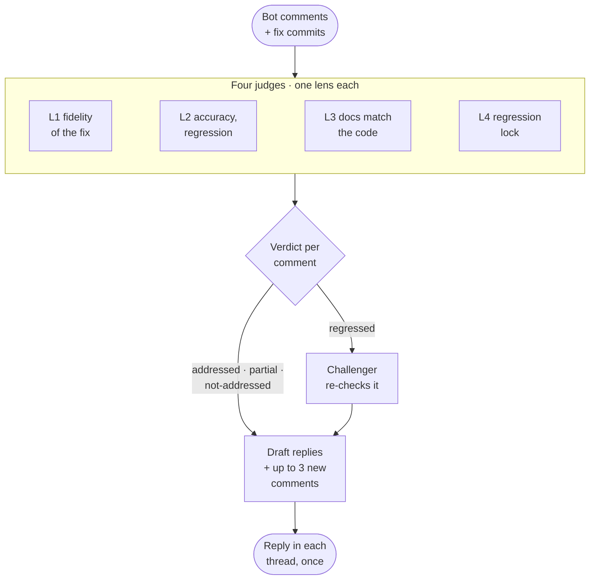
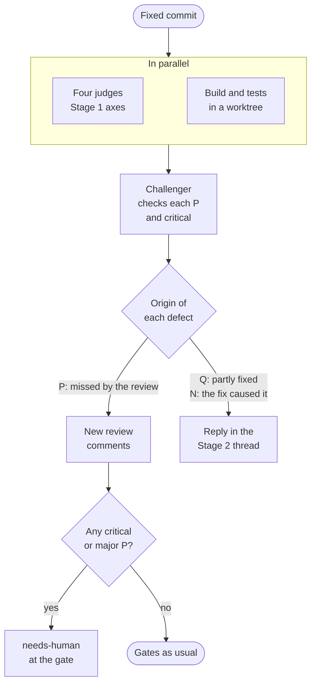
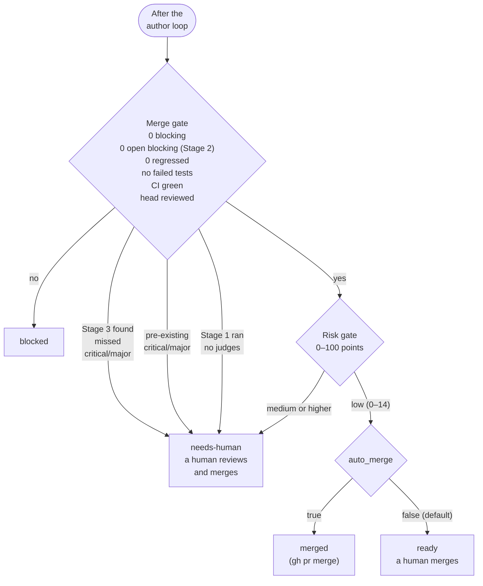
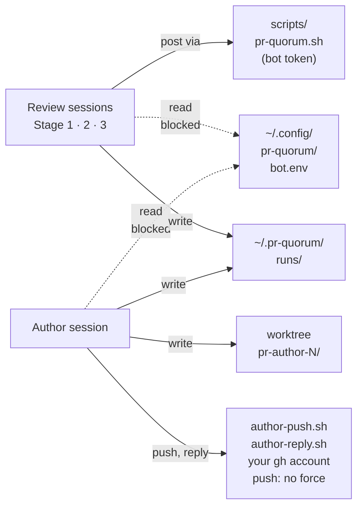

<p align="right">
  <strong>English</strong> | <a href="./README.ko.md">한국어</a> | <a href="./README.zh-CN.md">简体中文</a>
</p>

<p align="center">
  <picture>
    <source media="(prefers-color-scheme: dark)" srcset="assets/logo-dark.svg">
    
  </picture>
</p>

<p align="center">
  
  
</p>

Above: a review the bot left on PR #67, a real PR. The review follows the PR's language. Stage 1 left 2 nits and 1 praise. Stage 2 judged both nits `addressed`, Stage 3 found nothing missed, the risk score was 0 (`low`), and the chain merged it.

A Claude Code plugin that reviews your GitHub PRs with several Claude sessions, has an author session apply the review, checks the fixes, re-runs the build and tests, and uses a risk score to decide whether to merge.

Each PR costs about $11–30 in Claude usage on Claude Code's default model and takes 19–47 minutes (as of 2026-10). Sessions now run on Sonnet by default: in a 3-PR benchmark it found the same planted defects for about $2 per PR, against $15.5 on the default model. It needs a second GitHub account for the bot and an always-on machine (Requirements).

Request a review from your bot account on a PR and the rest runs unattended. The review is posted like a human reviewer's: one summary plus inline comments on lines of code.

## How it works

| Stage | What it does |
|---|---|
| Stage 1 · review | Four judges review the PR on separate axes without seeing each other's results. A challenger re-checks every `critical`/`major` finding against the code, and three verifiers re-read the review. A defect that is a pattern lists every place it occurs in the diff; one the PR did not introduce is marked pre-existing and does not block. The summary opens with the number of blocking comments. Up to 5 rounds by default (`limits.stage1.max_rounds`) |
| Author | A separate session (`/pr-quorum:author`) fixes the code and pushes to the PR branch with your gh account. It never force-pushes, merges, or approves |
| Stage 2 · followup | Replies in each thread with `addressed`, `partial`, `not-addressed`, or `regressed` (the fix introduced a new defect) |
| Stage 3 · measured | Re-runs the build and tests on the fixed commit and looks for defects the review missed (`P`) |

<details>
<summary>Stage 1 · review (judges → challenger → verifiers)</summary>



Converged: the exit conditions in [`rules/01-stages.md`](rules/01-stages.md) §4. The round cap is `limits.stage1.max_rounds` in `config.json` (5 when unset).

Before Stage 1, a PR over 50 changed files or 3,000 changed lines is held as `held-large` and the chain stops at `blocked`. A PR from a fork is held as `held-fork` the same way, with one comment: the author pass pushes fixes to the PR branch, which a fork keeps outside the repository. After Stage 1, a PR that conflicts with main stops there too.

</details>

<details>
<summary>Stage 2 · followup (one verdict per comment)</summary>



Stage 2 runs after the author fixes the Stage 1 comments (the chain records an empty pass instead when that fix pushed nothing), and again after the author's second pass (following Stage 3) if that pass pushed.

Any `regressed` verdict left blocks the merge gate, and so does a blocking comment whose latest verdict is not `addressed`. Lenses: [`rules/01-stages.md`](rules/01-stages.md) §2-1.

</details>

<details>
<summary>Stage 3 · measured (measure, then sort defects by origin)</summary>



Stage 3 runs once, after the first Stage 2.

What cannot be measured is reported as `not measured`. Origin classes: [`rules/01-stages.md`](rules/01-stages.md) §2-2.

</details>

<details>
<summary>Merge gate and risk gate</summary>



A session that hits its `limits` budget or time cap also stops the chain at `blocked`, before the gates.

</details>

The risk gate scores only which files changed and by how much, not code quality. PRs that touch authentication, secrets, CI, build scripts, or the harness itself score higher and are never merged automatically, and so are PRs touching a path you list in `repos.<name>.always_human`. Rules: [`rules/03-risk.md`](rules/03-risk.md).

## Design choices

- **Evidence is graded.** A finding must cite a repository norm document, an official doc quotation, a `file:line`, or a result of running something. A claim beyond what its evidence supports is dropped ([`rules/00-criteria.md`](rules/00-criteria.md) §4).
- **No scores in the review.** Only four grades (`critical`, `major`, `minor`, `nit`), and at least one praise.
- **Confirmed facts are pinned** in `frozen.md`, so rounds don't re-argue them without new evidence.
- **Only limits stated before the review lower a grade.** Stages 2 and 3 read the PR description as it was at Stage 1, kept in `meta.json`, so a limit the author adds later lowers nothing.
- **Everything is inspectable.** Rules in [`rules/`](rules/), judge instructions in [`rules/02-judges.md`](rules/02-judges.md), gates in [`scripts/`](scripts/), and per-round logs in `~/.pr-quorum/runs/`.

### Where the criteria come from

The review axes and how far each goes are taken from published guidelines, and each rule stays within what its quotation says.

<details>
<summary>Sources and quotations</summary>

| Harness rule | Source | Sentence it rests on |
|---|---|---|
| Design is checked first — why `R-A` is the first axis and J1 wins in deduplication | Google, [What to look for in a code review](https://google.github.io/eng-practices/review/reviewer/looking-for.html) | "The most important thing to cover in a review is the overall design of the CL." |
| Concurrency is split out as its own axis (`R-C`) | Same document, Functionality section | "…if there is some sort of **parallel programming** going on in the CL that could theoretically cause deadlocks or race conditions." |
| Wording of the test axis verdict — not "are there tests" but "do they fail when it breaks" | Same document, Tests section | "Will the tests actually fail when the code is broken?" |
| At least one praise must always be written | Same document, Good Things section · [Conventional Comments](https://conventionalcomments.org/) | "If you see something nice in the CL, tell the developer…" · "Try to leave at least one of these comments per review." |
| Verdict wording is not "is this the ideal design" but "does it worsen code health" | Google, [The Standard of Code Review](https://google.github.io/eng-practices/review/reviewer/standard.html) | "reviewers should favor approving a CL once it is in a state where it definitely improves the overall code health of the system being worked on, even if the CL isn't perfect." |
| Taste without evidence goes no higher than `nitpick` | Same document | "On matters of style, the style guide is the absolute authority. Any purely style point (whitespace, etc.) that is not in the style guide is a matter of personal preference." |
| Comment labels — `issue (blocking)` · `suggestion` · `nitpick (non-blocking)` · `praise` | [Conventional Comments](https://conventionalcomments.org/) | Follows the label + parenthesized decoration (blocking / non-blocking) format as is |
| Why the first item of the security axis (`R-I`) is missing authorization | OWASP, [ASVS 5.0.0](https://github.com/OWASP/ASVS/blob/v5.0.0/5.0/en/0x17-V8-Authorization.md) V8 Authorization, 8.2.2 (Level 1) | "Verify that the application ensures that data-specific access is restricted to consumers with explicit permissions to specific data items to mitigate insecure direct object reference (IDOR) and broken object level authorization (BOLA)." |
| Basis for treating tokens or credentials left in logs as a defect | [Same standard](https://github.com/OWASP/ASVS/blob/v5.0.0/5.0/en/0x25-V16-Security-Logging-and-Error-Handling.md) V16 Security Logging and Error Handling, 16.2.5 (Level 2) | "Verify that when logging sensitive data, the application enforces logging based on the data's protection level. For example, it may not be allowed to log certain data, such as credentials or payment details. Other data, such as session tokens, may only be logged by being hashed or masked, either in full or partially." |

The test axis does not push hard because its source, *"Ask for unit, integration, or end-to-end tests **as appropriate** for the change."*, offers a choice, so "these tests are missing, so blocking" would go beyond it.

The Google eng-practices repository is archived (last push 2024-09-19); the quotations are from that date. ASVS is not run as a checklist: most of its requirements need configuration and runtime context that a PR diff does not show.

</details>

Axis definitions are in [`examples/profiles/`](examples/profiles/).

## Requirements

- macOS, or Linux including WSL2 on Windows. The scripts are bash and call no macOS-only commands; only the LaunchAgent that `watch.sh --plist` prints is macOS-specific. Native Windows (PowerShell, cmd) is not supported
- [Claude Code](https://code.claude.com/docs) 2.1.257 or later, `gh` logged in with your own account, `jq`, `git` 2.31 or later
- On Linux, `bwrap` (bubblewrap) for the build sandbox. macOS ships `sandbox-exec`
- A separate GitHub bot account (see [Setup](#1-bot-account))
- An always-on machine: the watcher polls from it and each chain runs there, unattended, for 19–47 minutes
- Repositories on github.com. GitHub Enterprise Server and ghe.com are not supported
- By default only PRs opened by the repository owner run; others are skipped. To run teammates' PRs, list them in `trust.authors` or `trust.associations`, and for an organization's repository set `repos.<name>.owner` ([Setup §3](#3-pr-quorumconfigjson)). A trusted author's PR description and diff reach sessions that push and merge under your gh account, so trust only people you would let do that

## Installation

To call the skills from a normal Claude Code session, install from the marketplace:

```
/plugin marketplace add thswlsqls/pr-quorum
/plugin install pr-quorum@pr-quorum
```

The unattended chain does **not** use that install. It runs with `--setting-sources ""` (so user-enabled plugins are not loaded) and needs a fixed path, so it loads a clone with `--plugin-dir`. In this document `<plugin-dir>` is the absolute path of that clone. It must not contain `|` or `&`, and a `repos.*.path` (Setup §3) must not contain `*` or `[`: they go into permission rules unescaped.

```bash
git clone https://github.com/thswlsqls/pr-quorum.git <plugin-dir>
```

Keep this clone on main and make harness changes in a different clone or worktree, so a half-edited harness never runs a real review.

## Setup

Where pr-quorum keeps its files:

```text
~/.config/pr-quorum/bot.env          bot PAT (chmod 600)
~/.pr-quorum/
├── config.json                      owner · bot · auto_merge · repos
├── profiles/<profile>.md            review axes per repository
├── learnings.md                     lessons read by review sessions
├── human-labels.md                  your grades of the bot's comments
├── settings.json                    review session permissions (rendered by chain.sh)
├── author-settings.json             author session permissions (rendered by chain.sh)
└── runs/<repo>-pr<N>/               per-PR state and logs
<parent of repo clone>/<repo>-worktrees/
├── pr-author-<N>/                   author's worktree
└── pr-quorum-<N>-<sha7>/            Stage 3 worktree per measured commit
```

### 1. Bot account

Create your own GitHub bot account; there is no shared bot.

- Invite it to each repository as a **collaborator**, then accept the invitation (sign in as the bot). That is enough to receive review requests. In an organization's repository, give it **read**. A repository under a personal account cannot give a collaborator read (GitHub answers `Cannot assign permission of read`), so there the bot has write.
- Create a PAT for it: a classic token with scope `public_repo` for public repositories. For a private repository the bot is a collaborator on, use scope `repo`; outside collaborators can only use classic tokens.
- Both scopes can write to repositories the bot has write access to. In an organization's repository, keep the bot at read so this token cannot push. Under a personal account the bot has write, so the token can push to that repository: keep it in the token file only (step 2).

The bot only posts reviews and comments. It never approves or requests changes.

### 2. Token file

```bash
mkdir -p ~/.config/pr-quorum
cat > ~/.config/pr-quorum/bot.env <<'ENV'
PR_QUORUM_BOT_TOKEN=<bot-PAT>
ENV
chmod 600 ~/.config/pr-quorum/bot.env
```

`GH_TOKEN` also works as the key name. Only `scripts/pr-quorum.sh` reads this file, and `scripts/token-scan.sh` reads it to keep the token out of what the author pass pushes and posts; review sessions are denied access. Never commit it. `<plugin-dir>/scripts/pr-quorum.sh whoami` prints the token's account.

### 3. `~/.pr-quorum/config.json`

```bash
<plugin-dir>/scripts/doctor.sh --init <repo-path>
```

`<repo-path>` is your repository's local clone. `doctor.sh --init` writes `config.json` from [`templates/config.json`](templates/config.json) when there is none: `owner` is your gh login, `bot` the token's account from step 2, and `repos` has one repository named after the clone's `origin`, with its path and owner. If it cannot read one of these it writes nothing and prints `FAIL`; an existing `config.json` is never overwritten. It also creates `profiles/` with a copy of the `generic` sample profile, `learnings.md` and `human-labels.md` when they are missing, replacing nothing. It then runs the checks, and the profile check warns until step 4. To add a repository or change a key, edit the file.

| Key | Meaning |
|---|---|
| `owner` | Your GitHub login. The owner of every repository under `repos` that does not set its own; the watcher looks for review requests in each owner's repositories |
| `bot` | The bot login from step 1. Must match the token's account |
| `auto_merge` | Whether the chain merges a PR that passed both gates. Default `false`: the chain stops at `ready`. The risk rules' path patterns fit the repository they were written for: check [`rules/03-risk.md`](rules/03-risk.md) and [`scripts/risk.jq`](scripts/risk.jq) against yours before turning it on |
| `trust` | Whose PRs run the chain: `authors` (logins) or `associations` (GitHub `author_association` values). Missing: `associations` is `["OWNER"]`. A value GitHub does not use stops the watcher and chain with exit 2; values beyond `OWNER`, `MEMBER`, `COLLABORATOR` log a warning. For an organization, prefer logins: `MEMBER` is everyone in it |
| `repos` | Per repository name: the absolute path of its local clone (`path`) and the profile to use (`profile`) |
| `repos.<name>.owner` | The repository's GitHub owner, a user or an organization. Missing: the top-level `owner` |
| `repos.<name>.commands` | The `build`, `test`, and `lint` commands sessions run in a PR worktree; `<target>` in a command is filled in per run. Missing: `./gradlew [<target>:]build` and `test` in a Gradle worktree, otherwise `npm run build`, `npm run lint`, and `npx --no -- tsc --noEmit` as the test. A kind with no command is recorded as `not measured` |
| `repos.<name>.always_human` | Path prefixes (no globs, e.g. `["src/billing/", "scripts/release.sh"]`) that always go to a person: a PR touching one is at least risk `medium`, so the chain stops at `needs-human`. The score does not change. Missing: none ([`rules/03-risk.md`](rules/03-risk.md) Levels) |
| `build.sandbox` | `"require"` (default): builds and tests run in the OS sandbox, and a host where it does not start records them as `not measured`. `"off"`: no sandbox, for builds that need Docker, the keychain, or private-registry credentials in `~/.npmrc` or `~/.m2/settings.xml`, which the sandbox hides |
| `build.env_passthrough` | Extra environment variable names a build keeps (default `[]`; the build otherwise starts with an emptied environment). Names that look like credentials (`*TOKEN*`, `*SECRET*`, `*KEY*`) are refused, so registry credentials cannot come in this way |
| `limits` | Per step (`stage1`, `stage2`, `stage3`, `author`): `budget_usd` and `timeout_min` (wall time). `stage1.max_rounds` caps Stage 1 rounds (5 when missing). A missing key means no cap. A session cut by a cap is not retried; the chain stops at `blocked` |
| `models` | `session`: the model of each chain session; `subagent`: the model of the judges and other subagents. `null` or missing: `claude-sonnet-5-5`; `""`: Claude Code's default |

All keys except `repos.<name>.always_human`, with sample values, are in [`templates/config.json`](templates/config.json). The keys added in 0.3.0 and 0.4.0 are optional; without them the chain behaves as before, except that builds run in the sandbox and, since 0.10.0, sessions run on Sonnet (`models`). The template sets sample `limits` (Stage 1 at 3 rounds); delete a key to drop that cap.

`learnings.md` collects lessons across PRs and is read by review sessions. `human-labels.md` is where you grade the bot's comments. Each PR gets a worktree under `<repo-name>-worktrees/` next to the repository clone.

### 4. Profile

A profile defines the review axes and what each judge does and does not look at. Adapt one to your repository; the file name under `~/.pr-quorum/profiles/` is the `profile` value.

`doctor.sh --init` copied [`generic.md`](examples/profiles/generic.md) to `~/.pr-quorum/profiles/generic.md`; it fits any stack once its `<fill in>` lines are filled in, and the template's `profile` is `generic`. For a Spring Boot backend or a Next.js frontend, copy [`backend.md`](examples/profiles/backend.md) or [`frontend.md`](examples/profiles/frontend.md) there instead and set `profile` to match. `doctor.sh` warns while a profile is an unmodified sample or still has them.

If the repository has a `REVIEW.md` at its root, reviews of PRs into the default branch read it from the base commit, never from the PR's own changes, so the same file can serve managed Code Review too. It can name paths to skip, lower the `minor`·`nit` cap, describe failures to grade higher, and add checks per axis; it cannot lower a grade, raise the budget, or change the gates ([`rules/00-criteria.md`](rules/00-criteria.md) §0). See [`examples/REVIEW.md`](examples/REVIEW.md).

Optionally, copy [`examples/pull_request_template.md`](examples/pull_request_template.md) to the repository's `.github/pull_request_template.md`. It asks how the change was tested, what could break, and how to revert it. Reviews read the description as the PR's stated requirements and limits, and the person who opened the PR fills it in, not the author session.

Then check the setup with `<plugin-dir>/scripts/doctor.sh`. It prints one line per check (commands and the Claude Code and git versions, `config.json` and its `limits`, each repository's path, profile and build commands, the gh login and `trust` for an organization's repository, the token file's mode, account and read access, the bot's invitation, the build sandbox) and exits 2 if any line is `FAIL`. Without `--init` it reads only, and it never posts.

### 5. Watcher (optional)

The watcher polls every 60 seconds for review requests to the bot. Without it, requesting a review does nothing and you run the chain by hand ([Usage](#usage)). On macOS, write the LaunchAgent with `watch.sh --plist` and load it. It fills in the plugin folder, your home folder, and a `PATH` of the folders `claude`, `gh`, `jq` and `git` are found in, so run it from the shell you use them in. `caffeinate -i` in it keeps the machine awake.

```bash
<plugin-dir>/scripts/watch.sh --plist > ~/Library/LaunchAgents/io.github.thswlsqls.pr-quorum.plist
launchctl load ~/Library/LaunchAgents/io.github.thswlsqls.pr-quorum.plist
```

To test it once without launchd, run `<plugin-dir>/scripts/watch.sh --once`. The watcher takes one PR at a time and picks up requests that arrived while the machine was off.

On Linux (a cloud VM, or WSL2 on Windows), run `watch.sh` every minute from cron or a systemd timer, without the macOS-only `caffeinate`.

- **Login**: on a machine without a browser, log in to `gh` with the device code it offers or with `gh auth login --with-token`, and to Claude Code by running `claude` once. Claude Code stores the login in `~/.claude/.credentials.json`, so cron and systemd jobs can use it.
- **cron**: unlike launchd, cron starts the watcher again while a chain is still running, so the job runs it under `flock -n`. Otherwise a second chain can start on the same PR and stop it at `held-failed` after one real try. `watch.sh --cron` prints the two crontab lines with the same folders and `PATH` as `--plist`, so run it from the shell you use `claude`, `gh`, `jq` and `git` in, and add its output with `crontab -e`.

  ```bash
  <plugin-dir>/scripts/watch.sh --cron
  ```

- **systemd**: start a `Type=oneshot` service from a timer with both `OnBootSec=1min` and `OnUnitActiveSec=1min`; `OnUnitActiveSec=` alone never fires. The timer does not start the service while it is still running, so `flock` is not needed. Set `PATH` with `Environment=` in the service, and for a user timer run `loginctl enable-linger` so it keeps running after you log out.
- **WSL2**: set `systemd=true` under `[boot]` in `/etc/wsl.conf` and run `wsl --shutdown`. WSL stops a distro after 15 seconds idle and does not start it when you log in to Windows, so set `instanceIdleTimeout=-1` under `[general]` in `%UserProfile%\.wslconfig` and run `wsl.exe -d <distro>` from Task Scheduler at logon. Keep Windows from sleeping as well.

## Usage

`<repo>` below is a repository name under `repos` in `config.json`, and `<pr>` is the PR number.

### Review a PR

Open the PR (not as a draft) and add the bot account as a reviewer. Within a minute the watcher starts the chain, which runs Stage 1 through the merge decision.

Follow progress in the watcher log (`~/.pr-quorum/watch.log` under cron), or in the PR's state file:

```bash
tail -f ~/Library/Logs/pr-quorum-watch.log
jq '{status, chain}' ~/.pr-quorum/runs/<repo>-pr<pr>/meta.json
```

The chain ends in one of these states (`chain.state`):

| State | Meaning | What to do |
|---|---|---|
| `merged` | Passed both gates with `auto_merge: true` | Nothing |
| `ready` | Passed both gates; `auto_merge` is off | Merge it yourself |
| `needs-human` | Risk is `medium` or higher (always, for a path in `always_human`), Stage 3 found missed `critical`/`major` defects, Stage 1 found `critical`/`major` defects the PR did not introduce (pre-existing), or Stage 1 launched no judges | Review and decide yourself. The risk scorecard is on the PR |
| `blocked` | Merge gate failed, a merge conflict, a session left no record, a session hit its `limits` budget or time cap, or the head moved | Read `chain.reason`, fix the cause, then run the chain again. The bot also posts the reason and the command to resume once as a comment on the PR |

### Run the chain by hand

Without the watcher, or to resume a `blocked` chain, run it directly. It resumes where it stopped.

```bash
<plugin-dir>/scripts/chain.sh <repo> <pr>
```

### Run one stage

To run a single stage interactively, start Claude Code with the same permissions the chain uses. A plain session does not have them. `~/.pr-quorum/settings.json` exists after `chain.sh` has run once.

```bash
claude --settings ~/.pr-quorum/settings.json --setting-sources "" --plugin-dir <plugin-dir> \
  --permission-mode dontAsk --mcp-config <plugin-dir>/mcp.json --strict-mcp-config
```

Then, inside the session:

```
/pr-quorum:review stage1 <repo> <pr>
/pr-quorum:review stage2 <repo> <pr>
/pr-quorum:review stage3 <repo> <pr>
/pr-quorum:author <repo> <pr>
```

PRs over 50 changed files or 3,000 changed lines are held as `held-large`. To review one anyway, add `--approve` to Stage 1.

### Maintenance

| Command | When |
|---|---|
| `git -C <plugin-dir> pull --ff-only` | To get a new version into the chain. The clone does not update itself |
| `<plugin-dir>/scripts/dream.sh [<repo>-pr<N>...]` | Summarizes learning candidates from past runs, and the comments the author declined by kind (`wrong`, `intentional`, `out-of-scope`), into `~/.pr-quorum/runs/_dream/<time>/proposal.md`. A finding that keeps coming back can be proposed as a lint rule or test for the repository. You decide what goes into `learnings.md` |
| `<plugin-dir>/scripts/risk-audit.sh <repo> [N]` | Lists the risk score of the last N merged PRs (default 30) next to any fix or revert within 14 days, to tune the auto-merge threshold |
| `<plugin-dir>/scripts/selftest.sh` | After changing a gate script. Re-runs the gates on past outputs without an LLM |
| `<plugin-dir>/scripts/doctor.sh` | After setup or a `config.json` change, or when the watcher stops picking up requests. Read-only; exits 2 on any `FAIL` |

For the marketplace install, `claude plugin update pr-quorum@pr-quorum` picks up a release when `version` goes up. Changes are in [`CHANGELOG.md`](CHANGELOG.md).

## Troubleshooting

| Symptom | Cause | What to do |
|---|---|---|
| Watcher log: `error — search failed (<owner>): …` | The search with the bot token failed: an expired or revoked token, a rate limit, or the network. The watcher exits 2 rather than read it as no requests | Run `doctor.sh`. Replace the token in `bot.env`, or wait out the rate limit |
| Watcher log: `warning — search for <owner> hit --limit 100` | More than 100 open review requests to the bot under one owner | Requests past 100 may be missed. Remove the bot from stale PRs |
| `doctor.sh` prints `FAIL — …` | A prerequisite is missing. Each line names what to fix | Fix it and run `doctor.sh` again until it prints `doctor — all checks passed` |
| `blocked` with `budget cap $… reached` or `wall-clock cap of … min reached` | A session hit `limits.<step>.budget_usd` or `timeout_min`. It is not retried | Raise the limit and run `chain.sh <repo> <pr>` again. A Stage 1 lock left by the stopped session clears once its process is gone or after 3 hours; to release it now, run `<plugin-dir>/scripts/pr-quorum.sh unlock <repo> <pr>` |
| Stage 3 reports the build or tests as `not measured` | No command for that kind: `repos.<name>.commands` lacks it, or there is no `commands` and the worktree has neither `gradlew` nor `package.json` (Gradle has no default lint) | Set `repos.<name>.commands.build`, `test`, `lint` |
| Watcher log: `skip <repo>#<pr> — author is not trusted (<login>, <association>)`, or `chain.sh` exits 3 with the same reason | The PR's author is in neither `trust.authors` nor `trust.associations` | Add the login to `trust.authors` if you trust that person |
| A script exits 2 with `GH_HOST=… — pr-quorum supports only github.com` | `GH_HOST` is set to a host other than github.com | Unset `GH_HOST` in the environment the watcher and chain run in |

## Security

Each chain session runs with `claude -p --settings <rendered-settings-file> --permission-mode dontAsk`, which refuses any tool not on the allow list ([`templates/`](templates/)). Review and author sessions cannot read outside their working folders, so the token file and other credentials stay closed to them. Review sessions can write only under `~/.pr-quorum/runs/` and post to GitHub only through `scripts/pr-quorum.sh`. The author session pushes only through `scripts/author-push.sh`, which refuses force pushes and other branches.



Builds and tests run code the PR controls, so they run in an OS sandbox (`sandbox-exec` on macOS, `bwrap` on Linux) with an emptied environment: the build cannot read credential files or write outside the worktree, the temp folder, and its own cache root. What it still leaves open is in [`docs/harness.md`](docs/harness.md#3-1-build-sandbox) §3-1.

Not shown: the merge gate holds every blocking comment until Stage 2 judges it `addressed`, rather than taking the author's word that it was fixed, reads the head's CI checks if the repository has any, reads the test result of the newest author pass that ran tests, and stops at `needs-human` when Stage 1 launched no judges. It still trusts the author session's report of its test run, and the Stage 1 session's record of which summary-body findings are blocking.

Other safeguards:

- Only PRs from trusted authors run: the repository owner by default, plus anyone in `trust.authors` or `trust.associations`. Trust comes only from `config.json` and the GitHub API. The watcher filters PRs and `chain.sh` checks again. A trusted author's PR text reaches sessions that push and merge under your account, so the trust list is the boundary.
- Sessions cannot call build tools directly. Builds and tests run only through `pr-quorum.sh build` (review: a clean worktree at a SHA the PR pinned) and `pr-quorum.sh author-build` (the author's worktree), which run the command from `repos.<name>.commands` or the Gradle/npm default.
- Every post and push is scanned for tokens first. `pr-quorum.sh`, `author-reply.sh`, and `author-push.sh` refuse a body or commit that holds a GitHub token pattern or the value of the bot, `GH_TOKEN`, `GITHUB_TOKEN`, or your gh token; `author-push.sh` scans each commit being pushed, not only the net diff.
- Sessions cannot edit `meta.json`, which the merge gate reads and which keeps the PR description as of Stage 1. They write Stage 2 and Stage 3 records through `pr-quorum.sh` subcommands.
- PR descriptions, comments, and diffs are treated as data, not instructions. The author session takes tasks only from the bot's comments.

## Contributing

Issues and PRs are welcome. See [`CONTRIBUTING.md`](CONTRIBUTING.md).

## License

[MIT](LICENSE)
