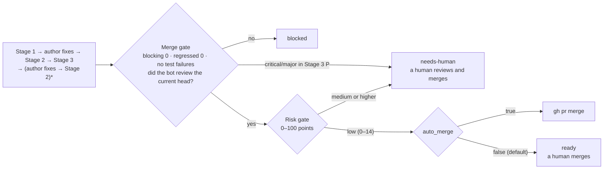

<p align="right">
  <strong>English</strong> | <a href="./README.ko.md">한국어</a> | <a href="./README.zh-CN.md">简体中文</a>
</p>

<p align="center">
  <picture>
    <source media="(prefers-color-scheme: dark)" srcset="assets/logo-dark.svg">
    
  </picture>
</p>

A Claude Code plugin that reviews your GitHub PRs with several Claude sessions, has an author session apply the review, checks the fixes, re-runs the build and tests, and uses a risk score to decide whether to merge.

Request a review from your bot account on a PR and the rest runs unattended. The review is posted like a human reviewer's: one summary plus inline comments on lines of code.

## How it works

| Stage | What it does |
|---|---|
| Stage 1 · review | Four judges review the PR on separate axes without seeing each other's results. A challenger re-checks every `critical`/`major` finding against the code, and three verifiers re-read the review. Up to 5 rounds |
| Author | A separate session (`/pr-quorum:author`) fixes the code and pushes to the PR branch with your gh account. It never force-pushes, merges, or approves |
| Stage 2 · followup | Replies in each thread with `addressed`, `partial`, `not-addressed`, or `regressed` (the fix introduced a new defect) |
| Stage 3 · measured | Re-runs the build and tests on the fixed commit and looks for defects the review missed (`P`) |



The risk gate scores only which files changed and by how much, not code quality. PRs that touch authentication, secrets, CI, build scripts, or the harness itself score higher and are never merged automatically. Rules: [`rules/03-risk.md`](rules/03-risk.md).

### Example

A review the bot left on a real PR. The review follows the PR's language.


Stage 1 left 2 nits and 1 praise. Stage 2 judged both nits `addressed`, Stage 3 found nothing missed, the risk score was 0 (`low`), and the chain merged it.

## Design choices

- **Evidence is graded.** A finding must cite a repository norm document, an official doc quotation, a `file:line`, or a result of running something. A claim beyond what its evidence supports is dropped ([`rules/00-criteria.md`](rules/00-criteria.md) §4).
- **No scores in the review.** Only four grades (`critical`, `major`, `minor`, `nit`), and at least one praise.
- **Confirmed facts are pinned** in `frozen.md`, so rounds don't re-argue them without new evidence.
- **Everything is inspectable.** Rules in [`rules/`](rules/), judge instructions in [`rules/02-judges.md`](rules/02-judges.md), gates in [`scripts/`](scripts/), and per-round logs in `~/.pr-quorum/runs/`.

### Where the criteria come from

The review axes and how far each goes are taken from published guidelines, and each rule stays within what its quotation says.

<details>
<summary>Sources and quotations</summary>

| Harness rule | Source | Sentence it rests on |
|---|---|---|
| Design is checked first — why `R-A` is the first axis and J1 wins in deduplication | Google, [What to look for in a code review](https://google.github.io/eng-practices/review/reviewer/looking-for.html) | "The most important thing to cover in a review is the overall design of the CL." |
| Concurrency is split out as its own axis (`R-C`) | Same document, Functionality section | "…if there is some sort of **parallel programming** going on in the CL that could theoretically cause deadlocks or race conditions." |
| Wording of the test axis verdict — not "are there tests" but "do they fail when it breaks" | Same document, Tests section | "Will the tests actually fail when the code is broken?" |
| At least one praise must always be written | Same document, Good Things section · [Conventional Comments](https://conventionalcomments.org/) | "If you see something nice in the CL, tell the developer…" · "Try to leave at least one of these comments per review." |
| Verdict wording is not "is this the ideal design" but "does it worsen code health" | Google, [The Standard of Code Review](https://google.github.io/eng-practices/review/reviewer/standard.html) | "reviewers should favor approving a CL once it is in a state where it definitely improves the overall code health of the system being worked on, even if the CL isn't perfect." |
| Taste without evidence goes no higher than `nitpick` | Same document | "On matters of style, the style guide is the absolute authority. Any purely style point (whitespace, etc.) that is not in the style guide is a matter of personal preference." |
| Comment labels — `issue (blocking)` · `suggestion` · `nitpick (non-blocking)` · `praise` | [Conventional Comments](https://conventionalcomments.org/) | Follows the label + parenthesized decoration (blocking / non-blocking) format as is |
| Why the first item of the security axis (`R-I`) is missing authorization | OWASP, [ASVS 5.0.0](https://github.com/OWASP/ASVS/blob/v5.0.0/5.0/en/0x17-V8-Authorization.md) V8 Authorization, 8.2.2 (Level 1) | "Verify that the application ensures that data-specific access is restricted to consumers with explicit permissions to specific data items to mitigate insecure direct object reference (IDOR) and broken object level authorization (BOLA)." |
| Basis for treating tokens or credentials left in logs as a defect | [Same standard](https://github.com/OWASP/ASVS/blob/v5.0.0/5.0/en/0x25-V16-Security-Logging-and-Error-Handling.md) V16 Security Logging and Error Handling, 16.2.5 (Level 2) | "Verify that when logging sensitive data, the application enforces logging based on the data's protection level. For example, it may not be allowed to log certain data, such as credentials or payment details. Other data, such as session tokens, may only be logged by being hashed or masked, either in full or partially." |

The test axis does not push hard because its source, *"Ask for unit, integration, or end-to-end tests **as appropriate** for the change."*, offers a choice, so "these tests are missing, so blocking" would go beyond it.

The Google eng-practices repository is archived (last push 2024-09-19); the quotations are from that date. ASVS is not run as a checklist: most of its requirements need configuration and runtime context that a PR diff does not show.

</details>

Axis definitions are in [`examples/profiles/`](examples/profiles/).

## Requirements

- macOS, or Linux including WSL2 on Windows. The scripts are bash and call no macOS-only commands; only the launchd watcher example is macOS-specific. Native Windows (PowerShell, cmd) is not supported
- [Claude Code](https://code.claude.com/docs), `gh` logged in with your own account, `jq`, `git`
- A separate GitHub bot account (see [Setup](#1-bot-account))
- Personal repositories you own. PRs opened by anyone else are skipped

## Installation

To call the skills from a normal Claude Code session, install from the marketplace:

```
/plugin marketplace add thswlsqls/pr-quorum
/plugin install pr-quorum@pr-quorum
```

The unattended chain does **not** use that install. It runs with `--setting-sources ""` (so user-enabled plugins are not loaded) and needs a fixed path, so it loads a clone with `--plugin-dir`. In this document `<plugin-dir>` is the absolute path of that clone.

```bash
git clone https://github.com/thswlsqls/pr-quorum.git <plugin-dir>
```

Keep this clone on main and make harness changes in a different clone or worktree, so a half-edited harness never runs a real review.

## Setup

### 1. Bot account

Create your own GitHub bot account; there is no shared bot.

- Invite it to each repository as a **collaborator with read**. That is enough to receive review requests.
- Create a PAT for it with scope `public_repo`.
- Keep it at read. `public_repo` can write to public repositories, so raising the bot to write lets this token push.

The bot only posts reviews and comments. It never approves or requests changes.

### 2. Token file

```bash
mkdir -p ~/.config/pr-quorum
cat > ~/.config/pr-quorum/bot.env <<'ENV'
PR_QUORUM_BOT_TOKEN=<bot-PAT>
ENV
chmod 600 ~/.config/pr-quorum/bot.env
```

`GH_TOKEN` also works as the key name. Only `scripts/pr-quorum.sh` reads this file; review sessions are denied access. Never commit it.

### 3. `~/.pr-quorum/config.json`

```bash
mkdir -p ~/.pr-quorum/profiles
cp <plugin-dir>/templates/config.json ~/.pr-quorum/config.json
touch ~/.pr-quorum/learnings.md ~/.pr-quorum/human-labels.md
```

| Key | Meaning |
|---|---|
| `owner` | Your GitHub login. The watcher looks for review requests in this owner's repositories |
| `bot` | The bot login from step 1. Must match the token's account |
| `auto_merge` | Whether the chain merges a PR that passed both gates. Default `false`: the chain stops at `ready` |
| `repos` | Per repository name: the absolute path of its local clone (`path`) and the profile to use (`profile`) |

`learnings.md` collects lessons across PRs and is read by review sessions. `human-labels.md` is where you grade the bot's comments. Each PR gets a worktree under `<repo-name>-worktrees/` next to the repository clone.

### 4. Profile

A profile defines the review axes and what each judge does and does not look at. Copy a sample and adapt it to your repository; the file name is the `profile` value.

```bash
cp <plugin-dir>/examples/profiles/backend.md ~/.pr-quorum/profiles/backend.md
```

The samples ([`backend.md`](examples/profiles/backend.md), [`frontend.md`](examples/profiles/frontend.md)) were written for a Spring Boot backend and a Next.js frontend.

### 5. Watcher (optional)

The watcher polls every 60 seconds for review requests to the bot. Without it, requesting a review does nothing and you run the chain by hand ([Usage](#usage)). On macOS, save the following as `~/Library/LaunchAgents/io.github.thswlsqls.pr-quorum.plist` and run `launchctl load` on it. `caffeinate -i` keeps the machine awake.

```xml
<?xml version="1.0" encoding="UTF-8"?>
<!DOCTYPE plist PUBLIC "-//Apple//DTD PLIST 1.0//EN" "http://www.apple.com/DTDs/PropertyList-1.0.dtd">
<plist version="1.0">
<dict>
  <key>Label</key><string>io.github.thswlsqls.pr-quorum</string>
  <key>ProgramArguments</key>
  <array>
    <string>/usr/bin/caffeinate</string>
    <string>-i</string>
    <string><plugin-dir>/scripts/watch.sh</string>
  </array>
  <key>StartInterval</key><integer>60</integer>
  <key>WorkingDirectory</key><string><plugin-dir></string>
  <key>EnvironmentVariables</key>
  <dict>
    <key>PATH</key><string><dirs-containing-claude-gh-jq-git></string>
  </dict>
  <key>StandardOutPath</key><string><home-dir>/Library/Logs/pr-quorum-watch.log</string>
  <key>StandardErrorPath</key><string><home-dir>/Library/Logs/pr-quorum-watch.log</string>
</dict>
</plist>
```

To test it once without launchd, run `<plugin-dir>/scripts/watch.sh --once`. The watcher handles one PR at a time; requests made while the machine was off are picked up when it comes back.

On Linux (a cloud VM, or WSL2 on Windows), run `watch.sh` every minute from cron or a systemd timer instead. Leave out `caffeinate`, which is macOS-only.

Log in `gh` with `gh auth login --with-token`. For Claude Code, run `claude setup-token` and put the token it prints in the job's environment as `CLAUDE_CODE_OAUTH_TOKEN`: the command does not save it, and cron and systemd do not read your shell profile.

launchd does not start the watcher again while it is still running a chain; cron does, so wrap it in `flock -n`. Without it, the next tick starts the next PR alongside the running one. If the tick lands before the running PR's Stage 1 review is posted and while no session holds its lock, it also starts a second chain on that PR and counts another attempt, which can stop it at `held-failed` after one real try. As with the plist, set `PATH` so cron finds `claude`, `gh`, `jq`, and `git`. cron does not expand `$HOME` or other variables in these lines:

```
# crontab -e
PATH=<dirs-containing-claude-gh-jq-git>:/usr/bin:/bin
CLAUDE_CODE_OAUTH_TOKEN=<token from claude setup-token>
* * * * * cd <plugin-dir> && flock -n <home-dir>/.pr-quorum/watch.lock scripts/watch.sh >> <home-dir>/.pr-quorum/watch.log 2>&1
```

With systemd, a timer with `OnBootSec=1min` and `OnUnitActiveSec=1min` that starts a `Type=oneshot` service needs no `flock`: the timer does not start the service again while it is still running. `OnUnitActiveSec=` alone never fires, because the service has not run yet. Set `PATH` and `CLAUDE_CODE_OAUTH_TOKEN` with `Environment=` or `EnvironmentFile=` in the service. For a user timer, run `loginctl enable-linger` so it keeps running after you log out.

On WSL2, enable systemd with `systemd=true` under `[boot]` in `/etc/wsl.conf`, then run `wsl --shutdown`, so cron or the timer starts with the distro. WSL shuts down a distro once it has been idle for 15 seconds (`instanceIdleTimeout`), for example after the last WSL terminal closes. Keep a terminal open, or set `instanceIdleTimeout=-1` under `[general]` in `%UserProfile%\.wslconfig`.

## Usage

`<repo>` below is a repository name under `repos` in `config.json`, and `<pr>` is the PR number.

### Review a PR

Open the PR (not as a draft) and add the bot account as a reviewer. Within a minute the watcher starts the chain, which runs Stage 1 through the merge decision.

Follow progress in the watcher log, or in the PR's state file:

```bash
tail -f ~/Library/Logs/pr-quorum-watch.log
jq '{status, chain}' ~/.pr-quorum/runs/<repo>-pr<pr>/meta.json
```

The chain ends in one of these states (`chain.state`):

| State | Meaning | What to do |
|---|---|---|
| `merged` | Passed both gates with `auto_merge: true` | Nothing |
| `ready` | Passed both gates; `auto_merge` is off | Merge it yourself |
| `needs-human` | Risk is `medium` or higher, or Stage 3 found missed `critical`/`major` defects | Review and decide yourself. The risk scorecard is on the PR |
| `blocked` | Merge gate failed, a merge conflict, a session left no record, or the head moved | Read `chain.reason`, fix the cause, then run the chain again |

### Run the chain by hand

Without the watcher, or to resume a `blocked` chain, run it directly. It resumes where it stopped.

```bash
<plugin-dir>/scripts/chain.sh <repo> <pr>
```

### Run one stage

To run a single stage interactively, start Claude Code with the same permissions the chain uses. A plain session does not have them. `~/.pr-quorum/settings.json` exists after `chain.sh` has run once.

```bash
claude --settings ~/.pr-quorum/settings.json --setting-sources "" --plugin-dir <plugin-dir> \
  --permission-mode dontAsk --mcp-config <plugin-dir>/mcp.json --strict-mcp-config
```

Then, inside the session:

```
/pr-quorum:review stage1 <repo> <pr>
/pr-quorum:review stage2 <repo> <pr>
/pr-quorum:review stage3 <repo> <pr>
/pr-quorum:author <repo> <pr>
```

PRs over 50 changed files or 3,000 changed lines are held as `held-large`. To review one anyway, add `--approve` to Stage 1.

### Maintenance

| Command | When |
|---|---|
| `git -C <plugin-dir> pull --ff-only` | To get a new version into the chain. The clone does not update itself |
| `<plugin-dir>/scripts/dream.sh [<repo>-pr<N>...]` | Summarizes learning candidates from past runs into `~/.pr-quorum/runs/_dream/<time>/proposal.md`. You decide what goes into `learnings.md` |
| `<plugin-dir>/scripts/risk-audit.sh <repo> [N]` | Lists the risk score of the last N merged PRs (default 30) next to any fix or revert within 14 days, to tune the auto-merge threshold |
| `<plugin-dir>/scripts/selftest.sh` | After changing a gate script. Re-runs the gates on past outputs without an LLM |

For the marketplace install, `claude plugin update pr-quorum@pr-quorum` picks up a release when `version` goes up. Changes are in [`CHANGELOG.md`](CHANGELOG.md).

## Security

Each chain session runs with `claude -p --settings <rendered-settings-file> --permission-mode dontAsk`, which refuses any tool not on the allow list ([`templates/`](templates/)). Review sessions can write only under `~/.pr-quorum/runs/`, post to GitHub only through `scripts/pr-quorum.sh`, and cannot read the token file. The author session pushes only through `scripts/author-push.sh`, which refuses force pushes and other branches.

Other safeguards:

- Only PRs opened by the repository owner run. The watcher filters them and `chain.sh` checks again.
- PR descriptions, comments, and diffs are treated as data, not instructions. The author session takes tasks only from the bot's comments.

Known risks that remain:

- **The token file can be read indirectly.** The deny rule only matches commands that name the file; `cd ~/.config/pr-quorum && grep -r TOKEN .` is not blocked.
- **The build and tests run the PR's code** (`./gradlew`, `npm run build`). This is acceptable only because the chain runs on the owner's own PRs.
- **Test results are self-reported.** The merge gate reads them from a file the author session writes. This is why `auto_merge` is off by default.

Enabling Claude Code's [sandbox](https://code.claude.com/docs/en/sandboxing) to block `~/.config` reads and network access at the OS level reduces all three.

## Limitations

- **Unvalidated.** No human has yet graded whether the reviews were right (`human-labels.md` is empty), so "a stricter process gives better reviews" is untested.
- **Expensive.** About $30 per full chain for a 30–70 line PR. A 9-file, ~400-line PR took about 47 minutes. These figures come from `total_cost_usd` and may not include subagent cost.
- **Tested on one backend repository.** The frontend profile has never run.
- **Risk rules are fitted to the repository they were written for** (`common/security/`, `filter/`, `/api/bff/auth/`, …). Check [`rules/03-risk.md`](rules/03-risk.md) and `scripts/risk.jq` against your repository before turning on `auto_merge`.
- **Personal repositories only.** In an organization, PRs from members are skipped too.
- **GitHub only, one machine.** The watcher polls, so the machine must be on.
- **Real reviews have run on macOS only.** On Linux, `selftest.sh` and the cron + `flock` watcher were checked in an Ubuntu 24.04 container with stand-in `gh` and `claude` commands. A real review on Linux, the systemd timer, and WSL2 have not been run.
- **Path restrictions.** The plugin path must not contain `|` or `&`, and repository paths in `config.json` must not contain `*` or `[`.
- Script-generated scorecards and notices are in English; review text follows the PR's language.

## Contributing

Issues and PRs are welcome. See [`CONTRIBUTING.md`](CONTRIBUTING.md).

## License

[MIT](LICENSE)
