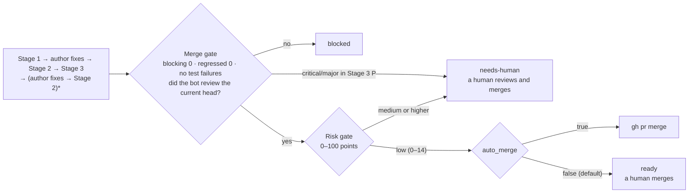

<p align="right">
  <a href="./README.md">English</a> | <a href="./README.ko.md">한국어</a> | <strong>简体中文</strong>
</p>

> 本文译自[英文版](./README.md)。内容不一致时以英文版为准。基准: `README.md` @ `67e2516`

<p align="center">
  <picture>
    <source media="(prefers-color-scheme: dark)" srcset="assets/logo-dark.svg">
    
  </picture>
</p>

一个 Claude Code 插件：把 GitHub PR 的审查分给多个 Claude 会话完成，在作者处理审查意见后再次核对并重新测量，并用风险分数决定是否合并。
在 PR 上把机器人账号指定为审查者即开始审查，审查结果像人类审查者一样发布：一条摘要加上附在代码行上的行内评论。

它原本是在个人仓库（tech-n-ai-backend）的 `tools/pr-eval/` 中运行的工具链（harness），现已迁移为插件。下文中的 PR 编号均指该仓库中的 PR。

## 功能

审查分三个阶段进行。如果只审查一次就结束，就没有人去核对意见是否真的被处理，也没有人检查审查是否遗漏了什么。

| 阶段 | 问题 | 做什么 |
|---|---|---|
| Stage 1 · review | 这个 PR 有哪些缺陷？ | 四个评审者（judge）分担审查维度，在互相看不到结果的情况下寻找缺陷。挑战者（challenger）对照实际代码复核每条 `critical`（致命）/`major`（重大）意见，三个验证者（verifier）分别从证据、引用和作者的角度重读审查。未达到标准时再跑一轮，最多 5 轮 |
| Stage 2 · followup | 作者是否按审查要求做了？ | 在每条评论的讨论串中回复一个判定：`addressed`（已处理，반영）、`partial`（部分处理，부분）、`not-addressed`（未处理，미반영）或 `regressed`（倒退，역행）。`regressed` 表示修改引入了新的缺陷 |
| Stage 3 · measured | 审查经得起测量吗？ | 在包含修改的提交上重新运行构建和测试，并寻找审查遗漏的缺陷（`P`） |

评审者、挑战者和验证者都以 `pr-quorum:judge` 代理运行，由 `/pr-quorum:review` 技能驱动各阶段。
处理审查意见的不是机器人，而是单独的作者会话（`/pr-quorum:author`）。作者会话只用用户的 gh 账号推送到 PR 分支，从不强制推送、合并或批准。

机器人被指定为审查者后，监视器（`scripts/watch.sh`）会在 60 秒内发现并启动链（`scripts/chain.sh`）。链在无人参与的情况下按以下顺序运行。



风险门禁不判断代码好坏，只根据改了哪些文件、改了多少来打分。涉及认证代码、密钥、CI、构建脚本或工具链本身的 PR 分数更高，不会被自动合并。机器人会把评分表作为 PR 评论留下。规则见 [`rules/03-risk.md`](rules/03-risk.md)。

## 真实审查示例

这是机器人在 tech-n-ai-backend PR #34 上留下的审查（该 PR 是一次重构，把新技术的批量保存从每条一次往返改为一次批量往返）。

审查摘要。先列出可能阻止合并的内容，再用表格列出每个审查维度指出了什么、无法验证什么。


一条行内评论。它附在问题所在的行上，并写明作为证据引用的文件和行号。中间是作者的回复，下方是作者修改后机器人在同一讨论串中留下的 Stage 2 判定。


该 PR 使用韩语，所以机器人也用韩语撰写。截图中的韩语与现在使用的 ID 对应如下：반영 → `addressed`，부분 → `partial`，미반영 → `not-addressed`，역행 → `regressed`，치명 → `critical`，중대 → `major`，경미 → `minor`，사소 → `nit`。

在这个 PR 上，Stage 1 留下了 6 条评论（其中 1 条是表扬）。作者修改后，Stage 2 判定 5 条 `addressed`（반영）、1 条 `partial`（부분），Stage 3 又发现了 1 处审查遗漏的测试缺口。

## 与其他审查工具的区别

这里只列出运行记录和规则文档能够证实的内容。它说明的是流程更严格，而不是证明审查更准确（见下文“尚不清楚的事”）。

- **它对证据分级，并单独检查引用是否真的支持结论。** 证据分为四类：仓库的规范性文档、官方文档的引用、代码中的 `file:line`，以及直接运行得到的结果。超出其等级所允许范围的主张会作为无效被丢弃。引用本身正确但结论超出引用范围的情况，由验证者 V2 发现（[`rules/00-criteria.md`](rules/00-criteria.md) §4、[`rules/02-judges.md`](rules/02-judges.md) §6）。
- **它单独判断修改是否让情况变得更糟（`regressed`），并在修改后重新测量。** PR #33 的第一次 Stage 2 得出 2 条 `regressed` 和 1 条 `not-addressed`，Stage 3 发现了遗漏的缺陷：#33 上 2 处，#34 上 1 处。
- **它把已确认的事实固定在 `frozen.md` 中。** 为避免每轮重复同样的争论，推翻已确认的事实需要提出该事实错误的新证据（失效条件 I-4）。
- **规则、提示词和门禁全部公开，可查看、可修改。** 规则在 [`rules/`](rules/)，给评审者的指令在 [`rules/02-judges.md`](rules/02-judges.md)，门禁在 [`scripts/`](scripts/)。可以通过 `~/.pr-quorum/runs/` 中的各轮日志追溯某条意见被提出的原因。

审查不使用分数。总分会让作者去争论分数而不是修改代码，所以只有四个等级：`critical`、`major`、`minor`（轻微）、`nit`（细枝末节）。审查中始终至少写一条表扬。

### 标准的出处

审查维度的顺序以及每个维度的范围来自公开的代码审查指南。本工具链会丢弃超出引用内容的主张，因此规则本身也限定在其引用的范围内。

| 工具链规则 | 出处 | 所依据的句子 |
|---|---|---|
| 先检查设计——这就是 `R-A` 作为第一个维度、去重时 J1 优先的原因 | Google, [What to look for in a code review](https://google.github.io/eng-practices/review/reviewer/looking-for.html) | "The most important thing to cover in a review is the overall design of the CL." |
| 并发单独作为一个维度（`R-C`） | 同一文档，Functionality 一节 | "…if there is some sort of **parallel programming** going on in the CL that could theoretically cause deadlocks or race conditions." |
| 测试维度判定的措辞——不是“有没有测试”，而是“代码坏了测试会不会失败” | 同一文档，Tests 一节 | "Will the tests actually fail when the code is broken?" |
| 始终至少写一条表扬 | 同一文档，Good Things 一节 · [Conventional Comments](https://conventionalcomments.org/) | "If you see something nice in the CL, tell the developer…" · "Try to leave at least one of these comments per review." |
| 判定措辞不是“这是不是理想的设计”，而是“是否损害代码健康度” | Google, [The Standard of Code Review](https://google.github.io/eng-practices/review/reviewer/standard.html) | "reviewers should favor approving a CL once it is in a state where it definitely improves the overall code health of the system being worked on, even if the CL isn't perfect." |
| 没有证据的个人偏好最高只到 `nitpick` | 同一文档 | "On matters of style, the style guide is the absolute authority. Any purely style point (whitespace, etc.) that is not in the style guide is a matter of personal preference." |
| 评论标签——`issue (blocking)` · `suggestion` · `nitpick (non-blocking)` · `praise` | [Conventional Comments](https://conventionalcomments.org/) | 原样沿用“标签 + 括号修饰（blocking / non-blocking）”的格式 |
| 安全维度（`R-I`）的第一项为何是缺少授权 | OWASP, [ASVS 5.0.0](https://github.com/OWASP/ASVS/blob/v5.0.0/5.0/en/0x17-V8-Authorization.md) V8 Authorization, 8.2.2 (Level 1) | "Verify that the application ensures that data-specific access is restricted to consumers with explicit permissions to specific data items to mitigate insecure direct object reference (IDOR) and broken object level authorization (BOLA)." |
| 把日志中残留的令牌或凭据视为缺陷的依据 | [同一标准](https://github.com/OWASP/ASVS/blob/v5.0.0/5.0/en/0x25-V16-Security-Logging-and-Error-Handling.md) V16 Security Logging and Error Handling, 16.2.5 (Level 2) | "Verify that when logging sensitive data, the application enforces logging based on the data's protection level. For example, it may not be allowed to log certain data, such as credentials or payment details. Other data, such as session tokens, may only be logged by being hashed or masked, either in full or partially." |

这也是测试维度不强硬要求的原因。它所依据的句子 *"Ask for unit, integration, or end-to-end tests **as appropriate** for the change."* 给出的是选择，因此写“缺少这些测试，所以 blocking”就超出了引用所支持的范围。

> Google eng-practices 仓库已归档（最后一次推送为 2024-09-19）。上面的引用来自该日期的文档。
>
> ASVS 并不作为检查清单执行。这两条引用只作为安全维度定义的依据。该标准的许多要求只有查看配置、架构和运行环境才能判断，而机器人看到的是 PR 的 diff，所以执行整份清单只会产生大量找不到可引用代码行作为证据的意见。

审查维度的定义，以及每个维度看什么、不看什么，见 [`examples/profiles/`](examples/profiles/)。

## 尚不清楚的事

- **没有人工判断审查是否正确。** 用于由人把已发布评论标记为正确、错误或越界的 `human-labels.md` 是空的。因此本工具链“流程越严格，审查越好”的假设尚未得到检验。
- **成本高。** 对一个 30–70 行的 PR，完整的链大约花费 $30（#52 $30.2，#55 $28.2）。迁移为插件后运行的第一个 PR #61（9 个文件，新增 384 行，删除 13 行）从 Stage 1 到作者第二轮处理用了约 47 分钟，记录的总成本为 $29.54。不过，我们尚未确认这个成本值（`claude -p` 的 `total_cost_usd`）是否涵盖整个会话，包括评审者、挑战者、验证者等子代理。如果不涵盖，实际成本会更高。
- **实际只在一个后端仓库上运行过。** [`examples/profiles/frontend.md`](examples/profiles/frontend.md) 只是草稿，没有在前端 PR 上运行的记录。

## 安装

通过插件市场安装：

```
/plugin marketplace add thswlsqls/pr-quorum
/plugin install pr-quorum@pr-quorum
```

使用 Claude Code 2.1.275 或更高版本时，也可以在会话中用一行完成。

```
/plugin install pr-quorum --marketplace thswlsqls/pr-quorum
```

通过插件市场安装的插件，只有在 `.claude-plugin/plugin.json` 中的 `version` 提高时才会收到新版本。如果有提交合并到 main 但版本号不变，已安装的插件不会变化（[官方文档](https://code.claude.com/docs/en/plugins/host-marketplace#release-a-new-version)）。按如下方式在 shell 中获取新版本。各版本的变更见 [`CHANGELOG.md`](CHANGELOG.md)。

```bash
claude plugin update pr-quorum@pr-quorum
```

**不过，无人值守的链不使用插件市场安装的版本，而是用 `--plugin-dir` 加载克隆下来的文件夹。** 原因有两个。

- 从插件市场安装的插件位于 `~/.claude/plugins/cache/` 下按版本划分的文件夹中，每次更新路径都会变。launchd 配置没有固定路径可指向。
- 为了让工具权限与本机设置相互隔离，链不读取用户设置（`--setting-sources ""`）。因此在用户设置中启用的安装不会被加载到链的会话中。

所以对于链，请克隆仓库，并让监视器和手动运行都指向该文件夹。本文中 `<plugin-dir>` 指该克隆的绝对路径。

```bash
git clone https://github.com/thswlsqls/pr-quorum.git <plugin-dir>
```

**让运行用的克隆与开发用的副本分开。** 用 `--plugin-dir` 加载的插件在每次会话启动时读取该文件夹中当时的文件。让监视器指向只跟踪 main 的克隆，在另一个克隆或 worktree 中修改工具链。这样改到一半的工具链就不会执行真实的审查。

**运行用的克隆不会自动更新。** 用 `--plugin-dir` 加载的克隆按原样读取克隆中的文件，与 `version` 无关。因此 `claude plugin update` 不会改变它，即使有新提交合并到 main，链也仍在克隆中的旧文件上运行。要使用这些变更，请自行用 `git pull` 拉取。

```bash
git -C <plugin-dir> switch main && git -C <plugin-dir> pull --ff-only
```

## 一次性设置

需要 `claude`、`gh`（以你的用户账号登录）、`jq` 和 `git`。监视器示例针对 macOS launchd。

### 1. 机器人账号

每个使用本插件的人都要自己另建一个用于发布审查的 GitHub 机器人账号。没有共用的机器人。

- 把它以 **read 权限的协作者（collaborator）** 身份邀请到要审查的仓库。read 权限足以接收审查请求。
- 令牌使用该机器人账号的 PAT，scope 为 `public_repo`。
- 机器人只发布审查和评论，不批准也不请求修改。如果由机器人掌握合并决定，人们就会为了通过机器人而扭曲审查。

阻止机器人修改代码的唯一手段是协作者的 read 角色。`public_repo` scope 包含对公开仓库的写权限，所以一旦把机器人提升为 write，这个令牌就能推送。

### 2. 令牌文件

```bash
mkdir -p ~/.config/pr-quorum
cat > ~/.config/pr-quorum/bot.env <<'ENV'
PR_QUORUM_BOT_TOKEN=<bot-PAT>
ENV
chmod 600 ~/.config/pr-quorum/bot.env
```

键名使用 `PR_QUORUM_BOT_TOKEN` 或 `GH_TOKEN` 均可。只有一个写入 GitHub 的脚本（`scripts/pr-quorum.sh`）会在内部读取此文件，审查会话被禁止读取它。**不要把它提交到任何仓库。**

### 3. `~/.pr-quorum/config.json`

按 PR 累积的状态和设置统一放在插件之外的 `~/.pr-quorum/` 中。复制示例 [`templates/config.json`](templates/config.json) 后进行修改。

```bash
mkdir -p ~/.pr-quorum/profiles
cp <plugin-dir>/templates/config.json ~/.pr-quorum/config.json
touch ~/.pr-quorum/learnings.md ~/.pr-quorum/human-labels.md
```

| 键 | 含义 |
|---|---|
| `owner` | 要审查的仓库所属的 GitHub owner 登录名。监视器在该 owner 的仓库中查找发给机器人的审查请求 |
| `bot` | 第 1 步创建的机器人账号登录名。必须与令牌文件对应的账号一致 |
| `auto_merge` | 链是否合并通过了两道门禁的 PR。默认为 `false`，此时链停在 `ready`，只留下风险评分表 |
| `repos` | 按仓库名指定其本地克隆的绝对路径（`path`）和要使用的配置档名（`profile`） |

`learnings.md` 是跨 PR 累积的学习记录，审查会话会读取它。`human-labels.md` 是由人来评判机器人评论的表格。两者都从空文件开始。
链会在每个仓库克隆旁边放一个 `<repo-name>-worktrees/` 文件夹，并在其中为每个 PR 创建一个 worktree。

### 4. 配置档

配置档（profile）是定义审查维度以及每个评审者看什么、不看什么的文档。复制一个示例并按你的仓库结构调整。文件名即 `config.json` 中的 `profile` 值。

```bash
cp <plugin-dir>/examples/profiles/backend.md ~/.pr-quorum/profiles/backend.md
```

两个示例（[`backend.md`](examples/profiles/backend.md) · [`frontend.md`](examples/profiles/frontend.md)）是为 tech-n-ai 的 Spring Boot 后端和 Next.js 前端编写的。

### 5. 监视器（可选）

监视器不运行时，指定审查者不会有任何效果。在 macOS 上，把以下内容放入 `~/Library/LaunchAgents/io.github.thswlsqls.pr-quorum.plist` 并运行 `launchctl load`。它用 `caffeinate -i` 包裹，使机器不会进入睡眠。

```xml
<?xml version="1.0" encoding="UTF-8"?>
<!DOCTYPE plist PUBLIC "-//Apple//DTD PLIST 1.0//EN" "http://www.apple.com/DTDs/PropertyList-1.0.dtd">
<plist version="1.0">
<dict>
  <key>Label</key><string>io.github.thswlsqls.pr-quorum</string>
  <key>ProgramArguments</key>
  <array>
    <string>/usr/bin/caffeinate</string>
    <string>-i</string>
    <string><plugin-dir>/scripts/watch.sh</string>
  </array>
  <key>StartInterval</key><integer>60</integer>
  <key>WorkingDirectory</key><string><plugin-dir></string>
  <key>EnvironmentVariables</key>
  <dict>
    <key>PATH</key><string><dirs-containing-claude-gh-jq-git></string>
  </dict>
  <key>StandardOutPath</key><string><home-dir>/Library/Logs/pr-quorum-watch.log</string>
  <key>StandardErrorPath</key><string><home-dir>/Library/Logs/pr-quorum-watch.log</string>
</dict>
</plist>
```

只运行一次时，使用 `<plugin-dir>/scripts/watch.sh --once`。
监视器按顺序一次处理一个 PR，机器关机时不运行。重新开机后，它会先处理积压的 PR。

## 安全措施与遗留风险

**工具权限由命令行设定，而不是由插件设定。** 链用 `claude -p --settings <rendered-settings-file> --permission-mode dontAsk` 启动每个会话，不在允许列表中的工具一律直接拒绝、不作询问。审查会话不能修改 `~/.pr-quorum/runs/` 以外的任何内容，只能通过指定脚本写入 GitHub，也不能读取机器人令牌文件。`chain.sh` 每次运行时都会从 [`templates/`](templates/) 中的模板把设置文件渲染到 `~/.pr-quorum/`。

所以 **当人以交互方式调用 `/pr-quorum:review` 时，这层保护不存在。** 手动运行时如需相同权限，请按如下方式启动。`~/.pr-quorum/settings.json` 在 `chain.sh` 运行过一次后才存在。

```bash
claude --settings ~/.pr-quorum/settings.json --setting-sources "" --plugin-dir <plugin-dir> \
  --permission-mode dontAsk --mcp-config <plugin-dir>/mcp.json --strict-mcp-config
```

其他安全措施：

- 链只接受仓库 owner 开启的 PR。监视器先过滤一次，`chain.sh` 启动时再检查一次。这样可以避免他人撰写的 PR 描述或 diff 进入以用户账号推送和合并的会话。
- 审查会话把 PR 描述、评论和 diff 中的文档当作数据，而不是指令。作者会话只从机器人账号发出的评论中接受任务。
- 作者会话只通过 `scripts/author-push.sh` 推送，该脚本拒绝强制推送和推送到其他分支。

**有三项风险尚未解决。**

- **不写出文件名而读取令牌文件的命令不会被阻止。** 禁止读取令牌文件夹的规则只对写明该文件的命令生效。官方文档指出，像 `cd ~/.config/pr-quorum && grep -r TOKEN .` 这样不使用文件名的命令不会被阻止，而审查会话和作者会话都可以使用 `cd` 和 `grep`。
- **构建和测试会执行 PR 中的代码。** `./gradlew` 和 `npm run build` 会原样运行 PR 中的构建脚本。“链只在仓库 owner 开启的 PR 上运行”这一检查是承受该风险的前提。
- **测试结果是会话对自身的报告值。** 合并门禁从作者会话写入的文件中读取测试是否通过以及剩余多少 blocking 意见。改用 CI 结果只对有 CI 的仓库有意义，因此改为默认关闭 `auto_merge`。

启用 Claude Code 的 [沙箱](https://code.claude.com/docs/en/sandboxing)，在操作系统层面阻止读取 `~/.config` 和网络访问，这三项风险都会减小。仅靠权限 deny 规则无法限制所运行的程序。

## 范围与限制

- **它是为个人仓库设计的。** 链只接受 `author_association == OWNER` 的 PR。在组织仓库中，成员开启的 PR 也会被跳过。它采用失败即关闭（fail closed）的方式，有人提出需求时再修改。
- **风险分数规则是按 tech-n-ai 的结构定制的。** 风险分数只使用变更的文件路径和行数，所以同样的 diff 总是得到同样的分数。但路径规则（`common/security/`、Gateway 的 `filter/`、`/api/bff/auth/` 等）是按 tech-n-ai 定制的，在其他仓库中修改认证代码可能不会提高分数。这就是 `auto_merge` 默认关闭的原因。开启前，请确认 [`rules/03-risk.md`](rules/03-risk.md) 和 `scripts/risk.jq` 也适合你的仓库。
- **不审查大型 PR。** 如果变更的文件超过 50 个，或新增加删除的行数超过 3,000，链会搁置该 PR，只在上面留下通知。
- **路径中不能出现某些字符。** 链用 `sed` 填充设置模板，因此如果插件文件夹路径包含 `|` 或 `&`，或 `config.json` 中的仓库路径包含 `*` 或 `[`，权限规则就会失效。
- **只支持 GitHub，且只在单台机器上运行。** 监视器采用轮询，所以机器必须开着。
- **审查文字使用 PR 的语言。** 由脚本生成的风险评分表和通知是英文的。

## 改进建议

`learnings.md` 按用户分别累积在 `~/.pr-quorum/` 中。如果 `scripts/dream.sh` 给出的提案中有也适用于其他仓库的条目，欢迎在本仓库提 issue 或 PR。外部提交的 PR 由人审查，而不是由链审查。

修改或运维插件时应阅读的内部文档是 [`docs/harness.md`](docs/harness.md)。其中包括脚本约定、输出规格以及经测量确认的事实。

## 许可证

[MIT](LICENSE)
