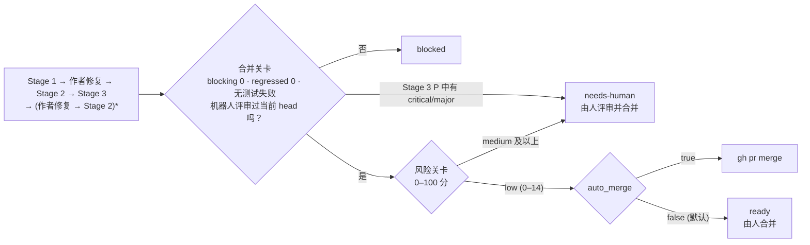

<p align="right">
  <a href="./README.md">English</a> | <a href="./README.ko.md">한국어</a> | <strong>简体中文</strong>
</p>

> 本文译自[英文版](./README.md)。内容不一致时以英文版为准。基准: `README.md` @ `9d15413`

<p align="center">
  <picture>
    <source media="(prefers-color-scheme: dark)" srcset="assets/logo-dark.svg">
    
  </picture>
</p>

一个让多个 Claude 会话分工评审 GitHub PR 的 Claude Code 插件。作者会话落实评审意见后，它核对修复、重新运行构建和测试，再用风险分决定是否合并。

在 PR 上把机器人账号设为评审人，其余流程无人值守地完成。评审像人类评审一样发布：一条总结，加上挂在代码行上的行内评论。

## 工作方式

| 阶段 | 做什么 |
|---|---|
| Stage 1 · review | 四名评审员分担评审维度，互不知晓对方结果地评审。质询者对每条 `critical`(致命)/`major`(重大) 意见对照代码复查，三名核验者重读评审。最多 5 轮 |
| 作者 | 独立的会话(`/pr-quorum:author`)修改代码，用你的 gh 账号推送到 PR 分支。从不强制推送、合并或批准 |
| Stage 2 · followup | 在每个讨论串中回复 `addressed`(已落实)、`partial`(部分)、`not-addressed`(未落实) 或 `regressed`(倒退，修复引入了新缺陷) |
| Stage 3 · measured | 在修复后的提交上重新运行构建和测试，查找评审遗漏的缺陷(`P`) |



风险关卡不评判代码质量，只看改了哪些文件、改了多少。涉及认证、密钥、CI、构建脚本或 harness 自身的 PR 分数更高，不会被自动合并。规则见 [`rules/03-risk.md`](rules/03-risk.md)。

### 示例

机器人在一个真实 PR 上留下的评审。评审文字跟随 PR 的语言。


Stage 1 留下了 1 条 nitpick 和 2 条表扬。Stage 2 判定这条 nitpick 为 `addressed`，Stage 3 未发现遗漏，风险分 0(`low`)，链路完成了合并。

## 设计取舍

- **证据分级。** 每条意见必须引用仓库规范文档、官方文档原文、`file:line` 或亲自运行的结果之一。超出证据支撑范围的主张会被剔除([`rules/00-criteria.md`](rules/00-criteria.md) §4)。
- **评审不打分。** 只有 `critical`、`major`、`minor`(轻微)、`nit`(琐碎) 四个等级，并且至少写一条值得肯定之处。
- **已确认的事实固定在 `frozen.md` 中**，没有新证据时各轮不再重复争论。
- **一切都可查看。** 规则在 [`rules/`](rules/)，评审员指令在 [`rules/02-judges.md`](rules/02-judges.md)，关卡在 [`scripts/`](scripts/)，逐轮记录在 `~/.pr-quorum/runs/`。

### 标准的出处

评审维度及各维度的边界取自公开的指南，每条规则都不超出其引文所说的范围。

<details>
<summary>出处与引文</summary>

| Harness 规则 | 出处 | 所依据的句子 |
|---|---|---|
| 最先检查设计 — 这是 `R-A` 为第一维度、去重时 J1 优先的原因 | Google, [What to look for in a code review](https://google.github.io/eng-practices/review/reviewer/looking-for.html) | "The most important thing to cover in a review is the overall design of the CL." |
| 将并发单独拆为一个维度(`R-C`) | 同一文档，Functionality 节 | "…if there is some sort of **parallel programming** going on in the CL that could theoretically cause deadlocks or race conditions." |
| 测试维度的判定措辞 — 不是"有没有测试"，而是"代码坏了时测试会不会失败" | 同一文档，Tests 节 | "Will the tests actually fail when the code is broken?" |
| 必须至少写一条值得肯定之处 | 同一文档 Good Things 节 · [Conventional Comments](https://conventionalcomments.org/) | "If you see something nice in the CL, tell the developer…" · "Try to leave at least one of these comments per review." |
| 判定措辞不是"这是否是理想设计"，而是"是否让代码健康度变差" | Google, [The Standard of Code Review](https://google.github.io/eng-practices/review/reviewer/standard.html) | "reviewers should favor approving a CL once it is in a state where it definitely improves the overall code health of the system being worked on, even if the CL isn't perfect." |
| 没有依据的个人偏好最多只写到 `nitpick` | 同一文档 | "On matters of style, the style guide is the absolute authority. Any purely style point (whitespace, etc.) that is not in the style guide is a matter of personal preference." |
| 评论标签 — `issue (blocking)` · `suggestion` · `nitpick (non-blocking)` · `praise` | [Conventional Comments](https://conventionalcomments.org/) | 原样沿用"标签 + 括号修饰(blocking / non-blocking)"的格式 |
| 安全维度(`R-I`)的第一项是授权缺失的原因 | OWASP, [ASVS 5.0.0](https://github.com/OWASP/ASVS/blob/v5.0.0/5.0/en/0x17-V8-Authorization.md) V8 Authorization, 8.2.2 (Level 1) | "Verify that the application ensures that data-specific access is restricted to consumers with explicit permissions to specific data items to mitigate insecure direct object reference (IDOR) and broken object level authorization (BOLA)." |
| 将令牌或凭据留在日志中视为缺陷的依据 | [同一标准](https://github.com/OWASP/ASVS/blob/v5.0.0/5.0/en/0x25-V16-Security-Logging-and-Error-Handling.md) V16 Security Logging and Error Handling, 16.2.5 (Level 2) | "Verify that when logging sensitive data, the application enforces logging based on the data's protection level. For example, it may not be allowed to log certain data, such as credentials or payment details. Other data, such as session tokens, may only be logged by being hashed or masked, either in full or partially." |

测试维度不咄咄逼人，是因为其依据 *"Ask for unit, integration, or end-to-end tests **as appropriate** for the change."* 给出的是选择。写成"缺少这些测试，所以 blocking"就超出了引文。

Google eng-practices 仓库已归档(最后一次推送 2024-09-19)，上述引文以当时为准。ASVS 不作为检查清单运行：它的大部分要求需要 PR diff 中看不到的配置和运行环境才能判断。

</details>

评审维度的定义见 [`examples/profiles/`](examples/profiles/)。

## 环境要求

- macOS(watcher 示例基于 launchd，脚本为 bash)
- [Claude Code](https://code.claude.com/docs)、用你自己的账号登录的 `gh`、`jq`、`git`
- 一个单独的 GitHub 机器人账号(见[配置](#1-机器人账号))
- 你本人拥有的个人仓库。其他人开的 PR 会被跳过

## 安装

要在日常的 Claude Code 会话中调用技能，从 marketplace 安装：

```
/plugin marketplace add thswlsqls/pr-quorum
/plugin install pr-quorum@pr-quorum
```

无人值守的链路**不使用**这个安装。链路以 `--setting-sources ""` 运行(不会加载用户设置中启用的插件)，并且需要固定路径，所以它用 `--plugin-dir` 加载一个克隆。本文中 `<plugin-dir>` 指该克隆的绝对路径。

```bash
git clone https://github.com/thswlsqls/pr-quorum.git <plugin-dir>
```

让这个克隆停留在 main，在另一个克隆或 worktree 中修改 harness，避免改到一半的 harness 跑真实评审。

## 配置

### 1. 机器人账号

创建你自己的 GitHub 机器人账号；没有共享的机器人。

- 以 **collaborator read** 邀请它加入每个要评审的仓库。这足以接收评审请求。
- 为它创建 scope 为 `public_repo` 的 PAT。
- 保持 read 权限。`public_repo` 能写公开仓库，一旦把机器人提升为 write，这个令牌就能推送。

机器人只发布评审和评论，从不批准或请求修改。

### 2. 令牌文件

```bash
mkdir -p ~/.config/pr-quorum
cat > ~/.config/pr-quorum/bot.env <<'ENV'
PR_QUORUM_BOT_TOKEN=<bot-PAT>
ENV
chmod 600 ~/.config/pr-quorum/bot.env
```

键名也可以用 `GH_TOKEN`。只有 `scripts/pr-quorum.sh` 读取这个文件，评审会话被禁止读取。切勿提交它。

### 3. `~/.pr-quorum/config.json`

```bash
mkdir -p ~/.pr-quorum/profiles
cp <plugin-dir>/templates/config.json ~/.pr-quorum/config.json
touch ~/.pr-quorum/learnings.md ~/.pr-quorum/human-labels.md
```

| 键 | 含义 |
|---|---|
| `owner` | 你的 GitHub 登录名。watcher 在该所有者的仓库中查找评审请求 |
| `bot` | 第 1 步创建的机器人登录名。必须与令牌的账号一致 |
| `auto_merge` | 链路是否合并通过两道关卡的 PR。默认 `false`：链路停在 `ready` |
| `repos` | 按仓库名给出本地克隆的绝对路径(`path`)和使用的 profile(`profile`) |

`learnings.md` 汇集跨 PR 的经验，由评审会话读取。`human-labels.md` 用于由人给机器人的评论打分。每个 PR 会在仓库克隆旁的 `<repo-name>-worktrees/` 下得到一个 worktree。

### 4. Profile

Profile 定义评审维度，以及每名评审员看什么、不看什么。复制一个样例并按你的仓库调整；文件名就是 `profile` 的值。

```bash
cp <plugin-dir>/examples/profiles/backend.md ~/.pr-quorum/profiles/backend.md
```

样例([`backend.md`](examples/profiles/backend.md)、[`frontend.md`](examples/profiles/frontend.md))是为 Spring Boot 后端和 Next.js 前端写的。

### 5. Watcher(可选)

Watcher 每 60 秒查找发给机器人的评审请求。没有它，请求评审不会触发任何事，需要手动运行链路([用法](#用法))。在 macOS 上，把下面的内容保存为 `~/Library/LaunchAgents/io.github.thswlsqls.pr-quorum.plist`，然后对它执行 `launchctl load`。`caffeinate -i` 让机器保持唤醒。

```xml
<?xml version="1.0" encoding="UTF-8"?>
<!DOCTYPE plist PUBLIC "-//Apple//DTD PLIST 1.0//EN" "http://www.apple.com/DTDs/PropertyList-1.0.dtd">
<plist version="1.0">
<dict>
  <key>Label</key><string>io.github.thswlsqls.pr-quorum</string>
  <key>ProgramArguments</key>
  <array>
    <string>/usr/bin/caffeinate</string>
    <string>-i</string>
    <string><plugin-dir>/scripts/watch.sh</string>
  </array>
  <key>StartInterval</key><integer>60</integer>
  <key>WorkingDirectory</key><string><plugin-dir></string>
  <key>EnvironmentVariables</key>
  <dict>
    <key>PATH</key><string><dirs-containing-claude-gh-jq-git></string>
  </dict>
  <key>StandardOutPath</key><string><home-dir>/Library/Logs/pr-quorum-watch.log</string>
  <key>StandardErrorPath</key><string><home-dir>/Library/Logs/pr-quorum-watch.log</string>
</dict>
</plist>
```

不经 launchd 试运行一次：`<plugin-dir>/scripts/watch.sh --once`。Watcher 一次处理一个 PR；机器关机期间到达的请求会在开机后处理。

## 用法

下文中 `<repo>` 是 `config.json` 中 `repos` 下的仓库名，`<pr>` 是 PR 编号。

### 评审一个 PR

以非草稿状态打开 PR，并把机器人账号添加为评审人。一分钟内 watcher 会启动链路，从 Stage 1 一直运行到合并判断。

通过 watcher 日志或 PR 的状态文件查看进度：

```bash
tail -f ~/Library/Logs/pr-quorum-watch.log
jq '{status, chain}' ~/.pr-quorum/runs/<repo>-pr<pr>/meta.json
```

链路以下列状态之一结束(`chain.state`)：

| 状态 | 含义 | 你要做什么 |
|---|---|---|
| `merged` | 在 `auto_merge: true` 下通过了两道关卡 | 无 |
| `ready` | 通过了两道关卡，但 `auto_merge` 关闭 | 自己合并 |
| `needs-human` | 风险为 `medium` 及以上，或 Stage 3 发现遗漏的 `critical`/`major` 缺陷 | 自己评审并决定。风险评分表在 PR 上 |
| `blocked` | 合并关卡未通过、合并冲突、会话未留下记录，或 head 发生了变化 | 查看 `chain.reason`，解决原因后重新运行链路 |

### 手动运行链路

不用 watcher，或要继续一个 `blocked` 的链路时，直接运行它。它会从停下的地方继续。

```bash
<plugin-dir>/scripts/chain.sh <repo> <pr>
```

### 只运行一个阶段

要交互式地运行单个阶段，用与链路相同的权限启动 Claude Code。普通会话没有这些权限。`~/.pr-quorum/settings.json` 在 `chain.sh` 运行过一次后才会生成。

```bash
claude --settings ~/.pr-quorum/settings.json --setting-sources "" --plugin-dir <plugin-dir> \
  --permission-mode dontAsk --mcp-config <plugin-dir>/mcp.json --strict-mcp-config
```

然后在会话中调用：

```
/pr-quorum:review stage1 <repo> <pr>
/pr-quorum:review stage2 <repo> <pr>
/pr-quorum:review stage3 <repo> <pr>
/pr-quorum:author <repo> <pr>
```

变更文件超过 50 个或变更行数超过 3,000 行的 PR 会以 `held-large` 搁置。若仍要评审，在 Stage 1 加上 `--approve`。

### 维护

| 命令 | 何时使用 |
|---|---|
| `git -C <plugin-dir> pull --ff-only` | 让链路用上新版本时。克隆不会自动更新 |
| `<plugin-dir>/scripts/dream.sh [<repo>-pr<N>...]` | 把以往运行中的经验候选整理到 `~/.pr-quorum/runs/_dream/<time>/proposal.md`。是否写入 `learnings.md` 由你决定 |
| `<plugin-dir>/scripts/risk-audit.sh <repo> [N]` | 列出最近 N 个已合并 PR(默认 30)的风险分，并对照 14 天内的修复或回滚 PR，用于调整自动合并阈值 |
| `<plugin-dir>/scripts/selftest.sh` | 修改关卡脚本后。不用 LLM，在以往产出上重跑关卡 |

Marketplace 安装在 `version` 提升后可用 `claude plugin update pr-quorum@pr-quorum` 获取新版本。变更见 [`CHANGELOG.md`](CHANGELOG.md)。

## 安全

每个链路会话都以 `claude -p --settings <rendered-settings-file> --permission-mode dontAsk` 运行，不在允许列表([`templates/`](templates/))中的工具一律直接拒绝。评审会话只能写入 `~/.pr-quorum/runs/` 之下，只能通过 `scripts/pr-quorum.sh` 向 GitHub 发布，且无法读取令牌文件。作者会话只通过 `scripts/author-push.sh` 推送，该脚本拒绝强制推送和其他分支。

其他防护：

- 只运行仓库所有者开的 PR。Watcher 先过滤，`chain.sh` 再检查一次。
- PR 描述、评论和 diff 被当作数据而非指令。作者会话只从机器人的评论中领取任务。

仍然存在的风险：

- **令牌文件可以被间接读取。** 拒绝规则只匹配点名该文件的命令；`cd ~/.config/pr-quorum && grep -r TOKEN .` 不会被拦截。
- **构建和测试会执行 PR 的代码**(`./gradlew`、`npm run build`)。之所以能接受这一点，是因为链路只运行所有者自己开的 PR。
- **测试结果是会话自报的。** 合并关卡从作者会话写的文件中读取结果。这也是 `auto_merge` 默认关闭的原因。

开启 Claude Code 的 [sandbox](https://code.claude.com/docs/en/sandboxing)，在操作系统层面阻止读取 `~/.config` 和网络访问，可以同时减轻这三项风险。

## 限制

- **效果未经验证。** 还没有人评判过评审是否正确(`human-labels.md` 为空)，"流程越严格评审越好"这一假设尚未检验。
- **成本高。** 30–70 行的 PR 跑完整条链路约 $30。一个 9 个文件、约 400 行的 PR 用时约 47 分钟。这些数字来自 `total_cost_usd`，可能不含子代理的成本。
- **只在一个后端仓库上跑过。** 前端 profile 从未运行过。
- **风险规则贴合最初编写时所用仓库的路径**(`common/security/`、`filter/`、`/api/bff/auth/` …)。开启 `auto_merge` 前，先确认 [`rules/03-risk.md`](rules/03-risk.md) 和 `scripts/risk.jq` 适合你的仓库。
- **仅限个人仓库。** 在组织仓库中，成员开的 PR 也会被跳过。
- **仅支持 GitHub，单台机器。** Watcher 采用轮询，机器必须开着。
- **路径限制。** 插件路径不能含 `|` 或 `&`，`config.json` 中的仓库路径不能含 `*` 或 `[`。
- 脚本生成的评分表和通知是英文；评审文字跟随 PR 的语言。

## 参与贡献

欢迎提交 issue 和 PR。请参阅 [`CONTRIBUTING.md`](CONTRIBUTING.md)。

## 许可证

[MIT](LICENSE)
