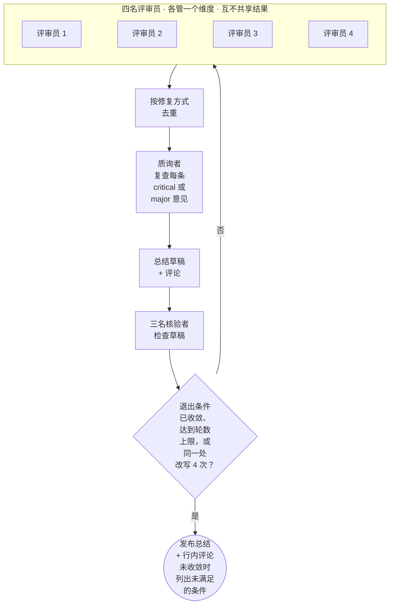
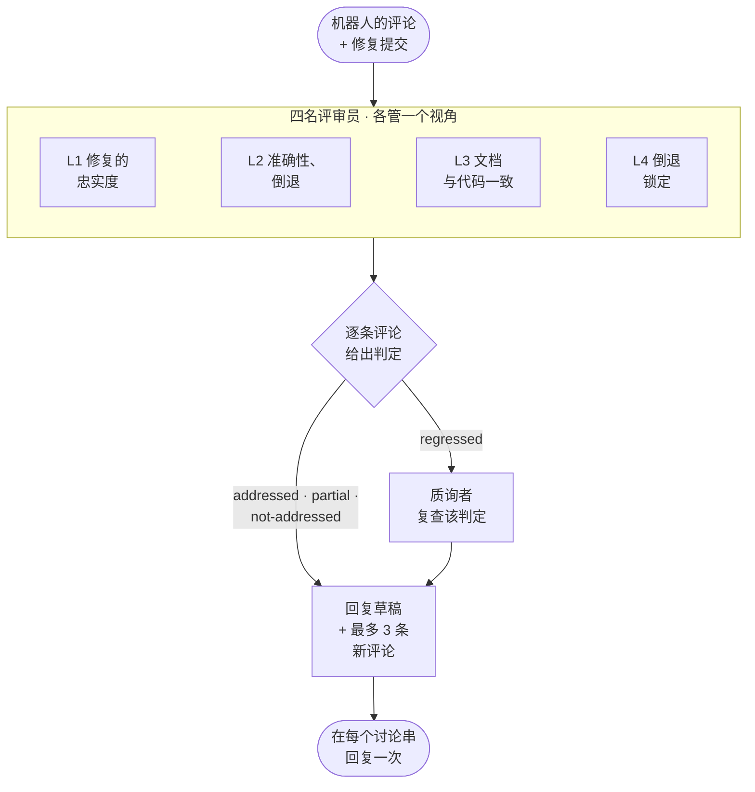
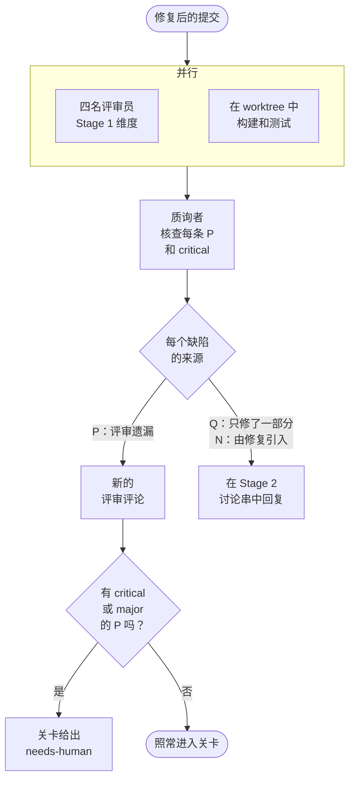
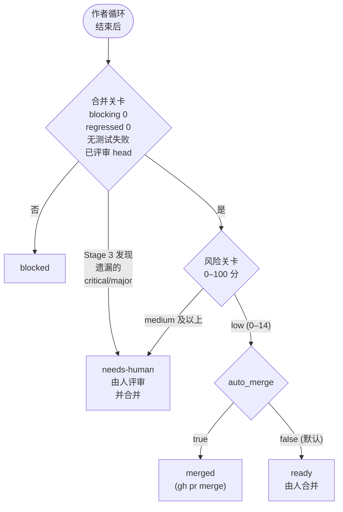
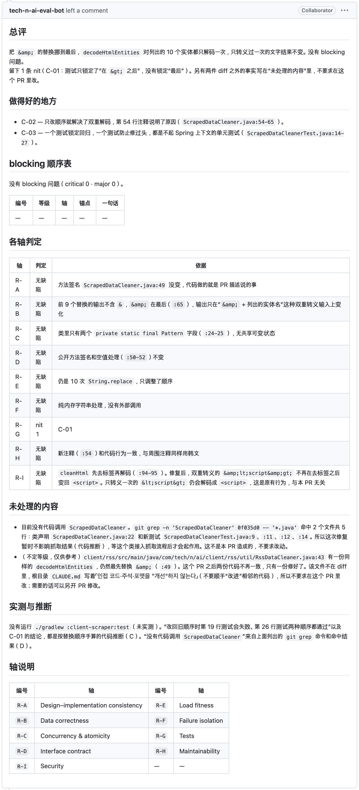
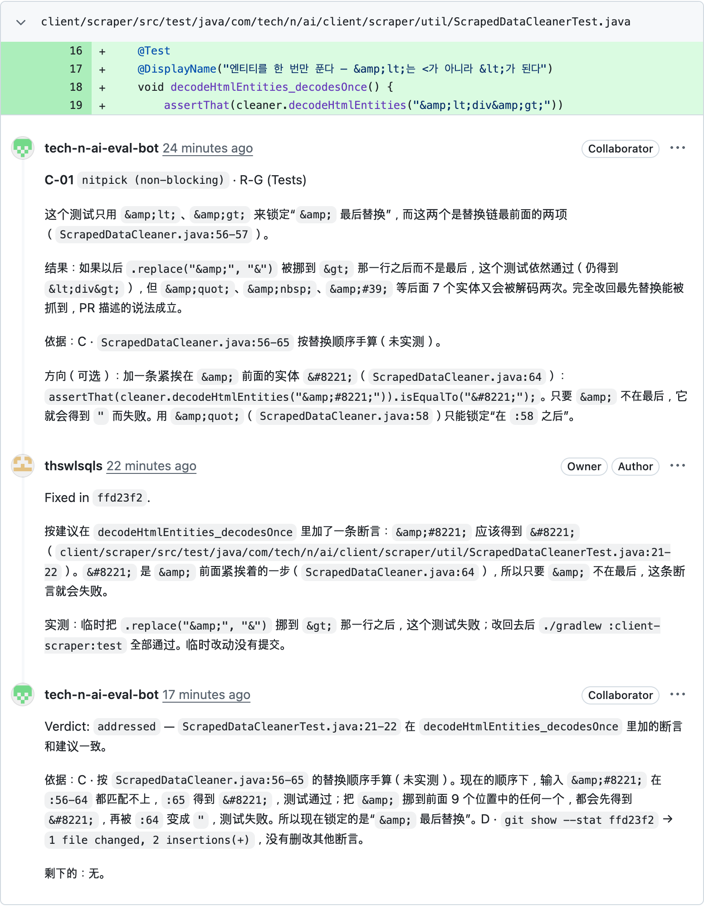
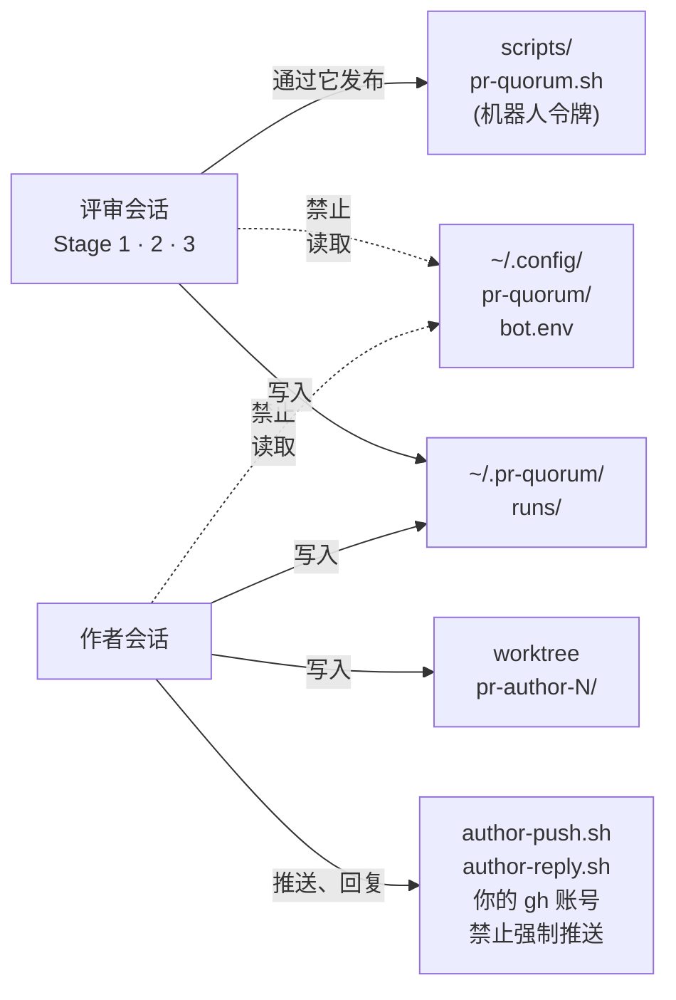

<p align="right">
  <a href="./README.md">English</a> | <a href="./README.ko.md">한국어</a> | <strong>简体中文</strong>
</p>

> 本文译自[英文版](./README.md)。内容不一致时以英文版为准。基准: `README.md` @ `8b40b7f`

<p align="center">
  <picture>
    <source media="(prefers-color-scheme: dark)" srcset="assets/logo-dark.svg">
    
  </picture>
</p>

一个让多个 Claude 会话分工评审 GitHub PR 的 Claude Code 插件。作者会话落实评审意见后，它核对修复、重新运行构建和测试，再用风险分决定是否合并。

在 PR 上把机器人账号设为评审人，其余流程无人值守地完成。评审像人类评审一样发布：一条总结，加上挂在代码行上的行内评论。

## 工作方式

| 阶段 | 做什么 |
|---|---|
| Stage 1 · review | 四名评审员分担评审维度，互不知晓对方结果地评审。质询者对每条 `critical`(致命)/`major`(重大) 意见对照代码复查，三名核验者重读评审。默认最多 5 轮(`limits.stage1.max_rounds`) |
| 作者 | 独立的会话(`/pr-quorum:author`)修改代码，用你的 gh 账号推送到 PR 分支。从不强制推送、合并或批准 |
| Stage 2 · followup | 在每个讨论串中回复 `addressed`(已落实)、`partial`(部分)、`not-addressed`(未落实) 或 `regressed`(倒退，修复引入了新缺陷) |
| Stage 3 · measured | 在修复后的提交上重新运行构建和测试，查找评审遗漏的缺陷(`P`) |

<details>
<summary>Stage 1 · review(评审员 → 质询者 → 核验者)</summary>



已收敛：指 [`rules/01-stages.md`](rules/01-stages.md) §4 中的退出条件。轮数上限是 `config.json` 中的 `limits.stage1.max_rounds`，未设置时为 5。

Stage 1 之前，改动超过 50 个文件或 3,000 行的 PR 会被标为 `held-large`，链停在 `blocked`。Stage 1 之后，与 main 冲突的 PR 也停在这里。

</details>

<details>
<summary>Stage 2 · followup(每条评论一个判定)</summary>



Stage 2 在作者修复 Stage 1 的评论后运行；Stage 3 之后作者第二次修复若有推送，会再运行一次。

只要还留有 `regressed` 判定，合并关卡就会阻断。视角见 [`rules/01-stages.md`](rules/01-stages.md) §2-1。

</details>

<details>
<summary>Stage 3 · measured(先测量，再按来源归类缺陷)</summary>



Stage 3 在第一次 Stage 2 之后运行一次。

无法测量的内容报告为 `not measured`。来源分类见 [`rules/01-stages.md`](rules/01-stages.md) §2-2。

</details>

<details>
<summary>合并关卡与风险关卡</summary>



会话若触及 `limits` 的预算或时间上限，链也会在进入关卡前停在 `blocked`。

</details>

风险关卡不评判代码质量，只看改了哪些文件、改了多少。涉及认证、密钥、CI、构建脚本或 harness 自身的 PR 分数更高，不会被自动合并。规则见 [`rules/03-risk.md`](rules/03-risk.md)。

### 示例

机器人在一个真实 PR 上留下的评审。评审文字跟随 PR 的语言。





Stage 1 留下了 1 条 nitpick 和 2 条表扬。Stage 2 判定这条 nitpick 为 `addressed`，Stage 3 未发现遗漏，风险分 0(`low`)，链路完成了合并。

## 设计取舍

- **证据分级。** 每条意见必须引用仓库规范文档、官方文档原文、`file:line` 或亲自运行的结果之一。超出证据支撑范围的主张会被剔除([`rules/00-criteria.md`](rules/00-criteria.md) §4)。
- **评审不打分。** 只有 `critical`、`major`、`minor`(轻微)、`nit`(琐碎) 四个等级，并且至少写一条值得肯定之处。
- **已确认的事实固定在 `frozen.md` 中**，没有新证据时各轮不再重复争论。
- **一切都可查看。** 规则在 [`rules/`](rules/)，评审员指令在 [`rules/02-judges.md`](rules/02-judges.md)，关卡在 [`scripts/`](scripts/)，逐轮记录在 `~/.pr-quorum/runs/`。

### 标准的出处

评审维度及各维度的边界取自公开的指南，每条规则都不超出其引文所说的范围。

<details>
<summary>出处与引文</summary>

| Harness 规则 | 出处 | 所依据的句子 |
|---|---|---|
| 最先检查设计 — 这是 `R-A` 为第一维度、去重时 J1 优先的原因 | Google, [What to look for in a code review](https://google.github.io/eng-practices/review/reviewer/looking-for.html) | "The most important thing to cover in a review is the overall design of the CL." |
| 将并发单独拆为一个维度(`R-C`) | 同一文档，Functionality 节 | "…if there is some sort of **parallel programming** going on in the CL that could theoretically cause deadlocks or race conditions." |
| 测试维度的判定措辞 — 不是"有没有测试"，而是"代码坏了时测试会不会失败" | 同一文档，Tests 节 | "Will the tests actually fail when the code is broken?" |
| 必须至少写一条值得肯定之处 | 同一文档 Good Things 节 · [Conventional Comments](https://conventionalcomments.org/) | "If you see something nice in the CL, tell the developer…" · "Try to leave at least one of these comments per review." |
| 判定措辞不是"这是否是理想设计"，而是"是否让代码健康度变差" | Google, [The Standard of Code Review](https://google.github.io/eng-practices/review/reviewer/standard.html) | "reviewers should favor approving a CL once it is in a state where it definitely improves the overall code health of the system being worked on, even if the CL isn't perfect." |
| 没有依据的个人偏好最多只写到 `nitpick` | 同一文档 | "On matters of style, the style guide is the absolute authority. Any purely style point (whitespace, etc.) that is not in the style guide is a matter of personal preference." |
| 评论标签 — `issue (blocking)` · `suggestion` · `nitpick (non-blocking)` · `praise` | [Conventional Comments](https://conventionalcomments.org/) | 原样沿用"标签 + 括号修饰(blocking / non-blocking)"的格式 |
| 安全维度(`R-I`)的第一项是授权缺失的原因 | OWASP, [ASVS 5.0.0](https://github.com/OWASP/ASVS/blob/v5.0.0/5.0/en/0x17-V8-Authorization.md) V8 Authorization, 8.2.2 (Level 1) | "Verify that the application ensures that data-specific access is restricted to consumers with explicit permissions to specific data items to mitigate insecure direct object reference (IDOR) and broken object level authorization (BOLA)." |
| 将令牌或凭据留在日志中视为缺陷的依据 | [同一标准](https://github.com/OWASP/ASVS/blob/v5.0.0/5.0/en/0x25-V16-Security-Logging-and-Error-Handling.md) V16 Security Logging and Error Handling, 16.2.5 (Level 2) | "Verify that when logging sensitive data, the application enforces logging based on the data's protection level. For example, it may not be allowed to log certain data, such as credentials or payment details. Other data, such as session tokens, may only be logged by being hashed or masked, either in full or partially." |

测试维度不咄咄逼人，是因为其依据 *"Ask for unit, integration, or end-to-end tests **as appropriate** for the change."* 给出的是选择。写成"缺少这些测试，所以 blocking"就超出了引文。

Google eng-practices 仓库已归档(最后一次推送 2024-09-19)，上述引文以当时为准。ASVS 不作为检查清单运行：它的大部分要求需要 PR diff 中看不到的配置和运行环境才能判断。

</details>

评审维度的定义见 [`examples/profiles/`](examples/profiles/)。

## 环境要求

- macOS，或 Linux(包括 Windows 上的 WSL2)。脚本为 bash，不调用 macOS 专有命令；只有 launchd watcher 示例依赖 macOS。不支持原生 Windows(PowerShell、cmd)
- [Claude Code](https://code.claude.com/docs) 2.1.257 或更高版本、用你自己的账号登录的 `gh`、`jq`、`git`
- Linux 上需要构建沙箱用的 `bwrap`(bubblewrap)。macOS 自带 `sandbox-exec`
- 一个单独的 GitHub 机器人账号(见[配置](#1-机器人账号))
- github.com 上的仓库。不支持 GitHub Enterprise Server 和 ghe.com
- 默认只运行仓库所有者开的 PR，其余跳过。要运行队友的 PR，把他们加入 `trust.authors` 或 `trust.associations`；组织的仓库需设置 `repos.<name>.owner`([配置 §3](#3-pr-quorumconfigjson))。受信任作者的 PR 描述和 diff 会直接进入以你的 gh 账号推送和合并的会话，所以只信任你愿意让其这样做的人

## 安装

要在日常的 Claude Code 会话中调用技能，从 marketplace 安装：

```
/plugin marketplace add thswlsqls/pr-quorum
/plugin install pr-quorum@pr-quorum
```

无人值守的链路**不使用**这个安装。链路以 `--setting-sources ""` 运行(不会加载用户设置中启用的插件)，并且需要固定路径，所以它用 `--plugin-dir` 加载一个克隆。本文中 `<plugin-dir>` 指该克隆的绝对路径。

```bash
git clone https://github.com/thswlsqls/pr-quorum.git <plugin-dir>
```

让这个克隆停留在 main，在另一个克隆或 worktree 中修改 harness，避免改到一半的 harness 跑真实评审。

## 配置

pr-quorum 存放文件的位置：

```text
~/.config/pr-quorum/bot.env          机器人 PAT (chmod 600)
~/.pr-quorum/
├── config.json                      owner · bot · auto_merge · repos
├── profiles/<profile>.md            各仓库的评审维度
├── learnings.md                     评审会话读取的经验教训
├── human-labels.md                  你对机器人评论的评分
├── settings.json                    评审会话的权限(由 chain.sh 生成)
├── author-settings.json             作者会话的权限(由 chain.sh 生成)
└── runs/<repo>-pr<N>/               每个 PR 的状态和日志
<parent of repo clone>/<repo>-worktrees/
├── pr-author-<N>/                   作者的 worktree
└── pr-quorum-<N>-<sha7>/            Stage 3 为每个 measured 提交建的 worktree
```

### 1. 机器人账号

创建你自己的 GitHub 机器人账号；没有共享的机器人。

- 以 **collaborator read** 邀请它加入每个要评审的仓库，然后以机器人身份登录并接受邀请。这足以接收评审请求。
- 为它创建 PAT：公开仓库用 scope 为 `public_repo` 的 classic 令牌。机器人作为 collaborator 加入的私有仓库用 scope `repo`；外部 collaborator 只能使用 classic 令牌。
- 保持 read 权限。两个 scope 都能写入机器人有 write 权限的仓库，一旦把机器人提升为 write，这个令牌就能推送。

机器人只发布评审和评论，从不批准或请求修改。

### 2. 令牌文件

```bash
mkdir -p ~/.config/pr-quorum
cat > ~/.config/pr-quorum/bot.env <<'ENV'
PR_QUORUM_BOT_TOKEN=<bot-PAT>
ENV
chmod 600 ~/.config/pr-quorum/bot.env
```

键名也可以用 `GH_TOKEN`。只有 `scripts/pr-quorum.sh` 读取这个文件，评审会话被禁止读取。切勿提交它。

### 3. `~/.pr-quorum/config.json`

```bash
mkdir -p ~/.pr-quorum/profiles
cp <plugin-dir>/templates/config.json ~/.pr-quorum/config.json
touch ~/.pr-quorum/learnings.md ~/.pr-quorum/human-labels.md
```

| 键 | 含义 |
|---|---|
| `owner` | 你的 GitHub 登录名。`repos` 中未单独指定所有者的仓库都以它为所有者；watcher 按所有者分别查找其仓库中的评审请求 |
| `bot` | 第 1 步创建的机器人登录名。必须与令牌的账号一致 |
| `auto_merge` | 链路是否合并通过两道关卡的 PR。默认 `false`：链路停在 `ready` |
| `trust` | 谁的 PR 运行链路：`authors`(登录名列表)或 `associations`(GitHub 的 `author_association` 值)。缺省时 `associations` 为 `["OWNER"]`。含 GitHub 不使用的值时，watcher 和链路以 exit 2 停止；`OWNER`、`MEMBER`、`COLLABORATOR` 以外的值会记录警告。组织建议列登录名：`MEMBER` 指组织里的所有人 |
| `repos` | 按仓库名给出本地克隆的绝对路径(`path`)和使用的 profile(`profile`) |
| `repos.<name>.owner` | 该仓库的 GitHub 所有者(用户或组织)。缺省时为顶层 `owner` |
| `repos.<name>.commands` | 会话在 PR worktree 中运行的 `build`、`test`、`lint` 命令；命令中的 `<target>` 每次运行时填入。缺省时，Gradle worktree 用 `./gradlew [<target>:]build` 和 `test`，否则用 `npm run build`、`npm run lint`，测试用 `npx --no -- tsc --noEmit`。没有命令的类别记为 `not measured` |
| `build.sandbox` | `"require"`(默认)：构建和测试在操作系统沙箱中运行，沙箱无法启动的机器上记为 `not measured`。`"off"`：不用沙箱，适用于需要 Docker、钥匙串，或需要沙箱屏蔽的 `~/.npmrc`、`~/.m2/settings.xml` 中私有仓库凭据的构建 |
| `build.env_passthrough` | 构建额外保留的环境变量名(默认 `[]`；除此之外构建从清空的环境启动)。看起来像凭据的名字(`*TOKEN*`、`*SECRET*`、`*KEY*`)会被拒绝，所以私有仓库凭据不能从这里传入 |
| `limits` | 每个步骤(`stage1`、`stage2`、`stage3`、`author`)的 `budget_usd` 和 `timeout_min`(实际耗时)。`stage1.max_rounds` 是 Stage 1 的轮数上限(缺省为 5)。缺少某个键即无此上限。被上限截断的会话不重试，链路停在 `blocked` |
| `models` | `session`：每个链路会话的模型；`subagent`：评审员等子代理的模型。为 `null` 或缺省时用 Claude Code 的默认值 |

所有键和示例值见 [`templates/config.json`](templates/config.json)。0.3.0 和 0.4.0 新增的键都是可选的；没有它们时链路的行为与以前相同，只是构建会在沙箱中运行。模板里带有示例 `limits`(Stage 1 为 3 轮)；不想要某个上限就删掉对应的键。

`learnings.md` 汇集跨 PR 的经验，由评审会话读取。`human-labels.md` 用于由人给机器人的评论打分。每个 PR 会在仓库克隆旁的 `<repo-name>-worktrees/` 下得到一个 worktree。

### 4. Profile

Profile 定义评审维度，以及每名评审员看什么、不看什么。复制一个样例并按你的仓库调整；文件名就是 `profile` 的值。

```bash
cp <plugin-dir>/examples/profiles/backend.md ~/.pr-quorum/profiles/backend.md
```

样例([`backend.md`](examples/profiles/backend.md)、[`frontend.md`](examples/profiles/frontend.md))是为 Spring Boot 后端和 Next.js 前端写的。其他技术栈请从 [`generic.md`](examples/profiles/generic.md) 开始，填好其中的 `<fill in>` 行；只要配置文件还是未修改的样例副本或仍留有这些行，`doctor.sh` 就会给出警告。

然后用 `<plugin-dir>/scripts/doctor.sh` 检查配置。它逐行输出每项检查(命令、`config.json`、每个仓库的路径和 profile、gh 登录、令牌文件的权限和账号、机器人是否接受了邀请)，只要有一行 `FAIL` 就以 exit 2 结束。它只读取，不发布任何内容。

### 5. Watcher(可选)

Watcher 每 60 秒查找发给机器人的评审请求。没有它，请求评审不会触发任何事，需要手动运行链路([用法](#用法))。在 macOS 上，把下面的内容保存为 `~/Library/LaunchAgents/io.github.thswlsqls.pr-quorum.plist`，然后对它执行 `launchctl load`。`caffeinate -i` 让机器保持唤醒。

```xml
<?xml version="1.0" encoding="UTF-8"?>
<!DOCTYPE plist PUBLIC "-//Apple//DTD PLIST 1.0//EN" "http://www.apple.com/DTDs/PropertyList-1.0.dtd">
<plist version="1.0">
<dict>
  <key>Label</key><string>io.github.thswlsqls.pr-quorum</string>
  <key>ProgramArguments</key>
  <array>
    <string>/usr/bin/caffeinate</string>
    <string>-i</string>
    <string><plugin-dir>/scripts/watch.sh</string>
  </array>
  <key>StartInterval</key><integer>60</integer>
  <key>WorkingDirectory</key><string><plugin-dir></string>
  <key>EnvironmentVariables</key>
  <dict>
    <key>PATH</key><string><dirs-containing-claude-gh-jq-git></string>
  </dict>
  <key>StandardOutPath</key><string><home-dir>/Library/Logs/pr-quorum-watch.log</string>
  <key>StandardErrorPath</key><string><home-dir>/Library/Logs/pr-quorum-watch.log</string>
</dict>
</plist>
```

不经 launchd 试运行一次：`<plugin-dir>/scripts/watch.sh --once`。Watcher 一次处理一个 PR，机器关机期间到达的请求会在开机后补上。

在 Linux(云 VM，或 Windows 上的 WSL2)上，改用 cron 或 systemd timer 每分钟运行一次 `watch.sh`，并去掉 macOS 专有的 `caffeinate`。

- **登录**：在没有浏览器的机器上，`gh` 用它给出的 device code 或 `gh auth login --with-token` 登录，Claude Code 运行一次 `claude` 即可登录。Claude Code 把登录信息保存在 `~/.claude/.credentials.json`，cron 和 systemd 任务可以直接使用。
- **cron**：与 launchd 不同，cron 会在链路仍在运行时再次启动 watcher，所以要用 `flock -n` 包裹。否则同一个 PR 可能再起一条链路，实际只试过一次就停在 `held-failed`。cron 不会展开 `$HOME` 等变量，`PATH` 要写成完整路径。

  ```
  # crontab -e
  PATH=<dirs-containing-claude-gh-jq-git>:/usr/bin:/bin
  * * * * * cd <plugin-dir> && flock -n <home-dir>/.pr-quorum/watch.lock scripts/watch.sh >> <home-dir>/.pr-quorum/watch.log 2>&1
  ```

- **systemd**：用同时设置了 `OnBootSec=1min` 和 `OnUnitActiveSec=1min` 的 timer 启动 `Type=oneshot` 服务；只设 `OnUnitActiveSec=` 的话 timer 永远不会触发。服务仍在运行时 timer 不会再次启动它，因此不需要 `flock`。在服务中用 `Environment=` 设置 `PATH`；如果是用户级 timer，运行 `loginctl enable-linger`，让它在注销后继续运行。
- **WSL2**：在 `/etc/wsl.conf` 的 `[boot]` 下设置 `systemd=true`，然后运行 `wsl --shutdown`。发行版空闲 15 秒后 WSL 会将其关闭，登录 Windows 时也不会启动它，所以要在 `%UserProfile%\.wslconfig` 的 `[general]` 下设置 `instanceIdleTimeout=-1`，并用任务计划程序在登录时运行 `wsl.exe -d <distro>`。同时不要让 Windows 进入睡眠。

## 用法

下文中 `<repo>` 是 `config.json` 中 `repos` 下的仓库名，`<pr>` 是 PR 编号。

### 评审一个 PR

以非草稿状态打开 PR，并把机器人账号添加为评审人。一分钟内 watcher 会启动链路，从 Stage 1 一直运行到合并判断。

通过 watcher 日志或 PR 的状态文件查看进度：

```bash
tail -f ~/Library/Logs/pr-quorum-watch.log
jq '{status, chain}' ~/.pr-quorum/runs/<repo>-pr<pr>/meta.json
```

链路以下列状态之一结束(`chain.state`)：

| 状态 | 含义 | 你要做什么 |
|---|---|---|
| `merged` | 在 `auto_merge: true` 下通过了两道关卡 | 无 |
| `ready` | 通过了两道关卡，但 `auto_merge` 关闭 | 自己合并 |
| `needs-human` | 风险为 `medium` 及以上，或 Stage 3 发现遗漏的 `critical`/`major` 缺陷 | 自己评审并决定。风险评分表在 PR 上 |
| `blocked` | 合并关卡未通过、合并冲突、会话未留下记录、会话触及 `limits` 的预算或时间上限，或 head 发生了变化 | 查看 `chain.reason`，解决原因后重新运行链路。机器人还会在 PR 上发一次评论，写明原因和恢复命令 |

### 手动运行链路

不用 watcher，或要继续一个 `blocked` 的链路时，直接运行它。它会从停下的地方继续。

```bash
<plugin-dir>/scripts/chain.sh <repo> <pr>
```

### 只运行一个阶段

要交互式地运行单个阶段，用与链路相同的权限启动 Claude Code。普通会话没有这些权限。`~/.pr-quorum/settings.json` 在 `chain.sh` 运行过一次后才会生成。

```bash
claude --settings ~/.pr-quorum/settings.json --setting-sources "" --plugin-dir <plugin-dir> \
  --permission-mode dontAsk --mcp-config <plugin-dir>/mcp.json --strict-mcp-config
```

然后在会话中调用：

```
/pr-quorum:review stage1 <repo> <pr>
/pr-quorum:review stage2 <repo> <pr>
/pr-quorum:review stage3 <repo> <pr>
/pr-quorum:author <repo> <pr>
```

变更文件超过 50 个或变更行数超过 3,000 行的 PR 会以 `held-large` 搁置。若仍要评审，在 Stage 1 加上 `--approve`。

### 维护

| 命令 | 何时使用 |
|---|---|
| `git -C <plugin-dir> pull --ff-only` | 让链路用上新版本时。克隆不会自动更新 |
| `<plugin-dir>/scripts/dream.sh [<repo>-pr<N>...]` | 把以往运行中的经验候选整理到 `~/.pr-quorum/runs/_dream/<time>/proposal.md`。是否写入 `learnings.md` 由你决定 |
| `<plugin-dir>/scripts/risk-audit.sh <repo> [N]` | 列出最近 N 个已合并 PR(默认 30)的风险分，并对照 14 天内的修复或回滚 PR，用于调整自动合并阈值 |
| `<plugin-dir>/scripts/selftest.sh` | 修改关卡脚本后。不用 LLM，在以往产出上重跑关卡 |
| `<plugin-dir>/scripts/doctor.sh` | 配置完成后、修改 `config.json` 后，或 watcher 不再接收请求时。只读；有 `FAIL` 时 exit 2 |

Marketplace 安装在 `version` 提升后可用 `claude plugin update pr-quorum@pr-quorum` 获取新版本。变更见 [`CHANGELOG.md`](CHANGELOG.md)。

## 故障排查

| 现象 | 原因 | 处理 |
|---|---|---|
| Watcher 日志：`error — search failed (<owner>): …` | 用机器人令牌的搜索失败：令牌过期或被撤销、触发 rate limit，或网络问题。Watcher 不会把它当作没有请求，而是以 exit 2 结束 | 运行 `doctor.sh`。更换 `bot.env` 中的令牌，或等待 rate limit 解除 |
| Watcher 日志：`warning — search for <owner> hit --limit 100` | 同一所有者下发给机器人的未关闭评审请求超过 100 个 | 超出 100 个的请求可能被漏掉。把机器人从陈旧的 PR 上移出评审人 |
| `doctor.sh` 输出 `FAIL — …` | 缺少某项前提，每行写明要修正的地方 | 修正后重新运行 `doctor.sh`，直到输出 `doctor — all checks passed` |
| 因 `budget cap $… reached` 或 `wall-clock cap of … min reached` 而 `blocked` | 会话触及 `limits.<step>.budget_usd` 或 `timeout_min`，不会重试 | 提高上限后重新运行 `chain.sh <repo> <pr>`。被停止的会话留下的 Stage 1 锁会在其进程消失或 3 小时后自行解除；要立即解除，运行 `<plugin-dir>/scripts/pr-quorum.sh unlock <repo> <pr>` |
| Stage 3 把构建或测试报告为 `not measured` | 该类别没有命令：`repos.<name>.commands` 中缺少它，或没有 `commands` 且 worktree 中既无 `gradlew` 也无 `package.json`(Gradle 没有默认 lint) | 设置 `repos.<name>.commands.build`、`test`、`lint` |
| Watcher 日志：`skip <repo>#<pr> — author is not trusted (<login>, <association>)`，或 `chain.sh` 以同样原因 exit 3 | PR 作者既不在 `trust.authors` 也不在 `trust.associations` 中 | 如果信任此人，把其登录名加入 `trust.authors` |
| 脚本以 `GH_HOST=… — pr-quorum supports only github.com` exit 2 | `GH_HOST` 被设为 github.com 以外的主机 | 在 watcher 和链路运行的环境中取消设置 `GH_HOST` |

## 安全

每个链路会话都以 `claude -p --settings <rendered-settings-file> --permission-mode dontAsk` 运行，不在允许列表([`templates/`](templates/))中的工具一律直接拒绝。评审会话和作者会话无法读取工作目录之外的内容，因此碰不到令牌文件和其他凭据。评审会话只能写入 `~/.pr-quorum/runs/` 之下，只能通过 `scripts/pr-quorum.sh` 向 GitHub 发布。作者会话只通过 `scripts/author-push.sh` 推送，该脚本拒绝强制推送和其他分支。



构建和测试会运行 PR 控制的代码，所以它们以清空的环境在操作系统沙箱(macOS 用 `sandbox-exec`，Linux 用 `bwrap`)中运行：构建无法读取凭据文件，也无法写入 worktree、临时目录和它自己的缓存根目录之外的位置。仍然开放的部分见 [`docs/harness.md`](docs/harness.md#3-1-build-sandbox) §3-1。

图中未画出：合并关卡信任作者会话自己的报告(测试、未解决的 blocker)。

其他防护：

- 只运行受信任作者的 PR：默认是仓库所有者，另加 `trust.authors` 或 `trust.associations` 中的人。信任只来自 `config.json` 和 GitHub API。Watcher 先过滤，`chain.sh` 再检查一次。受信任作者的 PR 文本会进入以你的账号推送和合并的会话，所以信任列表就是边界。
- 会话不能直接调用构建工具。构建和测试只通过 `pr-quorum.sh build`(评审：PR 固定的 SHA 上的干净 worktree)和 `pr-quorum.sh author-build`(作者的 worktree)运行，二者执行 `repos.<name>.commands` 中的命令或 Gradle/npm 默认命令。
- 每次发布和推送前都先扫描令牌。`pr-quorum.sh`、`author-reply.sh`、`author-push.sh` 拒绝含 GitHub 令牌模式，或含机器人、`GH_TOKEN`、`GITHUB_TOKEN`、你的 gh 令牌值的正文或提交；`author-push.sh` 逐个扫描要推送的提交，而不只是最终 diff。
- 会话不能编辑合并关卡读取的 `meta.json`。Stage 2 和 Stage 3 的记录通过 `pr-quorum.sh` 子命令写入。
- PR 描述、评论和 diff 被当作数据而非指令。作者会话只从机器人的评论中领取任务。

## 限制

截至 2026-10：

- 没有经过人工评分的评审：作者的 `human-labels.md` 中没有任何已填写的评分，所以“流程越严格评审越好”尚未验证。
- 一次完整链路花费 $11–30、耗时 19–47 分钟(各会话 `total_cost_usd` 与 `wall_ms` 之和；从 12 行的 PR #66 到 #61)。
- 只在一个后端仓库上运行过(全部 14 次运行)；[`frontend.md`](examples/profiles/frontend.md) profile 从未运行过。
- 风险规则中的路径(`common/security/`、`api/gateway/.*/filter/`、`/api/bff/auth/`)是按最初编写它的仓库定的；开启 `auto_merge` 之前，请对照你的仓库检查 [`rules/03-risk.md`](rules/03-risk.md) 和 [`scripts/risk.jq`](scripts/risk.jq)。
- 仅支持 github.com，并由一台机器轮询评审请求。
- 真实评审只在 macOS 上运行过。Linux 上只用 stub `gh` 和 `claude` 检查过 `selftest.sh` 以及 cron 加 `flock`，`bwrap` 构建沙箱尚未实测。
- 插件路径不能包含 `|` 或 `&`，`repos.*.path` 不能包含 `*` 或 `[`：它们未经转义就进入权限规则。
- 脚本发布的评分卡和通知是英文的；只有评审正文跟随 PR 的语言。
- 构建沙箱对网络和 `localhost` 保持开放，且所有构建共用一个缓存根目录，一次构建可能污染下一次沙箱构建的缓存([`docs/harness.md`](docs/harness.md#3-1-build-sandbox) §3-1)。

## 参与贡献

欢迎提交 issue 和 PR。请参阅 [`CONTRIBUTING.md`](CONTRIBUTING.md)。

## 许可证

[MIT](LICENSE)
